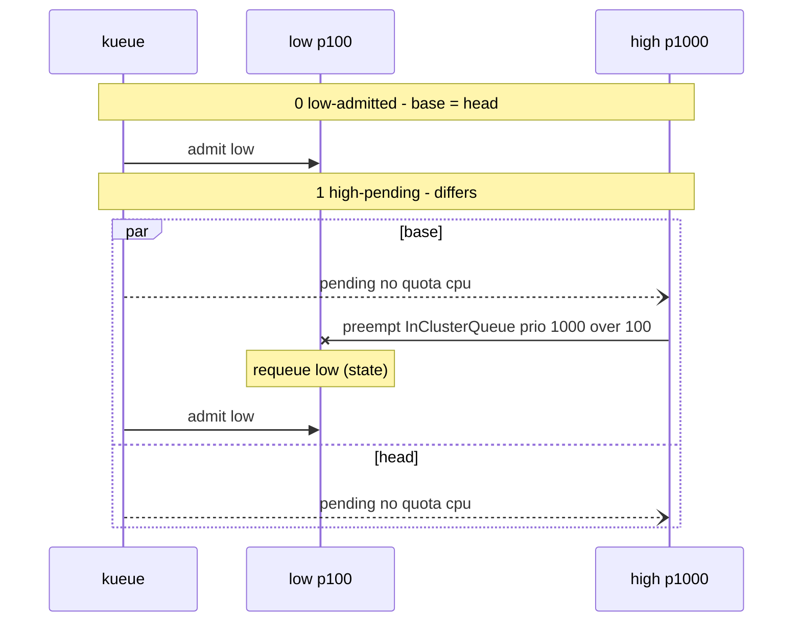

# Skill: Scheduling decision timeline for a PR

The PR author's coding agent writes the order of scheduling decisions on the
merge base and on the head, and for TAS where Kueue assigned the pods.
Human reviewers read it. The PR's own test remains the regression test.

Publishing follows
[kueue-pr-evidence-common](../kueue-pr-evidence-common/SKILL.md). The
per-side capture comes from
[kueue-pr-evidence-state-diff](../kueue-pr-evidence-state-diff/SKILL.md).

## When to use

Use this when the PR changes preemption, fair sharing, admission order, or
TAS placement. For a before/after table of object fields, use
[kueue-pr-evidence-state-diff](../kueue-pr-evidence-state-diff/SKILL.md).
When neither side recorded a scheduling decision, publish no block.

## How to capture

Reuse the state-diff run: the same steps on the merge base and the head,
with a dump at each key assertion, and one capture file per side under the
evidence output directory. This skill starts no cluster of its own.

Each checkpoint records its `index`, a stable `name`, the assertion text, the
Workload state (priority, conditions, admission with `topologyAssignment`,
`requeueState`), and the Events since the previous checkpoint, in order. The
Events are `events.k8s.io/v1`. Leave timestamps out of the timeline. Both
files record the runner, Kubernetes version, feature gates, scenario, and the
same base and head SHAs, each file's own SHA matching its side. The recorded
head SHA must be the current PR head, and the recorded base SHA must be the
merge base resolved in the common skill. Discard a file that fails a check,
or whose checkpoints lack an index, name, assertion text, Workload state,
or Events, and run state-diff again with them in its dump. An optional
Workload field that the object omits, such as `admission` on a pending
Workload, is absent, not missing.

Record each side's outcome from the run, beside its capture. State-diff's
capture has no outcome field. Write `passed` or `stopped on a failed
assertion`. Publish nothing for a failed or incomplete head, and fix the
steps or the PR. A passed head with fewer checkpoints still publishes. Keep
a base that stopped on a failed assertion, and the checkpoints it wrote.

## How to derive decisions

Order events by checkpoint index, then event order, never wall clock.

- Name the preemption reason with the constant verbatim, such as
  `InClusterQueue` or `InCohortFairSharing`, from that preemption's own
  `Preempted` event. Write `?` when the event does not name it. Take the
  preemptor from `PreemptedWorkload`. When it is absent, infer it and mark it
  `?`. When the capture cannot tell, write `?` alone. Take the effective
  priorities from the `Preempted` message.
- Some transitions have no event. Derive them from the state change against
  the previous checkpoint: an admission that appeared, a TAS re-placement
  while the workload stays admitted, an un-admission, a requeue. Mark such
  a transition `(state)`: its order against that checkpoint's events is
  unknown unless the capture shows it. A requeue for an earlier eviction
  still comes before that workload's next reserve or admit, because the
  workload stays inadmissible until it is requeued.
- `WorkloadSliceReplaced` is a finish of the old elastic slice, not a
  preemption.
- When a victim is admitted again while its preemptor stays pending, warn:
  `<side> '<checkpoint>': <victim> re-admitted after preemption by
  <preemptor>, which stays pending (likely preemption loop)`.

## Block shape

Follow the 25 visible-line budget from the common skill. Lines inside
`<details>` do not count. When the block does not fit, move the Mermaid
diagram into `<details>`, then the tables. When it still does not fit, fail
and report that instead of truncating.

The block holds, in order: a verdict sentence with the checkpoint count and
the changed counts (`preemptions 1 → 0`), one warning line per likely loop,
a `Runner: ... · gates: ... · scenario: ...` line, the checkpoint table
(`#`, `checkpoint`, `base`, `head`), the preemption table when either side
preempted, the TAS table when either side has a topology assignment, and a
Mermaid `sequenceDiagram`. When a failed base stops early, say where. A
passed head with fewer checkpoints still publishes. A failed or incomplete
head publishes nothing.

Every decision in the tables appears in the diagram and in the text
timeline. Draw a checkpoint that is identical on both sides once. Otherwise
use `par base` / `and head`. Drop `:`, `;`, `#`, and quotes from Mermaid
message text. The TAS table lists the pod counts that `topologyAssignment`
assigns per domain, per workload and podset, at each side's last
checkpoint. Skip `Finished` workloads and released admissions.

## Example

Shape only. Derive the rows from the capture in front of you.

````markdown
<!-- pr-evidence:kueue-pr-evidence-timeline:start -->
**kueue-pr-evidence-timeline** base 602de8f1b432 -> head e691e542aa87

**Scheduling decisions differ** from 'high-pending': preemptions 1 → 0, requeues 1 → 0, admissions 2 → 1.

base 'high-pending': low re-admitted after preemption by high, which stays pending (likely preemption loop)

Runner: envtest (k8s 1.34.1) · gates: defaults · scenario: preempt within one ClusterQueue

| # | checkpoint | base | head |
|---|---|---|---|
| 0 | `low-admitted` | admit low | same |
| 1 | `high-pending` ≠ | pending high · preempt high→low (InClusterQueue) · requeue low (state) · admit low | pending high |

| preemptor → preemptee | reason | priority | base | head |
|---|---|---|---|---|
| high → low | InClusterQueue | 1000 > 100 | 1 | 0 |

<details><summary>Mermaid timeline (base vs head)</summary>



</details>

<details><summary>Text timeline (event order)</summary>

```text
[0] low-admitted — low is admitted
  base  e0 admit low
  head  = base
[1] high-pending — high is pending
  base  e1 pending high no quota: cpu
        e2 preempt high → low InClusterQueue prio 1000 > 100
        state requeue low
        e4 admit low
  head  e1 pending high no quota: cpu
```

</details>
<!-- pr-evidence:kueue-pr-evidence-timeline:end -->
````

## Publish

Follow [kueue-pr-evidence-common](../kueue-pr-evidence-common/SKILL.md). The
skill name in the markers is `kueue-pr-evidence-timeline`. Fetch the PR
body, show the diff, and run `gh pr edit` only after the user explicitly
approves.
