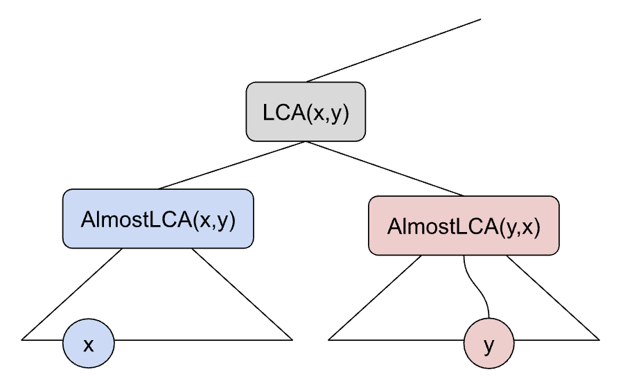

# KEP-1714: Fair Sharing
<!-- toc -->
- [Summary](#summary)
- [Motivation](#motivation)
  - [Goals](#goals)
  - [Non-Goals](#non-goals)
- [Proposal](#proposal)
  - [User Stories (Optional)](#user-stories-optional)
    - [Story 1](#story-1)
    - [Story 2](#story-2)
    - [Story 3](#story-3)
    - [Story 4: reclaim nominal quota without evicting borrowers to equalize shares](#story-4-reclaim-nominal-quota-without-evicting-borrowers-to-equalize-shares)
  - [Risks and Mitigations](#risks-and-mitigations)
    - [Borrowed capacity is kept until the borrower finishes](#borrowed-capacity-is-kept-until-the-borrower-finishes)
    - [The name can be read as &quot;do not preempt&quot;](#the-name-can-be-read-as-do-not-preempt)
- [Design Details](#design-details)
  - [Nominal-first admission ordering](#nominal-first-admission-ordering)
  - [Share value function and weights](#share-value-function-and-weights)
  - [Preemption algorithm](#preemption-algorithm)
    - [Choosing ClusterQueues to preempt from](#choosing-clusterqueues-to-preempt-from)
    - [Choosing workloads from ClusterQueues for preemption](#choosing-workloads-from-clusterqueues-for-preemption)
    - [Algorithmic Optimization](#algorithmic-optimization)
    - [Minimum number of preemptions](#minimum-number-of-preemptions)
  - [ReclaimOnly preemption strategy](#reclaimonly-preemption-strategy)
    - [API](#api)
    - [Validation](#validation)
    - [Handling](#handling)
      - [Order of candidates](#order-of-candidates)
      - [Workloads in the preemptor's ClusterQueue](#workloads-in-the-preemptors-clusterqueue)
      - [Smallest target set](#smallest-target-set)
    - [Interaction with other controls](#interaction-with-other-controls)
  - [Test Plan](#test-plan)
    - [ReclaimOnly](#reclaimonly)
      - [Unit tests](#unit-tests)
      - [Integration tests](#integration-tests)
      - [e2e tests](#e2e-tests)
  - [Graduation Criteria](#graduation-criteria)
    - [Alpha](#alpha)
    - [Beta](#beta)
    - [ReclaimOnly](#reclaimonly-1)
- [Implementation History](#implementation-history)
- [Drawbacks](#drawbacks)
- [Alternatives](#alternatives)
  - [A <code>None</code> preemption strategy](#a-none-preemption-strategy)
  - [<code>reclaimWithinCohort: Never</code> with a share-based list](#reclaimwithincohort-never-with-a-share-based-list)
  - [One strategy per ClusterQueue](#one-strategy-per-clusterqueue)
  - [Configurable Preemptions instead of a new value](#configurable-preemptions-instead-of-a-new-value)
  - [Nearest ClusterQueue first](#nearest-clusterqueue-first)
  - [<code>ReclaimOnly</code> followed by a share strategy](#reclaimonly-followed-by-a-share-strategy)
  - [Admission Fair Sharing across ClusterQueues](#admission-fair-sharing-across-clusterqueues)
<!-- /toc -->

## Summary
This KEP introduces weight-based Fair Sharing of unused resources across 
needing ClusterQueues, respecting borrowing and lending limits, multi-level
hierarchy and preferences of cohorts to distribute unused resources 
internally.

Setting `fairSharing.preemptionStrategies` to `[ReclaimOnly]` keeps admission ordered by share and limits Fair Sharing preemption across ClusterQueues to reclaim of nominal quota.
Configurable Preemptions can still select additional targets.

## Motivation
Currently unused resources are allocated on the "first come first served" basis
(assuming the same priorities of the upcoming workloads).
This approach is not optimal in large deployments where some users (ClusterQueues)
could get preferential treatment based solely on the timing of workload submission.
KEP [#1337](https://github.com/kubernetes-sigs/kueue/tree/main/keps/1337-preempt-within-cohort-while-borrowing) helps a bit in this situation, by introducing priority based preemptions
to borrowing, however in organizations with no strict budget enforcing, priorities
could be overused (if priorities could guarantee more resources, then everyone would
use the highest one, breaking the whole idea altogether). Thus a more comprehensive
solution of distributing unused resources is needed.

### Goals
* Create a mechanism to enforce Fair Sharing of resources. Two equally important
sub-organizations (Cohorts or ClusterQueues), placed in the similar spots in the
whole organization (hierarchy of Cohorts), actively competing for the same
resources (having workloads needing more than nominal quota), should 
be given a similar amount of resources. And any pre existing imbalances should
be timely resolved by preemption.

* Allow system admin to indicate that a sub-organization is more important than
their siblings, and should get proportionally more resources than others located
under the same parent. 

* When distributing resources, prioritize needs of CQ within the same
sub-organization and only after they have been fulfilled, proceed with distribution
outside of the suborganization.

* When enforcing Fair Sharing, ignore workload priorities unless:

   * The workload's priority is above admin-defined high priority. Super high
priority workloads overrule Fair Sharing and are treated according to KEP [#1337](https://github.com/kubernetes-sigs/kueue/tree/main/keps/1337-preempt-within-cohort-while-borrowing).

   * There is a need to preempt some non top priority workload from a ClusterQueue.
Then the lowest priority workloads from a CQ that is over its fair share should
be selected for preemption.

* The mechanism should be compatible with all existing or proposed Kueue features,
in particular:

   * Borrowing limits 
   * Lending limits
   * Guaranteed/nominal quota
   * Hierarchical cohorts

* Fair Sharing should not limit Kueue scalability. Kueue, with Fair Sharing enabled,
should be able to handle >1k ClusterQueues, >100 Cohorts and >10k workloads (that
are either running or queued) within a single hierarchical organization.

* The proposed system should be hard to game, for example by creating big workloads
that consume all capacity.

* Fair Sharing enforcement should not significantly decrease overall utilization,
however, pathological situations (like a single workload consuming all otherwise
unused capacity) should be resolved in favor of Fair Sharing than maximizing the
utilization (the big greedy workload should be preempted to admit smaller
workloads from other CQ that consume only their fair share).

* Let an administrator keep the share-based admission ordering and limit cross-ClusterQueue preemption to reclaim of nominal quota (scenario S1), including reclaim by a Cohort that is still within its subtree nominal quota.

### Non-Goals
* Use historical data (for example CQ A used a lot of shared capacity for the last
week, so now it should get less because others, who didn't need anything then, have
pending workloads). Fair Sharing should be based on point-in-time situation, although,
ideally it should be expandable to support history-based Fair Sharing(for example with #26)
without major redesign.

* Enable Fair Sharing only for some part of the resources or Cohort hierarchy.
Fair Sharing will be a global switch (at least initially).

* Maximize utilization at the cost of Fair Sharing.

* Disable every preemption.
`ReclaimOnly` still reclaims nominal quota, and it still preempts inside the preemptor's ClusterQueue when `withinClusterQueue` allows it.

* Change admission ordering, weights, or the share value.

* Choose `ReclaimOnly` for a single ClusterQueue.
`preemptionStrategies` stays cluster-wide.

## Proposal

Introduce a concept of fair share as the amount of resources lent to a CQ, 
on top of the given nominal quota, that doesn't justify "complains" against
any other similar CQ about excessive extra resources that CQ was given. Basically
the sharing of unused resources is fair, if no CQ can say it is grossly unfair.

Introduce a global Fair Sharing mechanism that is based on preemptions. As long
as there are some free and accessible resources in the cohort hierarchy, Kueue
will admit workloads without any limits. However, once the capacity is gone,
new workloads from Cohorts/CQ that have not received their fair share yet will
be permitted to preempt workloads from Chorots/CQ that received more than their
fair share would otherwise be (or more than the Cohort/CQ that is in need).

Additionally, we will introduce a reclaim mechanism at the Cohort level. Cohorts
that are in need, but whose consumption didn’t reach their total aggregated
nominal quota will be able to preempt workloads from Cohorts/CQ that are over
their budget and are borrowing from the Cohort/CQ that tries to admit a workload
within its own nominal quota (very similar to what we currently have for CQ
within the single level Cohort structure).

We will add an optional weight field to both Cohorts and CQ. The weight will
indicate how to fair share resources between sub-organizations (CQs or Cohorts)
under the same Cohort.

Fair Sharing will be configured for the whole cluster, using the configuration
file. In Alpha it will be just a feature gate.

Share-based preemption is selected by an explicit `preemptionStrategies` list.
When `fairSharing` is set, that list is required and an empty list is rejected.
An administrator who wants the admission ordering without share-based preemption sets `preemptionStrategies` to `[ReclaimOnly]`.
A workload then preempts workloads in other ClusterQueues only to reclaim nominal quota.
Details are in [ReclaimOnly preemption strategy](#reclaimonly-preemption-strategy).

### User Stories (Optional)

#### Story 1
I have 2 teams in my department in some US-based company, one on the east coast
(TeamE), one on the west coast (TeamW). Both come to work at 9 am their local time.
And immediately after that they start submitting their research jobs for execution
in their assigned CQs. Each of them have a bit of guaranteed resources, however they
both rely on a company-wide pool or resources that should be fairly shared. 

TeamE can submit as many workloads and consume as many resources as they can while
TeamW is not at work and doesn’t need resources. However, once they arrive, some of
the already submitted workloads from TeamE may be preempted (preferably the least
important) to ensure equal extra space (regardless of their given quota) for both teams. 


#### Story 2
I have two departments in my company D1 and D2 (modeled as Cohorts, under one
top-level Cohort). Each of the departments has 3 teams: A, B, C. Each of the teams
submits their workloads to the appropriate CQ: 1A, 1B, 1C, 2A, 2B, 2C. Each of the
teams/CQs is given some guaranteed resources within the big ML cluster. Each team
is also allowed to borrow as many resources from other teams as they want, as long
as they are not needed by the owner. However, due to internal accounting, company
internal politics, etc, free resources should first be distributed within the
department. For example:

* if CQ 1A has free resources, and both 1B and 1C are in need of extra resources 
to run their workloads, then 2A, 2B and 2C should not be given a share of 1A,
that would block any workload from 1B or 1C from running. 

* If CQ 1A has free resources and 1B and 1C do not need any of those to start
a workload (there are no pending workloads or they are too big anyway) then 2A, 2B,
2C should be given an equal share of the resources that correspond to their needs.

#### Story 3
I have 3 cohorts inside my organization (top cohort): CS, C1 and C2. CS contains
a single CQ that is given 300 GPU nominal quota. C1 contains 3 CQ: 1A, 1B and 1C,
among which 1C is considered to be 3 times more important than others. C2 contains
only one CQ: 2A.  Each of the queues 1A, 1B, 1C and 2A has a long backlog of jobs
to execute. I want to distribute the resources from CS in the following way:

* Both C1 and C2 get 150 GPUs each, because they are considered equally important.
* Inside C1, out of these 150 GPUs, 1A gets 30, 1B gets 30 and 1C gets 90 GPUs. 
1A and 1B are equally important but 1C is 3x more important than 1A and 1B.
* Inside C2 there is just a single CQ, so it gets all 150 GPUS.

#### Story 4: reclaim nominal quota without evicting borrowers to equalize shares

Two teams share one Cohort.
Each ClusterQueue has a nominal quota of 5 CPU and the same weight.
Jobs are short, so borrowed CPU returns when they finish.
Ordering admission by share is enough for the teams to converge.
Evicting a running job only to equalize shares wastes work that was about to finish.
Each team must still be able to take back its own nominal quota.

```yaml
apiVersion: config.kueue.x-k8s.io/v1beta2
kind: Configuration
fairSharing:
  preemptionStrategies: [ReclaimOnly]
```

Both `team-a` and `team-b` set `spec.preemption.reclaimWithinCohort: Any`.
`team-a` is admitted at 8 CPU, so it is borrowing 3 CPU from `team-b`.

| Incoming workload on `team-b` | `[LessThanOrEqualToFinalShare, LessThanInitialShare]` | `[ReclaimOnly]` |
| --- | --- | --- |
| 5 CPU, which fits in the nominal quota | Preempt `team-a` until `team-b` fits | Preempt `team-a` until `team-b` fits in its nominal quota |
| 6 CPU, so `team-b` would borrow 1 CPU | Preempt `team-a`. `team-b`'s share with the new workload is lower than `team-a`'s current share, so `LessThanInitialShare` applies | Leave `team-a` running. `team-b` stays pending until borrowed CPU is free |

The same split applies one level up.
A Cohort that is still inside its subtree nominal quota reclaims from a sibling Cohort that is borrowing.
It does not preempt that sibling only because the sibling's share is higher.

### Risks and Mitigations

* Fair Sharing may increase the number of preemptions in the system vs current
state where the first workload to acquire unused resources keeps them until it
finishes. Mitigations include:
    * Introduce minimum execution time before workloads can be preempted for Fair Sharing.
    * Introduce delayed fair share enforcement - new workloads have to wait a bit before preempting others to get their share.

* Fair Sharing may decrease utilization of the unused resources while attempting to
distribute them fairly, vs provide the tighties bin-packing. To avoid these scenarios,
users should prefer to run massive workloads under nominal quotas.

#### Borrowed capacity is kept until the borrower finishes

Under `ReclaimOnly`, two ClusterQueues that are both borrowing are not preempted to equalize shares.
A ClusterQueue can hold borrowed capacity for the lifetime of its workloads while another ClusterQueue with a lower share waits.
That is the tradeoff Story 4 asks for when workload churn is high.
An administrator who needs the shares to converge by eviction keeps a share-based `preemptionStrategies` list.

#### The name can be read as "do not preempt"

`ReclaimOnly` still preempts to reclaim nominal quota.
It also still preempts inside the preemptor's ClusterQueue when `withinClusterQueue` allows it.
The configuration reference has to say both next to the value, so an administrator does not read the name as disabling preemption.
`reclaimWithinCohort: Never` is what disables cross-ClusterQueue reclaim.


## Design Details

The enforcement of fair-share revolves around the idea of a share value per CQ or
Cohort and mechanisms to keep the share values among siblings in the hierarchy to
be as equal as possible. This is achieved via two mechanisms:

* During admission, prioritize admitting workload from the ClusterQueues and cohorts that have the lowest share value.
* Preempt workloads from ClusterQueues and cohorts that have the highest share value.

The algorithms take a decision from root-to-leaves. This favors admission from 
suborganizations that, as a whole, still have unused resources, or favors preemptions 
from suborganizations that, as a whole, are borrowing too much.

### Nominal-first admission ordering

When the `FairSharingPrioritizeNonBorrowing` feature gate is enabled,
a workload whose subtree is not borrowing is preferred over one whose
subtree is borrowing, before falling through to the DRS comparison.

This check is **per-flavor**: a subtree that borrows on flavor X but has
ample quota on flavor Y does not penalize workloads requesting flavor Y.

In hierarchical cohorts, the check is applied at every level of the
hierarchy (CQ to root). A subtree that fits within its quota at every
ancestor is preferred over one that borrows at any ancestor, even if the
borrowing occurs at a higher cohort level rather than the CQ itself.

### Share value function and weights

The value function is a variation of DRF (see
[1](https://amplab.cs.berkeley.edu/wp-content/uploads/2011/06/Dominant-Resource-Fairness-Fair-Allocation-of-Multiple-Resource-Types.pdf),
[2](https://dash.harvard.edu/bitstream/handle/1/11956916/Parkes_BeyondDominant.pdf;jsessionid=AC0D06C2CC07C693BD42008D7AE25D99?sequence=1)):

For a given resource _r_ provided by a ClusterQueue or cohort _c_, we calculate $T_r$ as the
total requests consumed by the Workloads for resource _r_ in that CQ or cohort,
that are above the nominal quota, added up for all flavors.
The value for a resource is the ratio of $T_r$ and the total nominal quotas
(or lendingLimits, if defined) for the resource _r_, added up for all flavors,
in the hierarchy of the parent of _c_.

Note that the share value for a suborganization (a node in the tree) is independent of the 
share value for its children. In other words, the calculation of the share value only 
depends on the sum of usages and sum of nominal quotas in the suborganization.

The value for the CQ or cohort is the maximum among the values for each resource, divided by the weight, if defined.

Weights will be added to ClusterQueueSpec and CohortSpec in the following optional struct:

```go
type struct FairSharing {
     Weight 	*Quantity  // Default is 1. 
}
```

### Preemption algorithm

The algorithm could be summarized as follows:

```
AdmitWorkload(x CQ, w Workload)
 While w does not fit and there are workloads that can still be preempted:
   Find CQs that are borrowing resources in the hierarchy
   For each CQ y:
	  Find workloads z that could be preempted while satisfying fairness
   Choose a workload from the biggest offender for preemption
 Possibly undo some preemption, while w still fits
```

`preemptionStrategies: [ReclaimOnly]` runs only scenario S1 from the sections below.
Scenario S2 is not used.
The API and the order of candidates are in [ReclaimOnly preemption strategy](#reclaimonly-preemption-strategy).

#### Choosing ClusterQueues to preempt from

When a CQ x fails to admit a workload w, one of the following scenarios may occur:

* [S1] A sub-organization to which CQ x belongs (its cohort, parent cohort, or CQ itself)
 still has enough resources to admit the workload within its nominal quota, as the total
 amount of its workload consumption is lower than the quota. However, as there are not
 enough resources in the system, someone must be borrowing resources. Thus, if we find
 a potential borrower, we can consider preempting some of its workloads, up to the point
 when it stops borrowing. This is equivalent to “reclaimWithinCohort” in ClusterQueues.


* [S2] A sub-organization to which CQ x belongs is borrowing, however it seems that it is
borrowing too little compared to other sub-organizations that are also borrowing, so some
action is needed to enforce Fair Sharing. We should compare how much the sub-orgs are
borrowing compared to each other, and preempt some workloads up to the point when its fair
share would be smaller than the sub-org for which preemptions are executed.

Let’s formalize the above description.

By LCA(x,y) we define the lowest common ancestor of two ClusterQueues x and y in the cohort
hierarchy. AlmostLCA(x,y) is the last but one element on the path from x to LCA(x,y) in the cohort hierarchy.

When trying to preempt some workloads to admit workload w to CQ x we consider all other
CQs that are in the same hierarchy. For each of such CQ y we check whether scenario S1
or S2 occur. To do that we compare sub-organizations that are rooted in AlmostLCA(x,y) and AlmostLCA(y,x).



First of all we validate if y is not using its local nominal quota, somewhere on the path.
If y was using some local nominal quota that lies entirely under AlmostLCA(y,x) then x should
not be allowed to preempt any of its workload. So we check whether both y and all cohorts on
the way up to AlmostLCA(y,x) are borrowing. If that happens then y may have something to
do with x being unable to admit the workload. 

We trigger scenario S1 if AlmostLCA(x,y) is not borrowing but x still has too little
resources. We put all y’s workloads on a list of potential preemptions, out of which
we will later (once we check all other CQs) select one that is most reasonable. 


We trigger scenario S2 if AlmostLCA(x,y) is borrowing. We check whether AlmostLCA(x,y)
and AlmostLCA(y,x) are borrowing roughly the same amount. To do this we use a value 
function that returns a value of the borrowed capacity.

#### Choosing workloads from ClusterQueues for preemption

For each workload z in y we check whether if:

[S2-a] value of AlmostLCA(y,x) **without z** is still higher (or equal) than value of AlmostLCA(x,y)
with admitted workload w. Y’s sub-orgs will still be better than X’s sub-org after we
preempt z and admit w, thus z is a reasonable candidate to re-balance Fair Sharing.


[S2-b] value of AlmostLCA(y,x) (with z) is strictly higher than AlmostLCA(x,y) with admitted workload w.
Here the case is that Y’s sub-org is greedy, and doesn’t allow smaller requests on the
x’s size. If no other preemption option is possible inside any other CQ, z should be
considered for preemption. Maybe y has a smaller workload that could be admitted, and
then both x and y will be ”happy”. In practice this rule prevents huge workloads from
taking the whole unused capacity, blocking everyone else and claiming that this is fair-sharing. 

After we gathered all possible preemption candidates form all relevant CQs we sort them
by the following criteria:

* [C1] Values of cohorts/cq on the way from root cohort to y. In descending order, so the
biggest “offenders” are first.
* [C2] Priority of the workload inside of CQ - least important ones are favored.
* [C3] Size of the workload inside of CQ - smallest workloads (based on the dominant resource) are favored.

We pick the best candidate from that ranking and provisionally preempt it. If the
workload w can be admitted to x then we are done (almost), if not, we search for the
next candidate starting back from ClusterQueue selection.

#### Algorithmic Optimization

Implemented naively, the proposed algorithm is O(n^2) on the number of workloads.

In practice, we don’t create one list of candidates and sort it every time. It can be noticed that after this provisional preemption.

* Order based on [C3] is not changed - no workload is resized.
* Order based on [C2] is not changed - no priority is changed. 
* Order based on [C1] may change a bit, but it applies to the whole groups that could be reshuffled. 

Thus finding the best candidate can be done via:

Finding the CQ with the highest value according to [C1] - this can be done by
sorting cq’s instead of workloads, their number is much smaller (some of them can be
dropped as not borrowing).
 
Picking the already (on the first iteration) sorted list of workloads and checking which of
them matches [S1], [S2-a] or maybe [S2-b]. If all of them match [S2-b] only, second-best
(or following) CQ should be selected.


#### Minimum number of preemptions

After we have determined a set of provisionally preempted workloads, we should
double-check if some of them could be simply put back as they either:

* In fact don’t provide resources to w, their preemption is wasted by some
lending/borrowing limits on the way.

* Are providing capacity that is also provided in much bigger quantity by other workloads

### ReclaimOnly preemption strategy

`[ReclaimOnly]` keeps the admission ordering from this KEP and applies only scenario S1 when choosing workloads in other ClusterQueues.

#### API

`ReclaimOnly` is a value of the existing `fairSharing.preemptionStrategies` list in `config.kueue.x-k8s.io/v1beta2`.
It is not a new field and it has no feature gate.

```go
type PreemptionStrategy string

const (
	LessThanOrEqualToFinalShare PreemptionStrategy = "LessThanOrEqualToFinalShare"
	LessThanInitialShare        PreemptionStrategy = "LessThanInitialShare"

	// ReclaimOnly preempts a Workload in another ClusterQueue only to reclaim
	// nominal quota (scenario S1).
	// AlmostLCA(preemptor, preemptee), with the preemptor Workload admitted,
	// must stay within its nominal quota, and every Cohort and ClusterQueue
	// on the path from AlmostLCA(preemptee, preemptor) down to the preemptee's
	// ClusterQueue must be borrowing.
	// Workloads in the preemptor's own ClusterQueue can still be preempted
	// according to withinClusterQueue.
	// Fair Sharing still orders admission.
	// It never triggers a preemption on its own to rebalance shares.
	// Candidates are considered starting from the ClusterQueues farthest from
	// the preemptor in the cohort hierarchy.
	// A level that cannot be reclaimed yet is revisited once reclaiming
	// elsewhere makes it possible.
	//
	// Not the default.
	// Used only when preemptionStrategies is exactly ["ReclaimOnly"].
	// An empty preemptionStrategies list is invalid and does not select
	// ReclaimOnly.
	ReclaimOnly PreemptionStrategy = "ReclaimOnly"
)

type FairSharing struct {
	// preemptionStrategies indicates which constraints a preemption must
	// satisfy.
	// The next entry is used only when the incoming Workload still does not
	// fit after the previous entries.
	// AlmostLCA(x, y) is defined under "Choosing ClusterQueues to preempt from".
	//
	// Only the following lists are supported:
	// - ["LessThanOrEqualToFinalShare"]
	// - ["LessThanInitialShare"]
	// - ["LessThanOrEqualToFinalShare", "LessThanInitialShare"]
	// - ["ReclaimOnly"]
	//
	// Any other combination or ordering fails validation and
	// kueue-controller-manager does not start.
	//
	// Required when fairSharing is set.
	// There is no default that means ReclaimOnly.
	PreemptionStrategies []PreemptionStrategy `json:"preemptionStrategies"`
}
```

#### Validation

`fairSharing` itself is optional.
When it is omitted, Fair Sharing is off and classical preemption is unchanged.

When `fairSharing` is set, `preemptionStrategies` must be one of these lists:

* `["LessThanOrEqualToFinalShare"]`
* `["LessThanInitialShare"]`
* `["LessThanOrEqualToFinalShare", "LessThanInitialShare"]`
* `["ReclaimOnly"]`

An empty list is rejected.
`ReclaimOnly` together with either share strategy is rejected, in either order.
Any other value, duplicate, or order is rejected.
Kueue reports the field as unsupported and does not start.

Removing `fairSharing` from the configuration turns Fair Sharing off, including `ReclaimOnly`.
Kueue reads the configuration at startup, so a change applies when kueue-controller-manager restarts.

#### Handling

Admission is unchanged.
Pending workloads are still ordered by dominant resource share and weight.
`FairSharingPrioritizeNonBorrowing` still prefers a subtree that is not borrowing.

For a workload in another ClusterQueue, all of the following have to hold:

1. `reclaimWithinCohort` is not `Never`, and the workload passes that policy (`Any` or `LowerPriority`).
2. The target ClusterQueue is borrowing a flavor the incoming workload still needs.
3. Every Cohort on the path from that ClusterQueue up to AlmostLCA(target, preemptor), and that AlmostLCA itself, is borrowing.
   A Cohort or ClusterQueue that is within its nominal quota protects the workloads under it.
   A child that is borrowing from its sibling is protected when the parent Cohort is still within its subtree nominal quota.
4. AlmostLCA(preemptor, target), with the incoming workload counted, is within nominal quota for every flavor the incoming workload requests.
   In a flat Cohort the AlmostLCA is the ClusterQueue itself.
   For a Cohort, nominal quota is the subtree quota.

The incoming workload's usage is counted while these checks run.
The eviction reason is `InCohortReclamation` ("reclamation within the cohort").
`kueue_preempted_workloads_total` counts that reason on the preempting ClusterQueue.
Share comparison (scenario S2) does not run, so the reason is never `InCohortFairSharing`.

##### Order of candidates

Other ClusterQueues are considered before the preemptor's own ClusterQueue.

The LeastCommonAncestors on the path from the preemptor up to the root are visited starting at the root.
ClusterQueues under a farther LeastCommonAncestor are considered before nearer ones.
Inside one LeastCommonAncestor, the higher share value comes first.
Ties break the same way as for the share-based strategies.
When a farther ClusterQueue and a nearer one are both valid reclaim targets and one workload is enough, the farther one is preempted.

After each selected target, the search starts again at the farthest LeastCommonAncestor.
Reclaiming a closer ClusterQueue lowers the preemptor's Cohorts and can bring a farther AlmostLCA back within nominal quota.
The search stops when a full pass selects nothing.

Example:

```text
root
├── cohort-c          subtree nominal 10
│   ├── a             nominal 10    P pending, requests 8
│   └── s             nominal 0     S admitted, uses 4
└── t                 nominal 2     T admitted, uses 6
```

`P` fits in `a`'s nominal quota, but only 2 CPU are free.
`t` is farther.
With `P` admitted, `cohort-c` would use 12 against a subtree nominal of 10, so `t` is not a reclaim target yet.
`s` is closer, `a` stays within its nominal quota of 10, and `s` is borrowing, so `S` is preempted.
`cohort-c` is then within its subtree nominal quota, the search returns to the root, and `T` is preempted.
`P` is admitted.

##### Workloads in the preemptor's ClusterQueue

These are considered only after the pass over other ClusterQueues selects nothing.
`withinClusterQueue` decides which of them are candidates.
`Never` skips them.
The eviction reason is `InClusterQueue` ("prioritization in the ClusterQueue").

After each such preemption the search over other ClusterQueues starts again from the root.
Dropping the preemptor's own usage can make an AlmostLCA fit within nominal quota, which makes a borrower reclaimable in the same attempt.

A workload that would still borrow at its AlmostLCA gets no target in another ClusterQueue.
It can still preempt inside its own ClusterQueue.
Fair Sharing does not use "the workload would borrow" as a reason to look for targets in other ClusterQueues.

##### Smallest target set

After the incoming workload fits, Kueue tries to put targets back from the last one selected to the first, while the incoming workload still fits.
A target is kept when putting it back would make another remaining target fail the nominal-quota checks.
In the example above, `T` is a valid reclaim only while `S` stays preempted, so `S` is not put back.

#### Interaction with other controls

| Control | Under `[ReclaimOnly]` |
| --- | --- |
| `withinClusterQueue` | Unchanged. Selects workloads in the preemptor's ClusterQueue. `Never` disables that. |
| `reclaimWithinCohort` | Unchanged as a filter. `Never` disables cross-ClusterQueue reclaim. Otherwise the nominal-quota checks above still apply. |
| `borrowWithinCohort` | Does not select targets. A value other than `Never` does not add share-based preemption. |
| `LessThanOrEqualToFinalShare`, `LessThanInitialShare` | Not evaluated. A list that also contains `ReclaimOnly` is rejected at startup. |
| `FairSharingPreemptWithinNominal` | Ignored. The nominal-quota check always runs. Turning the gate off does not switch `ReclaimOnly` to share comparison. |
| `FairSharingVerifyFinalTargets` | Ignored. The final target set is always checked, including while dropping targets. |
| `FairSharingReevaluatePreemptionCandidates` | Ignored. The restart from the farthest LeastCommonAncestor is unconditional. |
| `ConfigurablePreemptions` | When the gate is enabled and the ClusterQueue references a `PreemptionConfig`, those rules still run after `ReclaimOnly` candidates are exhausted. They can preempt workloads that `ReclaimOnly` would keep. |

### Test Plan

[x] I/we understand the owners of the involved components may require updates to
existing tests to make this code solid enough prior to committing the changes necessary
to implement this enhancement.

This is a very complex feature so there will be lots of unit, integration and e2e test covering various scenarios.

#### ReclaimOnly

##### Unit tests

* Configuration validation accepts `["ReclaimOnly"]`.
* Configuration validation rejects an empty list, a reversed share-strategy list, and every list that mixes `ReclaimOnly` with a share strategy.
* A preemptor that would borrow does not preempt another ClusterQueue, even when that ClusterQueue has a higher share.
* A preemptor that stays within nominal quota reclaims one workload from a borrowing ClusterQueue, with reason `InCohortReclamation`.
* A lower-priority workload in the preemptor's own ClusterQueue is preempted under `withinClusterQueue`, with reason `InClusterQueue`, including when the incoming workload would otherwise borrow.
* After that in-ClusterQueue preemption brings the AlmostLCA back within nominal quota, a borrowing ClusterQueue is reclaimed in the same attempt.
* In a nested Cohort, when both a nearer and a farther ClusterQueue can be reclaimed and one is enough, only the farther one is preempted.
* In a nested Cohort, a farther ClusterQueue that fails the nominal-quota check becomes a target only after a closer ClusterQueue is reclaimed, and both are preempted when the incoming workload needs both.
* A ClusterQueue that is within its nominal quota is not reclaimed, even when its workload has a lower priority than a workload in a borrowing sibling under the same Cohort.
* A preemptor whose own Cohort would still be borrowing does not reclaim from a ClusterQueue outside that Cohort.
* The cases above have the same result with `FairSharingPreemptWithinNominal` disabled, with `FairSharingVerifyFinalTargets` disabled, and with both disabled.
* With `ReclaimOnly` and `reclaimWithinCohort` set, fair sharing alone is not permission to preempt while borrowing.
  `borrowWithinCohort` without fair sharing still is.

##### Integration tests

* Hierarchical Cohorts: ClusterQueue `a` has nominal quota 10, sibling `s` has nominal 0 and uses 4, and `t` under the root has nominal 0 and uses 6.
  A new 6 CPU workload on `a` reclaims only `t`.
  A following 4 CPU workload on `a` reclaims `s`.
  `kueue_preempted_workloads_total` increases with reason `InCohortReclamation`.
* A workload that would borrow stays pending, and the admitted workloads in the other ClusterQueue are not evicted.
* A workload that fits in nominal quota preempts one borrowing workload and is then admitted.

##### e2e tests

No new end-to-end test.
The new behavior is quota accounting and eviction inside one cluster.
The integration tests already create Cohorts, ClusterQueues, and Workloads and observe admission, the `Evicted` condition, and the preemption metric.

### Graduation Criteria
#### Alpha

The alpha will be split among two releases.
Release v0.7 will only implement Fair Sharing in the existing flat structure (cohorts don’t have parents).
Release v0.8 will incorporate Fair Sharing with arbitrary hierarchies (KEP #79)

The following metrics will be added:
* ClusterQueue fairness value
* Preemptions per ClusterQueue, per reason (fair share, priority, reclamation)
* ClusterQueue pending demand per resource

Both releases will be accompanied with unit and integration tests.

#### Beta

A Beta release will incorporate feedback from users, and introduce improvements in areas such as:
* preemption control (relaxing preemption criteria, minimum execution time, etc.)
* visibility API (state of value function)
metrics
* Scalability scenarios

#### ReclaimOnly

No separate feature gate.
The value is an accepted `preemptionStrategies` list on the existing Fair Sharing configuration.
Once the implementation ([#17857](https://github.com/kubernetes-sigs/kueue/pull/17857)) merges, it is available whenever `fairSharing` is set.
Until then, validation rejects `["ReclaimOnly"]`.

It is ready for general use when:

* The validation, unit, and integration tests in the Test Plan pass.
* The preemption concept page and the `v1beta2` configuration reference describe the value, the supported lists, and the farthest-first order.
* A configuration that does not set `[ReclaimOnly]` keeps the share-based preemption it has today.

Changing the farthest-first order, or which target is kept when one target is valid only together with another, is a behavior change and needs a KEP update.

## Implementation History

* 2024.03.18 - KEP created (#1773)
* 2024.04.24 - Make dominant resource share flavor aware (#2037)
* 2026.03.27 - Fix nominal-first to check per-flavor borrowing at every hierarchy level (#10149)
* 2026.11.11 - Specify the `ReclaimOnly` preemption strategy (scenario S1 only); implementation in #17857

## Drawbacks

The main drawback is that Fair Sharing (together with Hierarchical Cohorts) significantly increases
the complexity of scheduling in Kueue.

`ReclaimOnly` adds a second candidate order next to the highest-share order.
Operators have to pick one list and live with either more evictions or slower convergence.

## Alternatives

* Stay with the current first come first served mechanism of distributing unused resources.

### A `None` preemption strategy

A value that disables cross-ClusterQueue preemption would also disable nominal-quota reclaim.
Story 4 still needs that reclaim.
`reclaimWithinCohort: Never` already disables reclaim, for `ReclaimOnly` and for the share-based lists.

### `reclaimWithinCohort: Never` with a share-based list

That turns off scenario S1 and scenario S2 together.
Nominal quota is then not enforced against borrowers.
`ReclaimOnly` turns off only S2.

### One strategy per ClusterQueue

The use case is a cluster-wide choice between rebalancing shares and only reclaiming nominal quota.
A per-ClusterQueue value would let one queue demand share rebalancing while its peer refuses it.
The comparison has no single answer in that case.
`preemptionStrategies` stays cluster-wide.

### Configurable Preemptions instead of a new value

[KEP-13396](../13396-configurable-preemptions/README.md) is still Alpha and does not cover reclaim or Fair Sharing.
That coverage is not planned for v0.21.
Waiting for it leaves Story 4 unconfigurable on the API that already selects the share strategies.
`ReclaimOnly` is that selection.
Once Configurable Preemptions can express "Fair Sharing admission, reclaim only", this value can be revisited.
Matching the behavior still requires the farthest-first order, not only a filter on the existing highest-share order.

### Nearest ClusterQueue first

Visiting the closest borrowing ClusterQueue first, once, never returns to a farther ClusterQueue that becomes reclaimable only after the closer one is gone.
In the nested example under [Order of candidates](#order-of-candidates), `P` would fail to get its nominal quota.
Farthest-first, restarted after every target, reclaims `S` and then `T` in the same attempt.

### `ReclaimOnly` followed by a share strategy

A list such as `["ReclaimOnly", "LessThanInitialShare"]` would fall through to share rebalancing when reclaim is not enough.
That brings back the evictions Story 4 exists to avoid.
Validation rejects every mixed list, so the fall-through cannot be configured by accident.

### Admission Fair Sharing across ClusterQueues

In the share-based lists, ordering candidates by share mainly keeps chains of preemptions short.
With `ReclaimOnly`, the share ordering of admission becomes the main way unused quota is spread.
That is close to [Admission Fair Sharing](../4136-admission-fair-sharing/README.md), which orders workloads by historical usage.
Extending Admission Fair Sharing to order workloads across ClusterQueues was considered instead of a new value.

It is not proposed here because:

* `admissionScope` exists only on ClusterQueue.
  Workloads from different ClusterQueues are not compared by usage today.
  The Cohort scope sketched in KEP-4136 needs usage status on Cohorts, a Cohort-wide candidate list, and rules for nested Cohorts.
  That is a separate KEP update with its own API.
* The signals differ.
  Admission Fair Sharing orders by usage decayed over a half life.
  The share value orders by current usage above nominal quota, with weights and borrowing and lending limits.
  The administrator in Story 4 wants the share ordering Fair Sharing already gives and only wants scenario S2 off.
  Moving to a usage history changes the admission order and needs a half life and sampling interval tuned per cluster.
* Nominal quota still has to be reclaimed with either ordering.
  `ReclaimOnly` keeps the Fair Sharing rules for that (scenario S1 and the checks under [Handling](#handling)).

If Admission Fair Sharing gains a Cohort scope, `ReclaimOnly` can be revisited, as with Configurable Preemptions.

