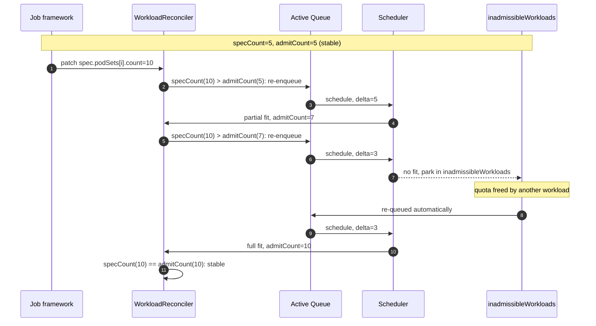

# KEP-5897: In-place Workload Resize

<!-- toc -->
- [Summary](#summary)
- [Motivation](#motivation)
  - [Goals](#goals)
  - [Non-Goals](#non-goals)
- [Proposal](#proposal)
  - [User Stories](#user-stories)
    - [Spark on Kubernetes with dynamic allocation](#spark-on-kubernetes-with-dynamic-allocation)
  - [Notes/Constraints/Caveats](#notesconstraintscaveats)
- [Design Details](#design-details)
  - [Terminology](#terminology)
  - [Enablement](#enablement)
    - [Feature gates](#feature-gates)
    - [Opt-in annotation](#opt-in-annotation)
  - [API](#api)
  - [Validation](#validation)
  - [Handling](#handling)
    - [Scale-up](#scale-up)
    - [Scale-down](#scale-down)
    - [Pod admission control](#pod-admission-control)
  - [Interactions](#interactions)
    - [Interaction with WorkloadSlices (KEP-77)](#interaction-with-workloadslices-kep-77)
    - [Interaction with PartialAdmission (KEP-420)](#interaction-with-partialadmission-kep-420)
    - [Interaction with Topology-Aware Scheduling](#interaction-with-topology-aware-scheduling)
  - [Test Plan](#test-plan)
    - [Unit tests](#unit-tests)
    - [Integration tests](#integration-tests)
  - [Graduation Criteria](#graduation-criteria)
    - [Alpha](#alpha)
    - [Beta](#beta)
    - [GA](#ga)
- [Implementation History](#implementation-history)
- [Drawbacks](#drawbacks)
- [Alternatives](#alternatives)
<!-- /toc -->

## Summary

This KEP adds in-place resize, a second mechanism for elastic (dynamically sized) jobs.
A job framework scales an already-admitted Workload by patching `spec.podSets[].count` on that same Workload, instead of creating a new slice Workload per scale step.

Compared with WorkloadSlices (KEP-77), in-place resize brings two benefits:

- It keeps a single Workload per job for the whole job lifetime, instead of one Workload per scale step, which lowers pressure on the API server and etcd.
- It gives a third-party job runtime one stable Workload to track and read the admitted count (`status.admission`) from — a good fit for frameworks like Spark that create and scale their own pods from inside the running job.

In-place resize and WorkloadSlices are two implementations of the same elastic-job idea. They are independently gated and mutually exclusive per job.

## Motivation

Kueue already supports elastic jobs through WorkloadSlices (KEP-77): each scale-up creates a new slice Workload that is admitted and then aggregates the old one.
That works well when the entity reconciling the Workload is also the entity that creates the job's pods.

It does not fit frameworks such as Spark on Kubernetes, where a SparkApplication controller talks to Kueue but executor pods are created, deleted, and scaled by the Spark driver via dynamic allocation, from inside the running job. Two problems follow from using WorkloadSlices for such a framework:

- One slice Workload per scale step. The Spark driver reacts to task backlog continuously, so at the scale of tens of thousands of SparkApplications the slice Workloads put significant pressure on etcd and the API server.
- No stable handle for the runtime. The driver has no single Workload to read, so it cannot easily cap pod creation to the quota Kueue has granted and tends to create pods that then sit pending.

In-place resize gives these frameworks a single, long-lived Workload: `spec.podSets[].count` is the scaling surface and `status.admission` reports the granted count. Kueue enforces that count through the shared elastic-job scheduling gate for pods it manages, and a self-scaling runtime like the Spark driver can read `status.admission` directly to drive its own executors.

### Goals

- Keep exactly one stable Workload per job for the whole job lifetime, so the API server and etcd footprint stays low under frequent scaling.
- Support partial admission on scale-up, so a scale-up that does not fully fit is admitted up to the available quota and continues automatically as more quota is released.

### Non-Goals

- Vertical scaling. Only horizontal scaling (PodSet counts) is in scope.

## Proposal

A job framework opts a job in with the `kueue.x-k8s.io/resize-elastic-job: "true"` annotation and the `ElasticJobsViaWorkloadResize` feature gate.
Kueue creates and admits one Workload as usual.
From then on, scaling is a patch to `spec.podSets[].count` on that Workload:

- On scale-up, Kueue re-evaluates admission for the delta and raises `status.admission`, fully or partially.
- On scale-down, Kueue lowers `status.admission` to match the spec and releases the freed quota.

### User Stories

#### Spark on Kubernetes with dynamic allocation

1. A user submits a SparkApplication opted into in-place resize. Kueue admits one Workload with a `driver` and an `executor` PodSet.
2. The Spark driver reads `status.admission` and runs exactly that many executors.
3. Dynamic allocation raises the executor target; the driver patches `spec.podSets[executor].count` up. Kueue admits as much of the delta as fits and raises `status.admission`, and the driver runs the newly admitted executors. If only part fits now, Kueue admits the rest on its own as quota frees up, with no further driver action.
4. Dynamic allocation finds executors idle; the driver patches the count down. Kueue immediately lowers `status.admission` and releases the freed quota, and the driver terminates the idle executors.

Throughout, there is one Workload per SparkApplication, and the driver never creates more executor pods than Kueue has admitted.

### Notes/Constraints/Caveats

In-place resize and WorkloadSlices are mutually exclusive on the same job; a job sets at most one of the two opt-in annotations.
If Kueue needs to preempt a resized job, it preempts the whole job as a single unit.

## Design Details

### Terminology

- In-place resize: scaling an admitted Workload by mutating `spec.podSets[].count`, without creating a new Workload.
- resize-elastic job: a job opted into in-place resize via the `kueue.x-k8s.io/resize-elastic-job` annotation.
- specCount: the per-PodSet `spec.podSets[].count`; what the job framework asks for.
- admitCount: the per-PodSet count recorded in `status.admission.podSetAssignments[].count`; the quota Kueue has granted.

### Enablement

In-place resize requires both a feature gate and a per-Workload opt-in annotation.
The behavior is active only when `ElasticJobsViaWorkloadResize` is enabled and the Workload carries `kueue.x-k8s.io/resize-elastic-job: "true"`.
Partial admission on scale-up additionally requires `ElasticJobsViaWorkloadResizeWithPartialReplicaScaleUp`.

#### Feature gates

```golang
// owner: @zhengchenyu
// kep: https://github.com/kubernetes-sigs/kueue/tree/main/keps/5897-workload-resize
//
// ElasticJobsViaWorkloadResize enables in-place elastic scaling of an admitted Workload by
// mutating spec.podSets[].count directly (instead of creating replacement WorkloadSlices).
// The job framework writes the target count on spec, Kueue writes the admitted count on
// status.admission, and Kueue releases quota on scale-down.
ElasticJobsViaWorkloadResize featuregate.Feature = "ElasticJobsViaWorkloadResize"

// owner: @zhengchenyu
// kep: https://github.com/kubernetes-sigs/kueue/tree/main/keps/5897-workload-resize
//
// ElasticJobsViaWorkloadResizeWithPartialReplicaScaleUp enables partial admission during
// scale-up for workloads managed by ElasticJobsViaWorkloadResize. When this gate is on and
// the workload has a MinCount set (e.g. via job-min-parallelism for batch/Job), the scheduler
// may admit at a count between MinCount and the requested Count if full quota is unavailable.
// When this gate is off, scale-up is all-or-nothing: the workload stays pending until the
// full requested count fits.
ElasticJobsViaWorkloadResizeWithPartialReplicaScaleUp featuregate.Feature = "ElasticJobsViaWorkloadResizeWithPartialReplicaScaleUp"
```

#### Opt-in annotation

```golang
// ResizeElasticJobAnnotation is set on a Job to indicate that it supports in-place elastic
// resize (ElasticJobsViaWorkloadResize feature gate). It is separate from the elastic-job
// annotation used by ElasticJobsViaWorkloadSlices so the two mechanisms are fully orthogonal.
// This annotation is alpha-level.
ResizeElasticJobAnnotation = "kueue.x-k8s.io/resize-elastic-job"
```

A dedicated annotation, rather than reusing the WorkloadSlices `kueue.x-k8s.io/elastic-job` annotation, keeps the two feature gates independent and lets validation reject the ambiguous case where both are set.

### API

In-place resize adds no new CRD fields.
It reuses `spec.podSets[].count` (specCount) as the requested size and `status.admission.podSetAssignments[].count` (admitCount) as the granted size.

It adds one Workload status condition:

```golang
// WorkloadScaleDown means that the Workload is scaling down its admitted pod counts
// to match the counts requested in spec.podSets.
WorkloadScaleDown = "ScaleDown"
```

Kueue sets `ScaleDown` with status `True`, reason `ScaleDown`, and message `Admitted counts converged to spec` when it lowers the admitted counts on a scale-down.
The condition lets operators see that a scale-down was observed and quota was released.

### Validation

Validation is enforced at the webhook, and applies only when `ElasticJobsViaWorkloadResize` is enabled and the object is opted in.

- `kueue.x-k8s.io/resize-elastic-job` and `kueue.x-k8s.io/elastic-job` must not both be set; they are mutually exclusive elastic-job mechanisms.
- A resize-elastic Workload must not set a PodSet `topologyRequest`; Topology-Aware Scheduling is unsupported in Alpha.
- A PodSet `minCount`, when set, must not exceed its `count` (existing rule, unchanged).
- A resize-elastic job is exempt from the rule that forbids changing `spec.parallelism` while the job is unsuspended and `job-min-parallelism` is set. That rule exists for classic partial admission, which assumes a fixed count; in-place resize is designed to change the count in place, so the guard would otherwise block every scale-up.
- Kueue may change `status.admission.podSetAssignments[].count` and its proportional `resourceUsage` on an already-admitted resize-elastic Workload. The assigned ClusterQueue and Flavors stay immutable.

Partial admission on scale-up is governed by a single predicate shared by the scheduler and the job reconciler:
`MinCount` is honored when `PartialAdmission` is enabled, or when `ElasticJobsViaWorkloadResizeWithPartialReplicaScaleUp` is enabled and the Workload is a resize-elastic job (the equivalent branch for WorkloadSlices is separate).
For in-place resize the presence of a user-set `MinCount` already expresses the intent to allow partial admission, so no extra per-job strategy annotation is needed.

### Handling

Let `specCount = spec.podSets[i].count` and `admitCount = status.admission.podSetAssignments[i].count`.
The WorkloadReconciler observes `Update` events on the admitted Workload and acts per PodSet:

| Case | Condition | Action |
|---|---|---|
| Scale-up | `specCount > admitCount` | Re-enqueue the admitted Workload; the scheduler evaluates the delta and raises `status.admission` (partial or full). |
| Scale-down | `specCount < admitCount` | Lower `status.admission` to `specCount`, release the freed quota, set the `ScaleDown` condition. |
| No-op | `specCount == admitCount` | The Workload is stable and is not re-enqueued. |

Throughout, the Workload stays `Admitted` and `Job.spec.suspend` stays `false`; the job keeps running with its currently admitted resources.

#### Scale-up

When `specCount > admitCount`, the WorkloadReconciler re-enqueues the already-admitted Workload into the active scheduling queue.
The scheduler computes the delta `specCount - admitCount` and tries to admit it.
If quota is available, it raises `status.admission` to a new count, full or partial.
If no quota is available, the Workload moves to `inadmissibleWorkloads` and is reconsidered when quota is released.

Because Kueue writes `status.admission`, every admission update re-triggers the `Update` event and is re-evaluated against the still-outstanding `specCount`.
As long as `specCount > admitCount`, the Workload keeps getting re-enqueued, so it climbs toward the target over multiple cycles without any further action from the job framework, until the target is admitted or the framework lowers `specCount`.

With `ElasticJobsViaWorkloadResizeWithPartialReplicaScaleUp` and a `MinCount` set, the scheduler searches `[max(MinCount, admitCount+1), specCount]` for the largest count that fits.
Without the gate, scale-up is all-or-nothing: the delta is admitted only if the full `specCount` fits.



#### Scale-down

When `specCount < admitCount`, the WorkloadReconciler lowers `status.admission` to `specCount`, scaling each PodSet assignment's `resourceUsage` proportionally, and releases the freed quota back to the ClusterQueue.
This converges the admitted state to the target without re-scheduling, and sets the `ScaleDown` condition.
The Workload is not re-enqueued.

#### Pod admission control

In-place resize supports two framework shapes, so running pods never exceed the count Kueue has admitted:

- Runtime reads admission (for example the Spark driver): the runtime reads `status.admission` and creates at most `admitCount` pods. No scheduling gate is involved.
- Controller creates pods from spec (for example batch/Job): the controller creates `specCount` pods directly, so Kueue must hold the ones beyond `admitCount`. New pods are created with the shared `kueue.x-k8s.io/elastic-job` scheduling gate, and the shared `ElasticJobUngater` removes the gate from as many pods as were admitted (room = granted − already-ungated). Pods are tagged with the `kueue.x-k8s.io/workload` annotation set to the Workload name, so the shared pod index and ungater find them. This reuses the scheduling-gate and ungater infrastructure defined in KEP-77; no new gate or controller is added.

### Interactions

#### Interaction with WorkloadSlices (KEP-77)

In-place resize and WorkloadSlices are two implementations of elastic jobs.
They are independently gated (`ElasticJobsViaWorkloadResize` vs `ElasticJobsViaWorkloadSlices`) and mutually exclusive per job: a job carries at most one of the two opt-in annotations, and the webhook rejects a job that sets both.
In-place resize reuses the shared `ElasticJobSchedulingGate` constant and the `ElasticJobUngater` controller from KEP-77; it does not add a parallel gate or controller.

#### Interaction with PartialAdmission (KEP-420)

Classic `PartialAdmission` assumes an immutable PodSet count and rewrites the job's parallelism to the minimum at admission time.
In-place resize instead changes the count in place and relies on `ElasticJobsViaWorkloadResizeWithPartialReplicaScaleUp` plus a user-set `MinCount` to admit a partial scale-up.
A resize-elastic job is therefore exempt from the parallelism-immutability guard that classic `PartialAdmission` imposes.

#### Interaction with Topology-Aware Scheduling

Topology-Aware Scheduling is not supported together with resize-elastic workloads in Alpha, but it is a goal for a later iteration (tracked under [Beta](#beta)).
A resize scale-up would compute its delta from the admitted topology assignment, which cannot be rescaled in place, so the delta would be zero and the scale-up would never progress.
Until that is solved, the webhook rejects a resize-elastic Workload that sets a PodSet `topologyRequest`; the two features can still be used separately in the meantime.

### Test Plan

[x] I/we understand the owners of the involved components may require updates to
existing tests to make this code solid enough prior to committing the changes necessary
to implement this enhancement.

#### Unit tests

The validation, scale-up/scale-down handling, and partial-admission predicate will adhere to regular best practices for unit tests and coverage, exercising both gate on/off paths.

#### Integration tests

The `scheduler` and `controllers/job` will be extended to cover scale-up (full and partial), scale-down, and the gate-off path for a resize-elastic Job.

### Graduation Criteria

#### Alpha

- [x] Feature gated by `ElasticJobsViaWorkloadResize`, disabled by default.
- [x] Scale-up re-admits the delta in place; scale-down converges `status.admission` down and releases quota.
- [x] Partial scale-up gated by `ElasticJobsViaWorkloadResizeWithPartialReplicaScaleUp`, disabled by default.
- [x] `resize-elastic-job` opt-in, mutually exclusive with the WorkloadSlices annotation, enforced at the webhook.
- [x] batch/Job integration: scale-up pods gated and ungated via the shared `ElasticJobUngater`.
- [x] Unit and integration tests cover scale-up, partial scale-up, scale-down, and the gate-off path.

#### Beta

- [ ] Support Topology-Aware Scheduling for resize-elastic workloads, by computing the scale-up delta against the existing topology assignment instead of rejecting `topologyRequest`.

#### GA

## Implementation History

## Drawbacks

- Kueue now supports two elastic-job mechanisms, which adds surface area users and integrators must understand.
- Leveraging scheduling gates together with `ResourceQuota` enforcement may leave gated pods counted against a namespace quota, as noted in KEP-77.

## Alternatives

Keep using WorkloadSlices (KEP-77) for all elastic jobs.