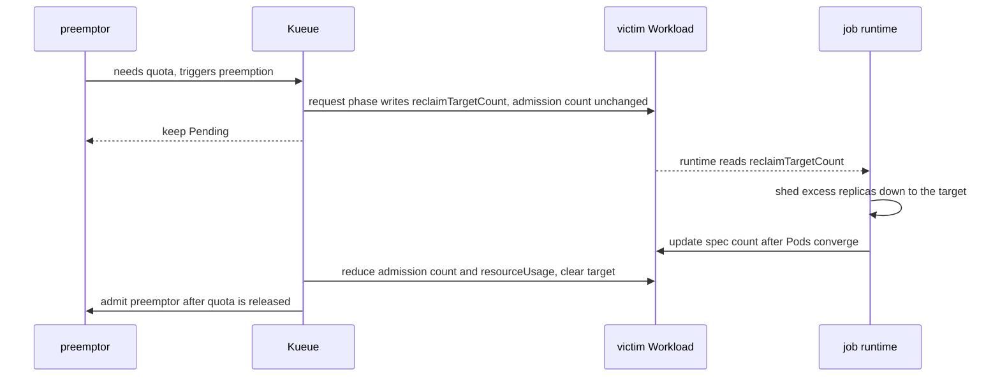

# KEP-975: Partial Preemption of Elastic Workloads

<!-- toc -->
- [Summary](#summary)
- [Motivation](#motivation)
  - [Goals](#goals)
  - [Non-Goals](#non-goals)
- [Proposal](#proposal)
  - [User Stories](#user-stories)
    - [Story 1: Spark on Kubernetes elastic executors](#story-1-spark-on-kubernetes-elastic-executors)
    - [Story 2: Ray with split baseline/opportunistic worker groups](#story-2-ray-with-split-baselineopportunistic-worker-groups)
    - [Story 3: Preempting an interactive Ray cluster loses the user's notebook session](#story-3-preempting-an-interactive-ray-cluster-loses-the-users-notebook-session)
    - [Story 4: Reclaiming GPU workers restarts a continuous Ray Data pipeline](#story-4-reclaiming-gpu-workers-restarts-a-continuous-ray-data-pipeline)
  - [Notes/Constraints/Caveats](#notesconstraintscaveats)
  - [Risks and Mitigations](#risks-and-mitigations)
- [Design Details](#design-details)
  - [Two-phase model: request != release](#two-phase-model-request--release)
  - [Workload API](#workload-api)
  - [Opt-in annotation](#opt-in-annotation)
  - [ReclaimMinCount](#reclaimmincount)
  - [Scheduler / Preemption](#scheduler--preemption)
    - [Eligibility](#eligibility)
    - [Candidate ordering](#candidate-ordering)
    - [Consuming candidates across rounds](#consuming-candidates-across-rounds)
    - [Target selection](#target-selection)
    - [Issuing preemptions](#issuing-preemptions)
    - [No-fit behavior](#no-fit-behavior)
    - [Example](#example)
  - [Webhook](#webhook)
  - [Job runtime contract](#job-runtime-contract)
  - [Test Plan](#test-plan)
    - [Unit tests](#unit-tests)
    - [Integration tests](#integration-tests)
    - [e2e tests](#e2e-tests)
  - [Graduation Criteria](#graduation-criteria)
- [Implementation History](#implementation-history)
- [Drawbacks](#drawbacks)
- [Alternatives](#alternatives)
  - [Kueue mutates the job's replica count directly](#kueue-mutates-the-jobs-replica-count-directly)
<!-- /toc -->

## Summary

Today Kueue preempts a Workload as a whole: the victim is evicted, `stopJob` suspends it, and all
of its Pods are torn down. For elastic workloads that can run at a reduced size (for example a Spark
application whose executor count can shrink), whole eviction is unnecessarily disruptive.

**Partial Preemption** lets Kueue reclaim quota from an elastic, opted-in Workload by shrinking one
PodSet to a target count, instead of evicting the whole Workload.
Kueue deletes the Pods above the target without changing the job's spec, and keeps the Pods that the
job recreates gated until quota is available again.
The scheduler selects the largest target count that lets the preemptor fit, so it reclaims only the
replicas needed. The victim keeps running at a smaller size and is never suspended. The feature is
alpha and gated by the `PartialPreemption` feature gate; when the gate is off, behavior is identical
to today.

## Motivation

Elastic batch/data workloads (Spark, Ray, and similar) can often continue making progress
with fewer replicas. When a higher-priority Workload needs quota, Kueue's only tool is to evict a
victim entirely. For a long-running elastic job this means killing the driver and every worker,
losing in-flight progress, and paying a full restart — even though releasing a few replicas would
have been enough.

Kueue cannot shrink a running job on its own: only the job's controller/driver owns its Pods.
Partial preemption therefore needs a way for Kueue to **signal** a desired reduced size and for the
job runtime to **act** on it, while the quota accounting stays correct throughout.

### Goals

- Provide an opt-in mechanism where preemption of an elastic Workload reclaims quota by removing
  Pods from one of its PodSets, down to no lower than its `ReclaimMinCount`, rather than evicting
  the whole Workload.
- Reclaim only as many Pods as the preemptor needs.
- Guarantee no quota over-subscription at any point during the scale-down.
- Work without requiring upstream changes to the Ray and Spark controllers.
- Let a shrunk Workload grow back with partial scale-up (KEP-12100) when quota is available again without introducing a new scale-up mechanism.
- Be fully gated so that, with the gate disabled, there is zero behavioral change.

### Non-Goals

- Kueue does not mutate the parent job's spec (see [Alternatives](#alternatives) for why).
- Kueue does not use the framework's state, such as idle Ray workers, to choose which Pods to
  remove.
- Kueue does not add a graceful shutdown of its own; a removed Pod gets the usual SIGTERM and
  `terminationGracePeriodSeconds`.
- Multi-host Ray worker groups (`numOfHosts > 1`) are not supported, as in partial scale-up
  (KEP-12100): Ray can only reach targets that are multiples of `numOfHosts`.

## Proposal

Introduce a per-PodSet target, `status.admission.podSetAssignments[].reclaimTargetCount`, that Kueue
writes on an admitted elastic Workload to request that the PodSet scale down to that count. The job
runtime observes `reclaimTargetCount`, sheds the excess replicas, and updates the Workload spec
count after the scale-down converges. The Workload controller then reduces the admission count and
resource usage and clears `reclaimTargetCount`, releasing quota for the preemptor.

The preemption decision path (both the classical and the Fair Sharing algorithms) is extended so
that an eligible elastic victim is simulated at the selected reduced count in the scheduling
snapshot instead of being removed, and such victims are preferred over whole eviction of
equal-priority peers.

### User Stories

#### Story 1: Spark on Kubernetes elastic executors

A Spark application runs with 20 executors (`minExecutors=2`) in a low-priority ClusterQueue that is
borrowing quota. A high-priority job arrives and needs quota equivalent to 10 executors. Instead of
suspending the whole Spark application or reducing it all the way to 2 executors, Kueue writes
`reclaimTargetCount=10` on the executor PodSet. The Spark driver gracefully decommissions executors
down to 10 and updates the Workload spec count. The Workload controller then updates admission
accounting, releases the quota, and the high-priority job is admitted. The Spark application keeps
running the entire time.

#### Story 2: Ray with split baseline/opportunistic worker groups

A RayCluster runs with two worker groups in a low-priority ClusterQueue with nominal quota and a
borrowing limit. One worker group is baseline capacity, sized to run only using the queue's nominal
quota, while the other is a `0..N` scalable group for opportunistic extra capacity. A high-priority
job arrives and needs part of the borrowed quota. Instead of suspending the entire RayCluster,
killing the head and all workers, Kueue writes `reclaimTargetCount=0` on the opportunistic worker
group's PodSet. The Ray driver scales in that worker group and updates the Workload spec count. The
Workload controller then releases the quota, and the high-priority job is admitted. The RayCluster,
including its head and baseline worker group, continues running the entire time.

### Story 3: Preempting an interactive Ray cluster loses the user's notebook session

As a researcher, I use a RayCluster as an interactive workspace: a Jupyter notebook runs on the head, and I submit Ray tasks to GPU workers from it.
When a higher-priority job needs GPUs, I want to give back GPU workers, not lose my session.
Partial preemption must never disrupt the head: it runs my notebook server, and I need it running to save my development work.

The head requests 8 CPUs and 32 GiB of memory and runs the notebook server.
The GPU worker group uses the Ray autoscaler, and each GPU worker uses a whole 8-GPU node.
My RayCluster opts in to partial preemption and declares a minimum of 0 GPU workers.
It runs at a lower priority than production jobs in the same ClusterQueue, `research`; CPU and memory quota are not a constraint in this example:

| `research`              |                                            |
|-------------------------|--------------------------------------------|
| GPU `nominalQuota`      | 64                                         |
| `withinClusterQueue`    | `LowerPriority`                            |
| WorkloadPriorityClasses | `interactive` (100), `production` (1000)   |

1. My RayCluster runs at priority `interactive` with its head and 4 GPU workers (32 GPUs).
   A production fine-tuning job uses the other 32 GPUs.
2. A second production job needs 16 GPUs.
   Kueue asks my RayCluster to shrink the GPU worker group to 2 workers; the head keeps running.
3. Two GPU worker Pods terminate.
   My notebook kernel and the results it has already collected are kept, and Ray recomputes task results that were stored only on the removed workers.
4. When the fine-tuning job finishes, the autoscaler scales the GPU workers back up as my notebook submits more work.

Currently, Kueue suspends the whole RayCluster in step 2.
KubeRay deletes the head with the workers, so the notebook server goes down, unsaved work is lost, and so is everything in the kernel's memory.
The RayCluster is requeued with 4 GPU workers and cannot start again until 32 GPUs are free.

### Story 4: Reclaiming GPU workers restarts a continuous Ray Data pipeline

As a user running a continuous Ray Data pipeline as a RayJob, I want the pipeline to use whatever GPU quota is spare in its Cohort.
When part of that quota is reclaimed, I want the Ray cluster and the pipeline to keep running with fewer GPU workers.

The pipeline reads from an unbounded source, so it never completes and never releases its quota on its own.
The Ray cluster has a CPU-only head, requesting 16 CPUs and 64 GiB of memory, and one worker group of GPU Pods.
Each GPU worker uses a whole 8-GPU node.
My RayJob opts in to partial preemption.
My ClusterQueue, `data`, has no GPU nominal quota; every GPU the RayJob uses is borrowed.
It shares a Cohort with `training`, which owns 16 GPU nodes; CPU and memory quota are not a constraint in this example:

|                       | `data`  | `training` |
|-----------------------|--------:|-----------:|
| GPU `nominalQuota`    | 0       | 128        |
| `reclaimWithinCohort` | `Never` | `Any`      |

1. While `training` is idle, the RayJob runs with its head and 16 GPU workers (128 GPUs).
2. A 12-node training job in `training` needs 96 GPUs.
   Kueue asks the RayJob to shrink the GPU worker group to 4 workers; the head keeps running.
3. A 4-node evaluation job in `training` needs the remaining 32 GPUs.
   Removing every GPU worker would leave the head running with nothing to do, so Kueue evicts the whole RayJob, as it does today.

Some pipelines keep state on the head that is expensive to rebuild, such as the driver's progress through the source.
For those, I explicitly allow the GPU worker group to shrink to 0.
In step 3, Kueue then removes the last 4 GPU workers instead: processing pauses, and the head keeps running until GPU nodes are free again.

Currently, Kueue suspends the whole RayJob in step 2.
KubeRay deletes the Ray cluster, and when the RayJob is admitted again, the cluster is recreated and the pipeline restarts from its last persisted progress.

### Notes/Constraints/Caveats

- The victim must opt in (annotation), have exactly one PodSet with `ReclaimMinCount` set, and
  currently be using more than `ReclaimMinCount`. Otherwise it is treated as a normal
  (whole-eviction) preemption target.
- `reclaimTargetCount` is owned by Kueue and is not a user-set field. An in-flight target is kept
  unchanged until the runtime converges and the Workload controller clears it.
- Partial preemption interoperates with elastic-job scale-down. Admission `count` and
  `resourceUsage` only decrease after the runtime updates the Workload spec and the Workload
  controller completes the accounting update.

### Risks and Mitigations

- **Over-subscription window.** Naively releasing quota when the request is written would let the
  preemptor and the not-yet-shrunk victim overlap. Mitigated by the [two-phase
  model](#two-phase-model-request--release): the request is decoupled from the release; admission
  accounting only drops after the runtime and Workload controller converge.
- **Uncooperative runtime.** A runtime that ignores `reclaimTargetCount` never releases quota, so
  the preemptor stays `Pending`. This is opt-in; only workloads whose runtime honors the field
  should set the annotation. Mitigated by the optional `partialPreemption.timeout` configuration:
  once a victim has stayed in the `Preempted` condition longer than the timeout without
  converging, the scheduler falls back to whole eviction for that victim.
- **Feature isolation.** All behavior is behind the `PartialPreemption` gate; when off, the 
  preemption path is the existing one.

## Design Details

### Two-phase model: request != release

The signal and the quota release are intentionally decoupled to avoid any over-subscription window:

- **request:** Kueue writes the selected `reclaimTargetCount` on the victim's admission. It does
  **not** change the accounted `count` or `resourceUsage` and does **not** release quota.
- **release:** The runtime reads `reclaimTargetCount`, sheds replicas, and updates the Workload spec
  count after the Pods converge. The Workload controller then updates the admission count and
  resource usage and clears the target, thereby releasing quota.



### Workload API

Add an optional, job-set field to `PodSet`, and an optional, Kueue-owned field to
`PodSetAssignment`:

```go
type PodSet struct {
    // ...

    // reclaimMinCount is the lowest count partial preemption may reduce this PodSet to. If unset,
    // this PodSet cannot be the target of partial preemption and the Workload falls back to
    // whole-eviction preemption. This is an alpha field and requires enabling the
    // PartialPreemption feature gate.
    //
    // +optional
    // +kubebuilder:validation:Minimum=0
    ReclaimMinCount *int32 `json:"reclaimMinCount,omitempty"`
}

type PodSetAssignment struct {
    // ...

    // reclaimTargetCount, when set and lower than count, requests the elastic job to scale this
    // PodSet down to reclaimTargetCount so partial preemption can reclaim its quota. Kueue owns
    // this field; the job runtime reads it and sheds pods down to reclaimTargetCount. Kueue clears
    // this field once the PodSet's desired spec count has converged to reclaimTargetCount or below.
    // This is an alpha field and requires enabling the PartialPreemption feature gate.
    //
    // +optional
    // +kubebuilder:validation:Minimum=0
    ReclaimTargetCount *int32 `json:"reclaimTargetCount,omitempty"`
}
```

### Opt-in annotation

A Workload opts in via an annotation, e.g. `kueue.x-k8s.io/partial-preemption: "true"`. The job's
integration layer sets it on the Job; the jobframework reconciler propagates it onto the Workload so
that the scheduler only ever needs to look at the Workload.

### ReclaimMinCount

The scale-down floor is its own field, `PodSet.ReclaimMinCount`, set by the job integration rather
than reused from an existing field. A PodSet may be eligible for partial admission, partial
preemption, both, or neither, independently, and a framework may legitimately want different
floors for each (for example, a Ray worker group admitted down to 0 replicas but only ever
preempted down to 4). The current partial-preemption algorithm requires exactly one PodSet with
`ReclaimMinCount` set; if there are zero or multiple such PodSets, the Workload falls back to
normal whole-eviction handling.

### Scheduler / Preemption

Whole eviction picks candidates in one pass: order them, then evict in order until the preemptor
fits. Partial preemption keeps that shape but splits the decision into three stages, because a
candidate is no longer "evict or not" but "shrink by how much":

1. **Ordering** — produce a total order over the candidates ([Candidate ordering](#candidate-ordering)).
2. **Consumption** — walk that order, possibly over several rounds, so one victim can be shrunk
   incrementally and several victims can accumulate reductions ([Consuming candidates across
   rounds](#consuming-candidates-across-rounds)).
3. **Target selection** — for each visited candidate, decide the target count for this round
   ([Target selection](#target-selection)).

With the `PartialPreemption` gate off, all three collapse to today's single forward pass that evicts
whole candidates in order, so there is no behavioral change.

#### Eligibility

A candidate is eligible for partial preemption when: the `PartialPreemption` gate is enabled, the
Workload carries the opt-in annotation with value `"true"`, exactly one PodSet has `ReclaimMinCount`
set, and its effective used count is above `ReclaimMinCount`. The used count comes from
`workload.Info.TotalRequests`; an existing lower `reclaimTargetCount` is used as the effective count
for simulation.

#### Candidate ordering

Partial preemption adds three criteria to the existing candidate comparator:

1. **Resume an in-flight reduction first.** A candidate whose current count is still above an
   in-flight `reclaimTargetCount` sorts just after already-evicting candidates, so a reduction
   already in progress is resumed before a fresh victim is picked. This is what keeps the scheduler
   from spreading reductions across new victims while an earlier target is still converging (see
   [Consuming candidates across rounds](#consuming-candidates-across-rounds)).
2. **Prefer shrinking over evicting.** Once priority ties, an eligible partial-preemptible candidate
   is preferred over a whole-eviction-only one, because shrinking a PodSet is cheaper than evicting a
   whole Workload.
3. **Among partial peers, prefer the one that can give back more.** The tie-break key is how far the
   candidate's effective used count exceeds its `ReclaimMinCount` (capped by any in-flight
   `reclaimTargetCount`) — the number of replicas it can still shed — not the raw used count. Because
   this key is recomputed each scheduling cycle, a victim that was already shrunk falls behind its
   peers, so repeated rounds rotate across candidates and spread the reduction instead of repeatedly
   hitting the same Workload.

With the gate off, these fields are all false/0, so the order is identical to today's.

#### Consuming candidates across rounds

The preemptor simulates preempting candidates in the order above and stops as soon as it fits. Whole
eviction needs only a single forward pass, since each candidate is removed in full. A partial
candidate, by contrast, may only be shrunk partway toward its floor in one visit, so one pass is not
always enough even when enough quota could eventually be reclaimed. Partial preemption therefore
lets the scheduler re-walk the still-reducible partial candidates over additional rounds, deepening
their reductions until the preemptor fits or no candidate can shed further.

**Why 6 segments.** In whole-eviction preemption each visited candidate gives up all of its quota,
so a single pass is always enough. With partial preemption a candidate may give up only part of its
quota, which creates a risk: a partial candidate visited early might contribute just a fraction of
what is needed, increasing the chance that the preemptor ends up reaching higher-priority or
non-hierarchy candidates that should have been avoided. The segment layout addresses this by grouping
candidates so that the ones the scheduler should prefer are exhausted first, before crossing into
groups that carry a higher disruption cost.

**Candidate groups and the 6-segment layout.** The iterator arranges candidates into six ordered
segments:

1. Evicted / pending-reclaim candidates with hierarchical advantage
2. Evicted / pending-reclaim candidates with priority advantage (lower-priority, same cohort)
3. Evicted / pending-reclaim candidates from the same queue
4. Non-evicted candidates with hierarchical advantage
5. Non-evicted candidates with priority advantage
6. Non-evicted candidates from the same queue

Segments 1-3 are walked once in a single leading pass, resuming in-progress reductions before
touching any fresh victim. Segments 4-6 run the multi-round walk. Because candidates are consumed
segment-by-segment, the scheduler fully exhausts one segment before moving to the next — it never
reaches higher-disruption candidates while lower-disruption ones can still contribute. This mirrors
how whole-eviction preemption works, just extended across multiple rounds.

Within each multi-round segment, candidates are ordered by `used - ReclaimMinCount` (capped by any
in-flight target), so the one that can shed the most is visited first. This key is recomputed each
cycle, so a victim already shrunk in a prior cycle falls behind its peers and the load spreads
across victims.

The `partialPreemption.enableStrictPriorityPreemption` flag controls whether rounds within a segment
cross priority boundaries. When off (the default), a round walks the entire segment regardless of
priority, spreading the reduction across all priorities and avoiding over-reducing a single
low-priority victim. When on, a round is bounded to the priority of the first candidate returned and
only advances to higher-priority candidates once the lower-priority ones in the segment are
exhausted.

With the gate off the walk degenerates to the single forward pass of today's whole-eviction
preemption, and the segment layout and `enableStrictPriorityPreemption` have no effect.

#### Target selection

If the candidate has an in-flight `reclaimTargetCount` from a previous scheduling cycle and the
current used count is still above it, target selection reuses that target directly and skips the
window calculation below. This is the target-selection counterpart to ordering criterion 1 and the
leading-round consumption of in-flight candidates: the same target is consistently pursued across
cycles until the runtime converges.

Otherwise, target selection decides how far to shrink the PodSet this round, within a
`[minTargetCount, maxTargetCount]` window:

- `maxTargetCount` (least reduction) is `used - 1`.
- `minTargetCount` (most reduction) is the PodSet's `ReclaimMinCount`. The optional
  `kueue.x-k8s.io/partial-preemption-max-reclaimed-count` annotation raises this floor to
  `used - maxReclaimedCount`, limiting how many replicas a single round may reclaim. The scheduler
  then visits the candidate in later rounds, deepening the target by up to `maxReclaimedCount` each
  time, until the preemptor fits or `ReclaimMinCount` is reached.

By default the scheduler reduces straight to `minTargetCount`. If the candidate alone is
insufficient, later candidates contribute and reductions accumulate across victims and rounds; a
candidate that has reached its floor can later be handled as a normal whole-eviction candidate.

The `partialPreemption.enableOnDemandPreemption` configuration flag switches to an on-demand mode:
instead of dropping straight to the floor, the scheduler binary-searches the
`[minTargetCount, maxTargetCount]` window for the largest target count that already makes the
preemptor fit, so it reclaims only the replicas actually needed. The search runs extra fit
simulations per candidate, which may cost scheduling-cycle performance, so it is a separate opt-in
flag; with the flag unset, the default floor-based reduction is used.

#### Issuing preemptions

For a partial target, Kueue does **not** evict or `stopJob`. It patches the victim's admission
status to set `reclaimTargetCount` and emits a `PartiallyPreempted` event. Quota is not released
here (that is the release phase of the two-phase model).

#### No-fit behavior

Partial targets are issued only when the resulting target set makes the preemptor fit. If the
preemptor still does not fit, tentative partial and whole-eviction targets are discarded, no
preemption is issued, and the preemptor remains `Pending` for a later scheduling cycle.

#### Example

All victims below belong to the same ClusterQueue as the arriving preemptor, so they all fall in
the same-queue segment; no hierarchical or cross-queue priority advantage applies, and the ordering
shown below is the priority tie-break within that single segment.

A cohort is fully used by three partial-preemptible victims: `L1` and `L2` at low priority and `H`
at medium priority. `L1` can shed 4 executors above its `ReclaimMinCount`, `L2` can shed 3. A
higher-priority preemptor arrives, `enableOnDemandPreemption` and `enableStrictPriorityPreemption`
are both on, and each PodSet caps a single round's reduction at a max-reclaimed-count of 2. The three
stages interact as follows:

1. **Ordering** puts the low-priority band `{L1, L2}` ahead of `H`; within the band the
   reclaimable-count tie-break puts `L1` ahead of `L2`. Order: `L1`, `L2`, then `H`.
2. **Consumption** with `enableStrictPriorityPreemption` on keeps the walk inside the low band, so
   `H` is never considered while `L1`/`L2` can still contribute. Round 1 shrinks `L1` then `L2`, each
   by the per-round cap of 2. If that is still short, `L2` being partial triggers a second round over
   the same band; round 2 returns to `L1` first (its reclaimable count is still highest).
3. **Target selection** in round 2 reuses the target already signaled for `L1` in round 1 and only
   deepens it (never raises it), stopping at the largest target that makes the preemptor fit.

`H` keeps running untouched. While `L1`/`L2` have in-flight targets whose executors have not yet
exited, ordering criterion 1 keeps them at the front across the scheduling cycles the reduction takes
to converge, so the preemptor resumes the same victims instead of starting new ones.

### Webhook

`reclaimTargetCount` lives under `status.admission`, which is otherwise immutable after admission.
When the `PartialPreemption` gate is enabled, the Workload validating webhook allows
`reclaimTargetCount` to change on an already-admitted Workload. When a target has completed, it also
allows the Workload controller to clear the target and reduce admission `count` and `resourceUsage`
to the converged spec count.

### Job runtime contract

Kueue only expresses intent; a cooperating runtime does the work. The contract for an integration:

1. Set the opt-in annotation on the Job when the workload can tolerate partial preemption.
2. Populate `ReclaimMinCount` for the elastic PodSet (the scale-down floor).
3. Watch the Workload's `reclaimTargetCount` and cap the PodSet's desired size at
   `min(desired, admittedCount, reclaimTargetCount)`.
4. After the actual Pods converge to the target or below, lower the Workload spec count. The
   Workload controller then updates admission accounting and clears the target.

### Test Plan

[X] I/we understand the owners of the involved components may require updates to existing tests to
make this code solid enough prior to committing the changes necessary to implement this enhancement.

#### Unit tests

This change should be covered by unit tests.

#### Integration tests

This change should be covered by integration tests, including the release-phase accounting
update and the timeout fallback to whole eviction.


### Graduation Criteria

## Implementation History

- 2026-08-18: KEP created; downstream proof-of-concept implemented and validated end-to-end with
  Spark on Kubernetes (feature gate `PartialPreemption`, `reclaimTargetCount` field, preemption
  path, webhook, and jobframework annotation propagation).

## Drawbacks

- Adds a new admission-status field and a new decision branch to both preemption algorithms,
  increasing the surface area of the preemption code.
- Requires cooperation from the job runtime; the benefit is zero for frameworks that do not honor
  `reclaimTargetCount`.

## Alternatives

### Kueue mutates the job's replica count directly

Kueue's jobframework could patch the job's `spec` replica count (e.g. `spec.count`) directly. This
needs no third-party code changes, but it violates the ownership convention — Kueue should not mutate
a job's spec — and is fragile across frameworks. We reject it as the default; it could be offered as
an explicit fallback for frameworks that cannot be modified.
