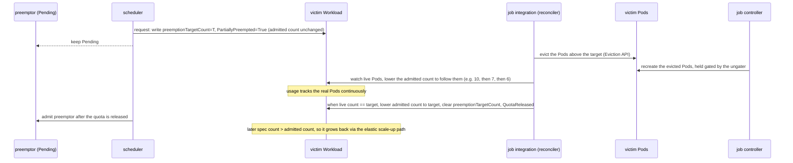

# KEP-975: Partial Preemption of Elastic Workloads

<!-- toc -->
- [Summary](#summary)
- [Motivation](#motivation)
  - [Goals](#goals)
  - [Non-Goals](#non-goals)
- [Proposal](#proposal)
  - [User Stories](#user-stories)
    - [Story 1: Preempting a Spark application loses all of its executors](#story-1-preempting-a-spark-application-loses-all-of-its-executors)
    - [Story 2: Preempting a Ray cluster also removes its baseline workers](#story-2-preempting-a-ray-cluster-also-removes-its-baseline-workers)
    - [Story 3: Preempting an interactive Ray cluster loses the user's notebook session](#story-3-preempting-an-interactive-ray-cluster-loses-the-users-notebook-session)
    - [Story 4: Reclaiming GPU workers restarts a continuous Ray Data pipeline](#story-4-reclaiming-gpu-workers-restarts-a-continuous-ray-data-pipeline)
  - [Notes/Constraints/Caveats](#notesconstraintscaveats)
  - [Risks and Mitigations](#risks-and-mitigations)
- [Design Details](#design-details)
  - [Terminology](#terminology)
  - [Two-phase model: request != release](#two-phase-model-request--release)
  - [Workload API](#workload-api)
  - [Opt-in annotation](#opt-in-annotation)
  - [PreemptionMinCount](#preemptionmincount)
  - [Scheduler / Preemption](#scheduler--preemption)
    - [Eligibility](#eligibility)
    - [Candidate ordering](#candidate-ordering)
    - [Shrink and evict passes](#shrink-and-evict-passes)
    - [Target selection](#target-selection)
    - [Issuing preemptions](#issuing-preemptions)
    - [No-fit behavior](#no-fit-behavior)
    - [Example](#example)
  - [Shrinking the PodSet](#shrinking-the-podset)
  - [Growing back](#growing-back)
  - [Validation](#validation)
  - [Handling](#handling)
  - [Interactions](#interactions)
  - [Integrations](#integrations)
    - [Ray](#ray)
    - [SparkApplication](#sparkapplication)
  - [Test Plan](#test-plan)
    - [Unit tests](#unit-tests)
    - [Integration tests](#integration-tests)
    - [e2e tests](#e2e-tests)
  - [Graduation Criteria](#graduation-criteria)
    - [Alpha](#alpha)
    - [Beta](#beta)
- [Implementation History](#implementation-history)
- [Drawbacks](#drawbacks)
- [Alternatives](#alternatives)
  - [Kueue mutates the job's replica count directly](#kueue-mutates-the-jobs-replica-count-directly)
  - [Release quota through reclaimablePods](#release-quota-through-reclaimablepods)
  - [Store the target in an annotation](#store-the-target-in-an-annotation)
  - [Delete Pods instead of evicting them](#delete-pods-instead-of-evicting-them)
  - [Drain each victim to its floor](#drain-each-victim-to-its-floor)
- [Future Work Ideas](#future-work-ideas)
<!-- /toc -->

## Summary

Today Kueue preempts a Workload as a whole: the victim is evicted, `stopJob` suspends it, and all
of its Pods are torn down. For elastic workloads that can run at a reduced size (for example a Spark
application whose executor count can shrink), whole eviction is unnecessarily disruptive.

**Partial Preemption** lets Kueue reclaim quota from an elastic, opted-in Workload by shrinking one
PodSet to a target count, instead of evicting the whole Workload.
Kueue evicts the Pods above the target without changing the job's spec, and keeps the Pods that the
job recreates gated until quota is available again.
The Kueue scheduler selects the largest target count that lets the preemptor fit, so it reclaims
only the replicas needed. The victim keeps running at a smaller size. Kueue evicts it whole only when
shrinking cannot free enough quota.

## Motivation

Elastic batch/data workloads (Spark, Ray, and similar) can often continue making progress
with fewer replicas. When a higher-priority Workload needs quota, Kueue's only tool is to evict a
victim entirely. For a long-running elastic job this means killing the driver and every worker,
losing in-flight progress, and paying a full restart — even though releasing a few replicas would
have been enough.

Kueue does not own a job's Pods, but it can evict some of them, as the cluster autoscaler and the
descheduler do. The job's controller then recreates them, and the elastic-job scheduling gate keeps
the new Pods from running until quota is available. Partial preemption builds on this, while keeping
the quota accounting correct throughout.

### Goals

- Provide an opt-in mechanism where preemption of an elastic Workload reclaims quota by removing
  Pods from one of its PodSets, down to no lower than its `preemptionMinCount`, rather than evicting
  the whole Workload.
- Reclaim only as many Pods as the preemptor needs.
- Guarantee no quota over-subscription at any point during the scale-down.
- Work without requiring upstream changes to the Ray and Spark controllers.
- Let a shrunk Workload grow back with partial scale-up (KEP-12100) when quota is available again,
  without introducing a new scale-up mechanism.

### Non-Goals

- Kueue does not mutate the parent job's spec (see [Alternatives](#alternatives) for why).
- Kueue does not use the framework's state, such as idle Ray workers, to choose which Pods to
  remove.
- Kueue does not add a graceful shutdown of its own; a removed Pod gets the usual SIGTERM and
  `terminationGracePeriodSeconds`.
- Multi-host Ray worker groups (`numOfHosts > 1`) are not supported, as in partial scale-up
  (KEP-12100): Ray can only reach targets that are multiples of `numOfHosts`.
- Proactive downscaling, where the job's runtime shrinks itself, is not part of this KEP (see
  [Proactive downscaling](FUTURE_WORK.md#proactive-downscaling)).

## Proposal

Introduce a per-PodSet target, `status.admission.podSetAssignments[].preemptionTargetCount`, that
Kueue writes on an admitted elastic Workload to shrink that PodSet to the target count.
kueue-controller-manager evicts the PodSet's Pods above the target, and keeps the Pods that the
job's controller recreates behind the elastic-job scheduling gate. Once the evicted Pods have
terminated, Kueue lowers the PodSet's admitted count to the target, which releases their quota for
the preemptor. The job grows back through the existing elastic scale-up path when quota is available
again.

The classical preemption path is extended so that an eligible elastic victim is simulated at the
selected reduced count in the scheduling snapshot instead of being removed, and every eligible
victim is shrunk before any candidate is evicted whole.

### User Stories

#### Story 1: Preempting a Spark application loses all of its executors

A Spark application with dynamic allocation runs with 20 executors (`minExecutors=2`) in a
low-priority ClusterQueue that is borrowing quota. A high-priority job arrives and needs quota
equivalent to 10 executors. Instead of suspending the whole Spark application or reducing it all the
way to 2 executors, Kueue removes 10 executors. Spark reruns their lost tasks on the remaining
executors and requests replacements, which Kueue keeps gated. Once the removed executors have
terminated, Kueue releases their quota and admits the high-priority job. When quota is available
again, Kueue starts the waiting executors. The Spark application keeps running the entire time.

#### Story 2: Preempting a Ray cluster also removes its baseline workers

A RayCluster runs with two worker groups in a low-priority ClusterQueue with nominal quota and a
borrowing limit. One worker group is baseline capacity, sized to run only using the queue's nominal
quota, with `minReplicas` equal to its size, while the other is a `0..N` scalable group for
opportunistic extra capacity, running 6 workers. A high-priority job arrives and needs the quota of
2 opportunistic workers. Instead of suspending the entire RayCluster, killing the head and all
workers, Kueue sets the opportunistic group's `preemptionTargetCount` to 4, the largest count that
lets the job fit, and evicts that group's 2 newest workers through the Eviction API. KubeRay
recreates them, and Kueue keeps the new Pods gated until quota is available again. Once the 2
evicted workers have terminated, Kueue releases their quota and the high-priority job is admitted.
The RayCluster, including its head and baseline worker group, continues running the entire time.

#### Story 3: Preempting an interactive Ray cluster loses the user's notebook session

A researcher uses a RayCluster as an interactive workspace: a Jupyter notebook runs on the head and submits Ray tasks to GPU workers.
When a higher-priority job needs GPUs, the researcher wants to give back GPU workers, not lose the notebook session.
Partial preemption must never disrupt the head: it runs the notebook server, which must keep running so the researcher can save their development work.

The head requests 8 CPUs and 32 GiB of memory and runs the notebook server.
The GPU worker group uses the Ray autoscaler, and each GPU worker uses a whole 8-GPU node.
The RayCluster opts in to partial preemption and sets `minReplicas: 0` on the GPU worker group.
It runs at a lower priority than production jobs in the same ClusterQueue, `research`; CPU and memory quota are not a constraint in this example:

| `research`              |                                            |
|-------------------------|--------------------------------------------|
| GPU `nominalQuota`      | 64                                         |
| `withinClusterQueue`    | `LowerPriority`                            |
| WorkloadPriorityClasses | `interactive` (100), `production` (1000)   |

1. The RayCluster runs at priority `interactive` with its head and 4 GPU workers (32 GPUs).
   A production fine-tuning job uses the other 32 GPUs.
2. A second production job needs 16 GPUs.
   Kueue removes 2 of its GPU workers; the head keeps running.
3. The two GPU worker Pods terminate, and KubeRay recreates them; Kueue keeps the new Pods waiting until quota is available.
   The notebook kernel and the results it has already collected are kept, and Ray recomputes task results that were stored only on the removed workers.
4. When the fine-tuning job finishes, Kueue starts the 2 waiting GPU workers.

Currently, Kueue suspends the whole RayCluster in step 2.
KubeRay deletes the head with the workers, so the notebook server goes down, unsaved work is lost, and so is everything in the kernel's memory.
Evicting the whole RayCluster gracefully would not save the session either.
A grace period lets the researcher's code write files or a checkpoint, but the kernel's memory, the objects in Ray's object store and the processes the researcher started are still lost, and the environment has to be rebuilt.
It also takes more than the job needs: the RayCluster is requeued with 4 GPU workers and cannot start again until 32 GPUs are free, although it could keep running on 16.
With partial preemption, the researcher loses only the tasks that ran on the 2 removed workers, and the session keeps running.

#### Story 4: Reclaiming GPU workers restarts a continuous Ray Data pipeline

A team runs a continuous Ray Data pipeline as a RayJob and wants it to use whatever GPU quota is spare in its Cohort.
When part of that quota is reclaimed, the Ray cluster and the pipeline should keep running with fewer GPU workers.

The pipeline reads from an unbounded source, so it never completes and never releases its quota on its own.
The Ray cluster has a CPU-only head, requesting 16 CPUs and 64 GiB of memory, and one worker group of GPU Pods.
Each GPU worker uses a whole 8-GPU node, and the GPU worker group sets `minReplicas: 1`.
The RayJob opts in to partial preemption.
Its ClusterQueue, `data`, has no GPU nominal quota; every GPU the RayJob uses is borrowed.
It shares a Cohort with `training`, which owns 16 GPU nodes; CPU and memory quota are not a constraint in this example:

|                       | `data`  | `training` |
|-----------------------|--------:|-----------:|
| GPU `nominalQuota`    | 0       | 128        |
| `reclaimWithinCohort` | `Never` | `Any`      |

1. While `training` is idle, the RayJob runs with its head and 16 GPU workers (128 GPUs).
2. A 12-node training job in `training` needs 96 GPUs.
   Kueue removes 12 of the 16 GPU workers; the head keeps running.
3. A 4-node evaluation job in `training` needs the remaining 32 GPUs.
   Removing every GPU worker would leave the head running with nothing to do, so Kueue evicts the whole RayJob, as it does today.

Some pipelines keep state on the head that is expensive to rebuild, such as the driver's progress through the source.
For those pipelines, the GPU worker group sets `minReplicas: 0`.
In step 3, Kueue then removes the last 4 GPU workers instead: processing pauses, and the head keeps running until Kueue can start the waiting workers again.

Currently, Kueue suspends the whole RayJob in step 2.
KubeRay deletes the Ray cluster, and when the RayJob is admitted again, the cluster is recreated and the pipeline restarts from its last persisted progress.

### Notes/Constraints/Caveats

- The victim must opt in, and exactly one of its PodSets must be above its `preemptionMinCount` (see
  [Eligibility](#eligibility)); otherwise it is evicted whole.
- `preemptionTargetCount` is owned by Kueue and is not a user-set field. A later preemption may
  lower a target, even while it is in flight, but never raises it.
- Workloads with gang semantics, such as Spark barrier stages, MPI or non-elastic distributed
  training, should not opt in, or should set their floor to the gang size.
- After a shrink, the job's spec still shows its original size, and the replacement Pods stay
  `Pending` with the `kueue.x-k8s.io/elastic-job` scheduling gate until quota is available.
- The floor is the job's own minimum (`minReplicas`, `minExecutors`), so it also bounds the
  framework's autoscaler; a separate preemption floor is a Beta criterion.
- A preemptor is admitted only after the evicted Pods' termination grace period, and a
  PodDisruptionBudget that blocks evictions keeps it `Pending`.

### Risks and Mitigations

- **Over-subscription window.** Releasing quota when Kueue evicts the Pods would let the preemptor
  and the still-terminating Pods overlap. Mitigated by the [two-phase
  model](#two-phase-model-request--release): quota is released only after no Pod above the target is
  left.
- **Pods that don't go away.** A PodDisruptionBudget can refuse an eviction, and a Pod can stay
  terminating. The preemptor then stays `Pending`. A timeout that evicts the victim whole is
  re-evaluated for Beta (see [Timeout](FUTURE_WORK.md#timeout)).
- **Lost work on removed Pods.** An evicted Pod loses its running tasks and in-memory state. Spark
  executors with decommissioning, and Ray workers on Ray 2.57 or later, drain on SIGTERM within the
  termination grace period. Users protect the rest with the floor.
- **Churn with autoscalers.** The job's controller or autoscaler recreates removed Pods right away.
  The replacements stay gated and use no quota, but they add Pods and API writes.
- **Users who opt in.** Opting in only makes the user's own Workload easier to shrink. The target
  lives in `status.admission`, so a user who can edit a Workload but not its status cannot make
  kueue-controller-manager evict Pods. The extra scheduler work is bounded (see [Target
  selection](#target-selection)).
- **Shrinking crosses priorities and queues.** Any shrink counts as cheaper than any whole eviction,
  so an opted-in higher-priority Workload can lose Pods while a lower-priority one keeps running,
  and same-queue victims can shrink before borrowed quota is reclaimed from other queues. Revisiting
  this with a cost model is a Beta criterion.
- **Downgrade.** Older versions ungate up to the admitted count, so a shrunk Workload can over-use
  quota. Before downgrading, turn the gate off and wait until no Workload has
  `preemptionTargetCount`, or evict those Workloads.
- **New permission.** kueue-controller-manager needs `create` on `pods/eviction`. It already has
  `delete` on Pods.
- **Feature isolation.** All behavior is behind the `PartialPreemption` gate; when off, the
  preemption path is the existing one.

## Design Details

### Terminology

- **Floor** — a PodSet's `preemptionMinCount`, the lowest count partial preemption shrinks it to.
- **Target** — a PodSet's `preemptionTargetCount`, the count Kueue shrinks it to.
- **In-flight target** — a target with Pods still above it.
- **Request phase** — Kueue sets the target and evicts the Pods above it; the quota stays charged.
- **Release phase** — no Pod above the target is left, so Kueue releases their quota by lowering the
  PodSet's admitted count (`status.admission.podSetAssignments[].count`) to the target and clearing
  the target in the same update.
- **Reactive downscaling** — the default. Kueue evicts the Pods and lowers the PodSet's admitted
  count itself; the job's runtime does not shrink itself.
- **Proactive downscaling** — the job's runtime lowers its own spec count to shrink, which the job
  framework must adapt to; it is not the default (see [Proactive
  downscaling](FUTURE_WORK.md#proactive-downscaling)).

### Two-phase model: request != release

The target and the quota release are intentionally decoupled to avoid any over-subscription window:

- **request:** Kueue writes the selected `preemptionTargetCount` on the victim's admission, stops
  ungating the PodSet's Pods above it, and evicts the Pods above it (see [Shrinking the
  PodSet](#shrinking-the-podset)). It does **not** change `status.admission` otherwise and does
  **not** release quota.
- **release:** Once no Pod above the target is left, including terminating ones, Kueue lowers the
  PodSet's admitted count (`status.admission.podSetAssignments[].count`, and its `resourceUsage`) to
  the target and clears `preemptionTargetCount` in the same update, which releases the quota. The
  admitted count is lowered only after the Pods are gone, never before, so the preemptor is never
  admitted onto quota a victim Pod still holds. The job's spec count is left unchanged, so the
  Workload can grow back (see [Growing back](#growing-back)).



### Workload API

Add an optional, integration-set field to `PodSet`, and an optional, Kueue-owned field to
`PodSetAssignment`:

```go
type PodSet struct {
    // ...

    // preemptionMinCount is the lowest count partial preemption may shrink this PodSet to.
    // If unset, partial preemption does not shrink this PodSet. The job integration sets it
    // from the job's own minimum (see PreemptionMinCount in the KEP).
    // This is an alpha field and requires enabling the PartialPreemption feature gate.
    //
    // +optional
    // +kubebuilder:validation:Minimum=0
    PreemptionMinCount *int32 `json:"preemptionMinCount,omitempty"`
}

type PodSetAssignment struct {
    // ...

    // preemptionTargetCount is the count that partial preemption shrinks this PodSet to.
    // While it is set, Kueue evicts the PodSet's Pods above it and does not ungate Pods above it.
    // After the evicted Pods terminate, Kueue lowers this PodSet's admitted count (count and
    // resourceUsage) to the target and clears this field in the same update, releasing the quota.
    // Only Kueue sets this field. Unset means that partial preemption has not shrunk this PodSet.
    // This is an alpha field and requires enabling the PartialPreemption feature gate.
    //
    // +optional
    // +kubebuilder:validation:Minimum=0
    PreemptionTargetCount *int32 `json:"preemptionTargetCount,omitempty"`
}
```

### Opt-in annotation

A job opts in with the annotation `kueue.x-k8s.io/partial-preemption: "true"`, next to
`kueue.x-k8s.io/elastic-job: "true"`, which partial preemption requires. kueue-controller-manager
copies it to the Workload, so the Kueue scheduler only needs to look at the Workload. Reviewing it
as an API field is a Beta criterion.

### PreemptionMinCount

The scale-down floor is its own field, `PodSet.preemptionMinCount`, set by the job integration
rather than reused from `minCount`. A PodSet may be eligible for partial admission, partial
preemption, both, or neither, independently, and a framework may legitimately want different floors
for each (for example, a Ray worker group admitted down to 0 replicas but only ever preempted down
to 4).

Users set the floor through the job's own minimum, which the integration copies:

| Integration | PodSet | `preemptionMinCount` |
|---|---|---|
| RayCluster, RayJob, RayService | each worker group with `numOfHosts` of 1 | `minReplicas`, 0 if unset |
| SparkApplication | executors, with `spec.dynamicAllocation.enabled` | `minExecutors`, 0 if unset |

The Ray head, the RayJob submitter and the Spark driver never get a floor, so they never shrink.

An integration copies the floor only when it creates the Workload or a scale-up slice; a later change
to the job's minimum takes effect on the next slice, not on the admitted Workload. The webhook
therefore rejects changing `preemptionMinCount` on an admitted Workload (see [Validation](#validation)).

### Scheduler / Preemption

Whole eviction picks candidates in one pass: order them, then evict in order until the preemptor
fits. Partial preemption keeps that shape but splits the decision into three stages, because a
candidate is no longer "evict or not" but "shrink by how much":

1. **Ordering** — produce a total order over the candidates ([Candidate ordering](#candidate-ordering)).
2. **Consumption** — walk that order twice: a shrink pass, then an evict pass ([Shrink and evict
   passes](#shrink-and-evict-passes)).
3. **Target selection** — the floor in both passes, which fill-back then raises ([Target
   selection](#target-selection)).

With the `PartialPreemption` gate off, all three collapse to today's single forward pass that evicts
whole candidates in order, so there is no behavioral change.

#### Eligibility

A candidate is eligible for partial preemption when the `PartialPreemption` gate is enabled, the
Workload carries the opt-in annotation with value `"true"` and is elastic, and exactly one PodSet
has an effective used count above its `preemptionMinCount`. That PodSet must not have a topology
assignment. Otherwise the candidate falls back to whole eviction; shrinking several PodSets is a
Beta criterion. The used count comes from the Workload's usage; an existing lower
`preemptionTargetCount` is used as the effective count for simulation. With `waitForPodsReady`
enabled, a Workload that has not yet reached PodsReady is evicted whole rather than shrunk. In
Alpha, a Workload with the `kueue.x-k8s.io/multikueue-origin` label, which MultiKueue dispatched to
a worker cluster, is evicted whole.

#### Candidate ordering

In Alpha, candidate ordering is identical to today's. Because of the two passes described in
[Shrink and evict passes](#shrink-and-evict-passes), partial preemptions are still favored over
whole evictions: every eligible candidate is shrunk before any candidate is evicted whole.

In a future version, we will re-evaluate the ordering and put a candidate that can shed more Pods
(`used - preemptionMinCount`, capped by any in-flight target) ahead of one that can shed fewer (see
[Partial-preemption-aware ordering](FUTURE_WORK.md#partial-preemption-aware-ordering)).

#### Shrink and evict passes

**Candidate groups and the 6-segment layout.** The iterator arranges candidates into six ordered
segments:

1. Evicted / shrinking candidates with hierarchical advantage
2. Evicted / shrinking candidates with priority advantage (lower-priority, same cohort)
3. Evicted / shrinking candidates from the same queue
4. Non-evicted candidates with hierarchical advantage
5. Non-evicted candidates with priority advantage
6. Non-evicted candidates from the same queue

The Kueue scheduler simulates the preemption over the candidate order and stops as soon as the
preemptor fits:

1. **Work already in progress (segments 1-3).** Already-evicted candidates count as removed, and a
   Workload with an in-flight target counts at that target.
2. **Shrink pass.** Walk the order and simulate each eligible candidate at its floor, skipping
   candidates that can only be evicted whole. Stop once the preemptor fits.
3. **Evict pass.** If the preemptor still does not fit, walk the order again and remove candidates
   whole, including the ones shrunk in step 2. Stop once the preemptor fits.

A partially preempted Workload can show up more than once. A Workload with an in-flight target
counts at that target in step 1, shows up again in the shrink pass if it is still above its floor,
and can show up a third time in the evict pass, which may evict it whole. A Workload shrunk in step 2
shows up again in step 3.

A shrink can change which candidates are still valid: a candidate in another ClusterQueue stops
qualifying once its ClusterQueue is back within nominal quota. So if the evict pass does not make
the preemptor fit, the Kueue scheduler discards the shrinks from step 2 and runs today's whole-eviction
pass, followed by fill-back. Partial preemption therefore never leaves a preemptor `Pending` that
whole eviction would admit.

Any shrink counts as cheaper than any whole eviction: the shrink pass walks the whole order, across
segments and priorities, before the evict pass evicts anything. Re-evaluating this cost model is a
Beta criterion (see [Cost model and candidate
ordering](FUTURE_WORK.md#cost-model-and-candidate-ordering)).

#### Target selection

In both passes, the target of a shrunk victim is its floor, `preemptionMinCount`. Fill-back then
raises it to the largest count that still lets the preemptor fit, binary-searching between the floor
and the victim's previous count. This adds at most
`ceil(log2(previous count - preemptionMinCount + 1))` fit simulations per victim. An in-flight
target stays in place unless the shrink pass lowers it toward the floor; no step raises it.

#### Issuing preemptions

For a partial target, Kueue does **not** evict the Workload or call `stopJob`. It patches the
victim's admission status to set `preemptionTargetCount`, and sets the `PartiallyPreempted`
condition to `True`. Its reason and message are the same as for the `Preempted` condition, plus the
PodSet and target count. Kueue emits a `PartiallyPreempted` event on the victim and a
`PreemptedWorkload` event on the preemptor, and increments
`kueue_partially_preempted_workloads_total`. Kueue records the event and the metric only when it
newly sets or lowers the target; a cycle that reuses an unchanged in-flight target does neither.
Quota is not released here (that is the release phase of the two-phase model).

#### No-fit behavior

Partial targets are issued only when the resulting target set makes the preemptor fit. The Kueue
scheduler reuses the existing over-preemption trimming: once it has a target set that frees enough quota,
`fillBackWorkloads` walks the targets and restores each candidate to the largest count that still
lets the preemptor fit, so a victim gives up only what the preemptor needs and is evicted whole only
when shrinking is not enough. With partial preemption enabled, `fillBackWorkloads` starts from the
last target rather than the second-to-last: whole-eviction preemption skips the last target because
it is always required, but a partial last victim can still be restored to a count above its floor.
Every whole restore happens before any partial one: fill-back first restores each evicted eligible
victim to its floor, then each victim to its count before the simulation (at most its in-flight
target), and only then binary-searches the largest count for each remaining victim. This follows the
Alpha cost model, where keeping a victim running beats giving Pods back to a higher-priority one.
With the strict-priority mode re-evaluated for Beta (see [Strict
priority](FUTURE_WORK.md#strict-priority)), fill-back would instead give Pods back to
higher-priority victims first.
If even evicting every candidate whole does not free enough quota, the tentative
partial and whole-eviction targets are discarded, no preemption is issued, and the preemptor remains
`Pending` for a later scheduling cycle.

#### Example

All victims below belong to the same ClusterQueue as the arriving preemptor, so they share the
same-queue segment. The ClusterQueue is fully used by four partial-preemptible victims:

| Victim | priority | used | `preemptionMinCount` | in-flight target |
|---|---|---|---|---|
| `L1` | low    | 5 | 2 | — |
| `L2` | low    | 5 | 3 | — |
| `M`  | medium | 5 | 1 | 3 (still draining) |
| `H`  | high   | 5 | 2 | — |

`M` already carries an in-flight `preemptionTargetCount` of 3 from an earlier cycle whose Pods have
not all exited. A preemptor with a higher priority than all four arrives needing 14. The candidate
order is `L1`, `L2`, `M`, `H`: by priority, and `L1` was admitted after `L2`.

| Step | Pass | Visit | Reclaimed | Still needed |
|---|---|---|---|---|
| 1 | in progress | `M` at its in-flight target 3 | 5 − 3 = **2** | 12 |
| 2 | shrink | `L1` to its floor 2 | **3** | 9 |
| 3 | shrink | `L2` to its floor 3 | **2** | 7 |
| 4 | shrink | `M` from its target 3 to its floor 1 | **2** | 5 |
| 5 | shrink | `H` to its floor 2 | **3** | 2 |
| 6 | evict | `L1` whole: its remaining 2 | **2** | 0, the preemptor fits |

Fill-back gives nothing back: restoring `L1` to its floor, or any victim to its previous count,
would leave the preemptor short. So `L1` is evicted, and `L2`, `M` and `H` keep running at 3, 1 and
2. `H` loses Pods while `L1`, at a lower priority, is evicted.

If the preemptor needed 11 instead, the shrink pass alone would make it fit at step 5, with no
eviction. Fill-back would then raise `H`, the last victim, from 2 to 3, the largest count that
still fits.

### Shrinking the PodSet

While a PodSet has a target and Pods above it, kueue-controller-manager's job reconciler shrinks it:

1. It counts the PodSet's Pods that are ungated and not terminal. Gated Pods hold no quota and are
   not counted.
2. It evicts the Pods above the target through the Eviction API, so PodDisruptionBudgets apply and
   the Pods get the `DisruptionTarget` condition. Pods that are already terminating are not evicted
   again. A refused eviction is retried; Kueue does not fall back to a plain delete.
3. It evicts Pods that are not scheduled yet first, then the Pods with the lowest
   `controller.kubernetes.io/pod-deletion-cost`, then the newest.
4. The elastic-job ungater does not ungate Pods above the target, so the Pods that the job's
   controller recreates stay gated.
5. When no Pod above the target is left, including terminating ones, Kueue lowers the PodSet's
   admitted count (`count` and `resourceUsage`) to the target, clears `preemptionTargetCount` in the
   same update, and sets `PartiallyPreempted` to `False` with reason `QuotaReleased`. The preemptor
   can now use the quota.

Because the release lowers the admitted count rather than reporting reclaimable Pods relative to the
spec count, a later independent spec-count change (for example the Ray autoscaler lowering
`replicas`) cannot double-count against the reclaim and under-count usage.

The steps are level-based, so after a kueue-controller-manager restart Kueue evicts only the Pods
still above the target, never a second batch. The job reconciler keeps shrinking the admitted
Workload even while a scale-up slice for the job is pending.

### Growing back

After the release, the Workload's admitted count is below its job's spec count, and the target is
cleared. Kueue already creates a scale-up slice when the job's spec count exceeds the Workload's
admitted count, so the shrunk Workload grows back through that existing path with no new trigger, and
slicing and `PodsReady` see the real size directly. Partial scale-up (KEP-12100) uses the
post-release admitted count as its baseline. The job then grows back through
`ElasticJobsViaWorkloadSlices`: with the `partial` scale-up strategy as quota frees, otherwise once
its whole size fits.

- While Pods above a target are still running, the Kueue scheduler does not admit a scale-up slice
  for that job.
- The scale-up slice competes for quota like a requeued whole-eviction victim today. It cannot
  preempt the preemptor, which had priority or hierarchical advantage over the victim, and with
  `PrioritizePreemptorWorkloads` the Kueue scheduler considers the waiting preemptor first.
- A later partial preemption may lower the target of the admitted Workload again.

### Validation

`status.admission` is otherwise immutable after admission. Partial preemption needs two narrow,
gated exceptions: `preemptionTargetCount` is mutable, and on the release of a partial preemption
Kueue may lower a PodSet assignment's `count` and `resourceUsage` together (a decrease only, for
elastic Workloads, behind the `PartialPreemption` gate). Kueue's webhooks reject:

- adding or changing `preemptionMinCount` or `preemptionTargetCount`, or lowering an assignment's
  `count`, while the `PartialPreemption` gate is off; with the gate off, integrations neither set
  `preemptionMinCount` nor copy the opt-in annotation;
- `preemptionMinCount` above the PodSet's count, or any change to it;
- `preemptionTargetCount` below the PodSet's `preemptionMinCount` or at or above the assignment's
  `count`, on a PodSet without `preemptionMinCount`, or raised;
- raising an assignment's `count`, changing its `flavors`, or any change to `resourceUsage` not in
  proportion to a `count` decrease on a partial-preemption release;
- `kueue.x-k8s.io/partial-preemption` other than `"true"` or `"false"`, and changes to it while the
  Workload holds quota.

The `PartialPreemption` gate depends on `ElasticJobsViaWorkloadSlices`.

### Handling

- **Target set:** the user sees the `PartiallyPreempted` condition and event on the victim, a
  `PreemptedWorkload` event on the preemptor, and `kueue_partially_preempted_workloads_total`, with
  the same labels as `kueue_preempted_workloads_total`.
- **Quota released:** `PartiallyPreempted` is `False` with reason `QuotaReleased`, and the PodSet's
  admitted count (`status.admission`) has been lowered to the target.
- **`preemptionMinCount` unset or equal to the PodSet's count:** the PodSet is never shrunk.
- **Gate turned off while a target is set:** Kueue stops setting targets and evicting Pods. It keeps
  honoring targets already set: the ungater still caps at them, the release still happens once the
  Pods above them are gone, and the scale-up slice is still created after it. So turning the gate
  off never over-uses quota.
- **Downgrade:** see [Risks and Mitigations](#risks-and-mitigations).

### Interactions

| Feature | What changes |
|---|---|
| `ElasticJobsViaWorkloadSlices` | Required. Partial preemption uses its scheduling gate and scale-up slices. |
| `ElasticJobsViaWorkloadSlicesWithPartialReplicaScaleUp` | Optional. With the `partial` strategy, a shrunk job grows back as quota frees. |
| `ReclaimablePods` | Independent: partial preemption releases quota by lowering the admitted count, not by reporting reclaimable Pods. |
| `PartialAdmission` | Independent: `minCount` bounds admission, `preemptionMinCount` bounds shrinking. |
| `WaitForPodsReady` | A shrink keeps the Alpha integrations' Workloads ready; see [Integrations](#integrations). |
| `PrioritizePreemptorWorkloads` | Recommended, so the waiting preemptor is considered before the victim's scale-up slice. |
| `ConfigurablePreemptions` | In Alpha, victims selected by a `PreemptionConfig` rule are evicted whole. Shrinking them is a Beta criterion. |
| Fair Sharing | In Alpha, Fair Sharing victims are evicted whole: Fair Sharing pops a candidate and removes it whole, re-ranks the ClusterQueues, and checks its share rules against that full removal, so a partial target does not feed its loop. Shrinking Fair Sharing victims is a Beta criterion. |
| `AdmissionFairSharing` | No change: partial preemption keeps the existing candidate order, including the LocalQueue-usage key. |
| `PriorityBoost` | No change: candidate ordering uses the effective priority. |
| Preemption limits (KEP-16925, proposed) | A shrink counts as one preemption of the victim. |
| Topology-Aware Scheduling | In Alpha, a PodSet with a topology assignment is not eligible, so partial preemption never applies in a ClusterQueue that uses TAS. |
| MultiKueue | Not supported in Alpha: a worker cluster evicts a Workload with the `kueue.x-k8s.io/multikueue-origin` label whole (see [Eligibility](#eligibility)). Supporting it, including how the manager learns about a release on the worker, is a Beta criterion. |
| `ElasticJobsViaWorkloadSlicesForProvisioningRequests` | No change for the shrink. The scale-up slice requests only the increment, as for any scale-up. |

### Integrations

Alpha covers batch/Job, RayCluster, RayJob, RayService and SparkApplication: the integrations that support
`ElasticJobsViaWorkloadSlices` and whose own controller recreates removed Pods. An integration
copies the opt-in annotation and sets the floors (see [PreemptionMinCount](#preemptionmincount));
Kueue never creates Pods.

batch/Job is covered in Alpha through reactive downscaling. A Pod that Kueue evicts would count
toward `backoffLimit`, and a Pod that exits 0 on SIGTERM would count as a completion, so an opt-in
Job must use `completionMode: Indexed`, `restartPolicy: Never`, and a `podFailurePolicy` rule that
`Ignore`s the `DisruptionTarget` condition; the Job webhook rejects opt-in Jobs that do not. With
that rule, a reclaimed (evicted) Pod is retried as a gated replacement, counted as neither a failure
nor a completion. Covering JobSet and the other elastic integrations is a Beta criterion.

#### Ray

- For a RayService, Kueue shrinks the active RayCluster.
- Kueue does not write `replicas`, `minReplicas`, `maxReplicas` or `workersToDelete`. KubeRay
  recreates an evicted worker once it is gone, with or without the Ray autoscaler, and the
  replacement inherits the elastic-job gate.
- The Ray autoscaler stops counting an evicted worker once it is terminating, and does not write the
  RayCluster for it. It counts a gated replacement as capacity, and after
  `RAY_AUTOSCALER_RECONCILE_ALLOCATE_STATUS_TIMEOUT_S` (default 1 hour) deletes it and lowers
  `replicas`. Users whose replacements may wait longer raise that timeout.
- From Ray 2.57, `ray start --block` drains the worker on SIGTERM for up to
  `RAY_GRACEFUL_SHUTDOWN_DRAIN_TIMEOUT_S` (default 30s): it takes no new work and exits when idle.
  The default termination grace period is also 30s, so users set the grace period above the drain
  timeout. Objects stored only on the removed worker are lost and are rebuilt from lineage.
- A lost worker fails a RayJob only if the Ray application fails, as today.
- The Workload stays ready: RayCluster and RayService readiness follows the head Pod or the Serve
  endpoints, and RayJob readiness follows the RayCluster state, which KubeRay resets only on
  suspend.

#### SparkApplication

- Requires the `ElasticJobsViaWorkloadSlicesForSparkApplication` gate.
- An evicted executor ends as deleted, not failed, so it does not count toward
  `spark.executor.maxNumFailures` or `spark.task.maxFailures`. Spark reruns its tasks on the
  remaining executors.
- The driver requests a replacement once the evicted Pod is terminal. Replacements stay gated and
  still count toward the executor PodSet's requested size, so the job grows back through a scale-up
  slice. `spark.kubernetes.allocation.maxPendingPods` bounds how many the driver keeps.
- With `spark.decommission.enabled` (Spark 3.1 or later, and an image with `/opt/decom.sh`), an
  evicted executor stops taking tasks, and with `spark.storage.decommission.enabled` it migrates its
  shuffle and cached blocks before it exits, within its termination grace period. Kueue does not set
  these; the docs recommend them.
- Without block migration, repeated shrinks during one shuffle stage can cause fetch failures that
  abort the stage after `spark.stage.maxConsecutiveAttempts` (default 4).
- Spark rejects barrier stages with dynamic allocation, so an elastic SparkApplication is not a gang
  workload.
- PodsReady expects the driver and as many running executors as the floor, so a shrink to the floor
  keeps the Workload ready.

### Test Plan

[X] I/we understand the owners of the involved components may require updates to existing tests to
make this code solid enough prior to committing the changes necessary to implement this enhancement.

#### Unit tests

- The shrink pass before the evict pass, and the fallback to today's whole-eviction pass.
- Fill-back: restores to the floor, then to the previous count, then the binary search, including
  the last victim; an in-flight target is never raised.
- Eligibility, including the PodsReady rule with and without `waitForPodsReady`.
- Which Pods are evicted: deletion cost, unscheduled, newest; gated and terminating Pods are
  skipped.
- The ungater cap at the target, and the release condition.
- Webhook validation of the new fields and annotations, with the gate on and off.

#### Integration tests

- A preemptor stays pending until the evicted Pods terminate, and is then admitted.
- Replacements stay gated; the scale-up slice is created after the release and grows the job back.
- A PodDisruptionBudget refuses the eviction; Kueue retries it, and the preemptor stays pending.
- A kueue-controller-manager restart during a shrink does not evict a second batch.
- A scale-up slice that is pending when the shrink starts.
- The spec count drops after the release, and the Workload is evicted whole after it; the admitted
  count follows both.
- A victim is shrunk to an intermediate target above its floor when that lets the preemptor fit (not
  straight to the floor), and is evicted whole when shrinking to the floor is not enough (Story 4).
- The gate is turned off with a target set.
- WaitForPodsReady does not evict a shrunk Workload.

#### e2e tests

- RayJob and RayCluster, with and without the Ray autoscaler: shrink, release and grow back, with
  the same head Pod. The evicted worker's SIGTERM drain runs.
- SparkApplication with dynamic allocation and decommissioning: shrink and grow back without
  restarting the driver.

### Graduation Criteria

#### Alpha

- The `PartialPreemption` feature gate, disabled by default.
- Reactive downscaling for batch/Job, RayCluster, RayJob, RayService and SparkApplication.
- Shrinking a victim to the largest target that still lets the preemptor fit, not straight to its
  floor, and whole eviction only when shrinking to the floor is not enough.
- The tests in the Test Plan.
- Docs on opting in, setting the floor, and the recommended Ray and Spark settings.

#### Beta

- The gate is enabled by default, and all reported bugs are fixed.
- Shrink more than one PodSet per Workload.
- A preemption floor separate from the job's own minimum.
- Support PodSets with a topology assignment, and MultiKueue.
- Shrink victims selected by `PreemptionConfig` rules.
- Shrink Fair Sharing victims instead of evicting them whole.
- Cover JobSet and the other elastic integrations.
- Review the opt-in annotation as an API field.
- Re-evaluate the cost model and the candidate ordering, a strict-priority mode, spreading reductions
  across victims, and a timeout for shrinks that do not converge (see
  [FUTURE_WORK.md](FUTURE_WORK.md)).
- Decide on proactive downscaling, with user feedback.

## Implementation History

- 2026-08-18: KEP created; downstream proof-of-concept implemented and validated end-to-end with
  Spark on Kubernetes (feature gate `PartialPreemption`, `reclaimTargetCount` field, preemption
  path, webhook, and jobframework annotation propagation).
- 2026-10-22: proactive proof of concept for batch/Job (#14590) and reactive proof of concept for
  RayJob and SparkApplication (#17484).
- 2026-10-27: reviewers agree on reactive downscaling as the default.
- 2026-11-02: KEP describes reactive downscaling end to end; fields renamed to `preemptionMinCount`
  and `preemptionTargetCount`.
- 2026-11-06: reactive downscaling releases quota by lowering the admitted count (not
  `reclaimablePods`); batch/Job added to Alpha; Fair Sharing shrinking deferred to Beta.

## Drawbacks

- Adds a new admission-status field and a new decision branch to both preemption algorithms,
  increasing the surface area of the preemption code.
- Kueue evicts Pods that it does not own. The job's controller sees them disappear and recreates
  them, which costs Pod churn.

## Alternatives

### Kueue mutates the job's replica count directly

Kueue's jobframework could patch the job's `spec` replica count (e.g. `spec.count`) directly. This
needs no third-party code changes, but it violates the ownership convention — Kueue should not mutate
a job's spec — and is fragile across frameworks.
For Ray, none of the fields works cleanly. With the autoscaler on, KubeRay does not delete Pods when
`replicas` drops, and the autoscaler resets it. Lowering `maxReplicas` means Kueue must restore the
user's value later, which breaks if Kueue loses track. `workersToDelete` belongs to the autoscaler,
which refuses new deletions while some are pending.

### Release quota through reclaimablePods

Kueue could keep `status.admission` immutable and release quota by reporting the reclaimed Pods in
`status.reclaimablePods` (as #17484 does); usage is then `min(admitted, spec count - reclaimable)`.
The release is then expressed relative to the spec count, so when a runtime's autoscaler lowers the
spec count independently (the Ray autoscaler lowering `replicas`), the spec drop and the reclaim
entry subtract twice until the next reconcile, briefly under-counting usage and letting the Kueue
scheduler hand out quota that is still in use. Lowering the admitted count keeps the grant equal to
the real size everywhere, at the cost of the narrow, gated webhook exception described in
[Validation](#validation).

### Store the target in an annotation

Any user who can edit the Workload could then make kueue-controller-manager evict Pods, and the
value cannot be validated like a status field.

### Delete Pods instead of evicting them

A plain delete skips PodDisruptionBudgets and sets no `DisruptionTarget` condition, so a Job's
`podFailurePolicy` cannot tell a removed Pod from a failure.

### Drain each victim to its floor

Kueue could reduce each victim straight to its floor and stop there. That takes more Pods than the
preemptor needs, so fill-back always binary-searches a partial restore. A drain-to-floor mode can be
added if users ask for it.

## Future Work Ideas

Ideas deferred from Alpha are in [FUTURE_WORK.md](FUTURE_WORK.md): the cost model and candidate
ordering, spreading reductions across victims, a timeout for shrinks that do not converge, and
proactive downscaling.
