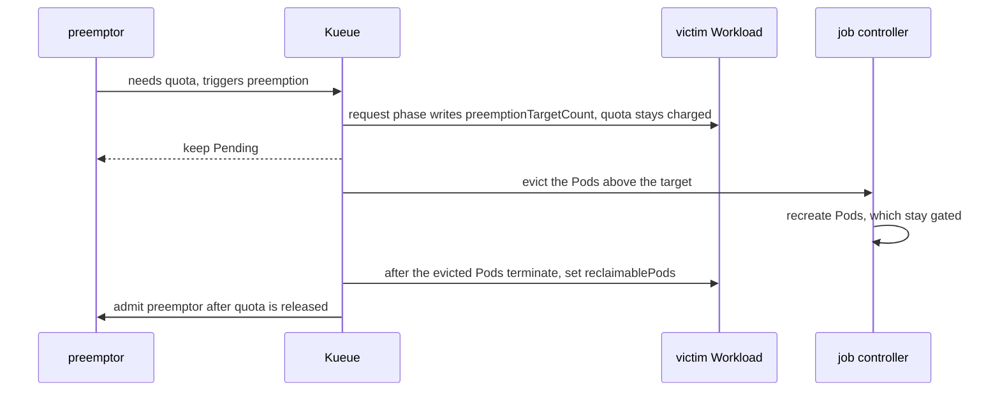
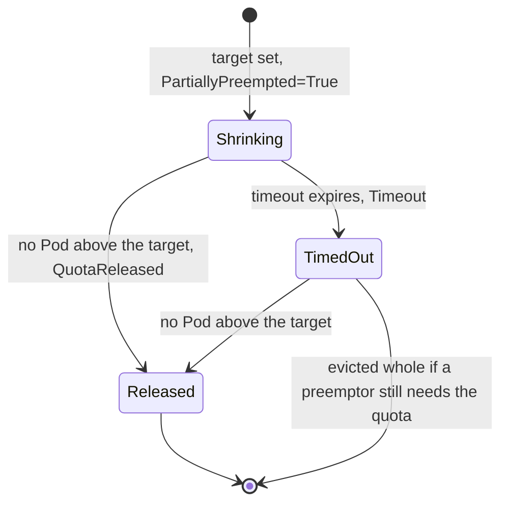

# KEP-975: Partial Preemption of Elastic Workloads

<!-- toc -->
- [Summary](#summary)
- [Motivation](#motivation)
  - [Goals](#goals)
  - [Non-Goals](#non-goals)
- [Proposal](#proposal)
  - [User Stories](#user-stories)
    - [Story 1: Preempting a Spark application loses all of its executors](#story-1-preempting-a-spark-application-loses-all-of-its-executors)
    - [Story 2: Preempting a Ray cluster also removes its baseline workers](#story-2-preempting-a-ray-cluster-also-removes-its-baseline-workers)
    - [Story 3: Preempting an interactive Ray cluster loses the user's notebook session](#story-3-preempting-an-interactive-ray-cluster-loses-the-users-notebook-session)
    - [Story 4: Reclaiming GPU workers restarts a continuous Ray Data pipeline](#story-4-reclaiming-gpu-workers-restarts-a-continuous-ray-data-pipeline)
  - [Notes/Constraints/Caveats](#notesconstraintscaveats)
  - [Risks and Mitigations](#risks-and-mitigations)
- [Design Details](#design-details)
  - [Two-phase model: request != release](#two-phase-model-request--release)
  - [Workload API](#workload-api)
  - [Opt-in annotation](#opt-in-annotation)
  - [PreemptionMinCount](#preemptionmincount)
  - [Scheduler / Preemption](#scheduler--preemption)
    - [Eligibility](#eligibility)
    - [Candidate ordering](#candidate-ordering)
    - [Consuming candidates across rounds](#consuming-candidates-across-rounds)
    - [Target selection](#target-selection)
    - [Issuing preemptions](#issuing-preemptions)
    - [No-fit behavior](#no-fit-behavior)
    - [Example](#example)
  - [Shrinking the PodSet](#shrinking-the-podset)
  - [Growing back](#growing-back)
  - [Timeout](#timeout)
  - [Validation](#validation)
  - [Handling](#handling)
  - [Interactions](#interactions)
  - [Integrations](#integrations)
    - [Ray](#ray)
    - [SparkApplication](#sparkapplication)
  - [Test Plan](#test-plan)
    - [Unit tests](#unit-tests)
    - [Integration tests](#integration-tests)
    - [e2e tests](#e2e-tests)
  - [Graduation Criteria](#graduation-criteria)
    - [Alpha](#alpha)
    - [Beta](#beta)
- [Implementation History](#implementation-history)
- [Drawbacks](#drawbacks)
- [Alternatives](#alternatives)
  - [Kueue mutates the job's replica count directly](#kueue-mutates-the-jobs-replica-count-directly)
  - [Release quota by lowering the admitted count](#release-quota-by-lowering-the-admitted-count)
  - [Store the target in an annotation](#store-the-target-in-an-annotation)
  - [Delete Pods instead of evicting them](#delete-pods-instead-of-evicting-them)
  - [Keep today's candidate order](#keep-todays-candidate-order)
  - [Drain each victim to its floor](#drain-each-victim-to-its-floor)
- [Future Work Ideas](#future-work-ideas)
  - [Proactive downscaling](#proactive-downscaling)
<!-- /toc -->

## Summary

Today Kueue preempts a Workload as a whole: the victim is evicted, `stopJob` suspends it, and all
of its Pods are torn down. For elastic workloads that can run at a reduced size (for example a Spark
application whose executor count can shrink), whole eviction is unnecessarily disruptive.

**Partial Preemption** lets Kueue reclaim quota from an elastic, opted-in Workload by shrinking one
PodSet to a target count, instead of evicting the whole Workload.
Kueue evicts the Pods above the target without changing the job's spec, and keeps the Pods that the
job recreates gated until quota is available again.
The scheduler selects the largest target count that lets the preemptor fit, so it reclaims only the
replicas needed. The victim keeps running at a smaller size; Kueue evicts it whole only when
shrinking cannot free enough quota in time. The feature is alpha and gated by the
`PartialPreemption` feature gate; when the gate is off, behavior is identical to today.

## Motivation

Elastic batch/data workloads (Spark, Ray, and similar) can often continue making progress
with fewer replicas. When a higher-priority Workload needs quota, Kueue's only tool is to evict a
victim entirely. For a long-running elastic job this means killing the driver and every worker,
losing in-flight progress, and paying a full restart — even though releasing a few replicas would
have been enough.

Kueue does not own a job's Pods, but it can evict some of them, as the cluster autoscaler and the
descheduler do. The job's controller then recreates them, and the elastic-job scheduling gate keeps
the new Pods from running until quota is available. Partial preemption builds on this, while keeping
the quota accounting correct throughout.

### Goals

- Provide an opt-in mechanism where preemption of an elastic Workload reclaims quota by removing
  Pods from one of its PodSets, down to no lower than its `preemptionMinCount`, rather than evicting
  the whole Workload.
- Reclaim only as many Pods as the preemptor needs.
- Guarantee no quota over-subscription at any point during the scale-down.
- Work without requiring upstream changes to the Ray and Spark controllers.
- Let a shrunk Workload grow back with partial scale-up (KEP-12100) when quota is available again,
  without introducing a new scale-up mechanism.
- Be fully gated so that, with the gate disabled, there is zero behavioral change.

### Non-Goals

- Kueue does not mutate the parent job's spec (see [Alternatives](#alternatives) for why).
- Kueue does not use the framework's state, such as idle Ray workers, to choose which Pods to
  remove.
- Kueue does not add a graceful shutdown of its own; a removed Pod gets the usual SIGTERM and
  `terminationGracePeriodSeconds`.
- Multi-host Ray worker groups (`numOfHosts > 1`) are not supported, as in partial scale-up
  (KEP-12100): Ray can only reach targets that are multiples of `numOfHosts`.
- Proactive downscaling, where the job's runtime shrinks itself, is not part of this KEP (see
  [Proactive downscaling](#proactive-downscaling)).

## Proposal

Introduce a per-PodSet target, `status.admission.podSetAssignments[].preemptionTargetCount`, that
Kueue writes on an admitted elastic Workload to shrink that PodSet to the target count.
kueue-controller-manager evicts the PodSet's Pods above the target, and keeps the Pods that the
job's controller recreates behind the elastic-job scheduling gate. Once the evicted Pods have
terminated, Kueue counts them as reclaimable, which releases their quota for the preemptor. The job
grows back through the existing elastic scale-up path when quota is available again.

The preemption decision path (both the classical and the Fair Sharing algorithms) is extended so
that an eligible elastic victim is simulated at the selected reduced count in the scheduling
snapshot instead of being removed, and such victims are preferred over whole eviction of
equal-priority peers.

### User Stories

#### Story 1: Preempting a Spark application loses all of its executors

A Spark application with dynamic allocation runs with 20 executors (`minExecutors=2`) in a
low-priority ClusterQueue that is borrowing quota. A high-priority job arrives and needs quota
equivalent to 10 executors. Instead of suspending the whole Spark application or reducing it all the
way to 2 executors, Kueue removes 10 executors. Spark reruns their lost tasks on the remaining
executors and requests replacements, which Kueue keeps gated. Once the removed executors have
terminated, Kueue releases their quota and admits the high-priority job. When quota is available
again, Kueue starts the waiting executors. The Spark application keeps running the entire time.

#### Story 2: Preempting a Ray cluster also removes its baseline workers

A RayCluster runs with two worker groups in a low-priority ClusterQueue with nominal quota and a
borrowing limit. One worker group is baseline capacity, sized to run only using the queue's nominal
quota, with `minReplicas` equal to its size, while the other is a `0..N` scalable group for
opportunistic extra capacity, running 6 workers. A high-priority job arrives and needs the quota of
2 opportunistic workers. Instead of suspending the entire RayCluster, killing the head and all
workers, Kueue sets the opportunistic group's `preemptionTargetCount` to 4, the largest count that
lets the job fit, and evicts that group's 2 newest workers through the Eviction API. KubeRay
recreates them, and Kueue keeps the new Pods gated until quota is available again. Once the 2
evicted workers have terminated, Kueue releases their quota and the high-priority job is admitted.
The RayCluster, including its head and baseline worker group, continues running the entire time.

#### Story 3: Preempting an interactive Ray cluster loses the user's notebook session

A researcher uses a RayCluster as an interactive workspace: a Jupyter notebook runs on the head and submits Ray tasks to GPU workers.
When a higher-priority job needs GPUs, the researcher wants to give back GPU workers, not lose the notebook session.
Partial preemption must never disrupt the head: it runs the notebook server, which must keep running so the researcher can save their development work.

The head requests 8 CPUs and 32 GiB of memory and runs the notebook server.
The GPU worker group uses the Ray autoscaler, and each GPU worker uses a whole 8-GPU node.
The RayCluster opts in to partial preemption and sets `minReplicas: 0` on the GPU worker group.
It runs at a lower priority than production jobs in the same ClusterQueue, `research`; CPU and memory quota are not a constraint in this example:

| `research`              |                                            |
|-------------------------|--------------------------------------------|
| GPU `nominalQuota`      | 64                                         |
| `withinClusterQueue`    | `LowerPriority`                            |
| WorkloadPriorityClasses | `interactive` (100), `production` (1000)   |

1. The RayCluster runs at priority `interactive` with its head and 4 GPU workers (32 GPUs).
   A production fine-tuning job uses the other 32 GPUs.
2. A second production job needs 16 GPUs.
   Kueue removes 2 of its GPU workers; the head keeps running.
3. The two GPU worker Pods terminate, and KubeRay recreates them; Kueue keeps the new Pods waiting until quota is available.
   The notebook kernel and the results it has already collected are kept, and Ray recomputes task results that were stored only on the removed workers.
4. When the fine-tuning job finishes, Kueue starts the 2 waiting GPU workers.

Currently, Kueue suspends the whole RayCluster in step 2.
KubeRay deletes the head with the workers, so the notebook server goes down, unsaved work is lost, and so is everything in the kernel's memory.
Evicting the whole RayCluster gracefully would not save the session either.
A grace period lets the researcher's code write files or a checkpoint, but the kernel's memory, the objects in Ray's object store and the processes the researcher started are still lost, and the environment has to be rebuilt.
It also takes more than the job needs: the RayCluster is requeued with 4 GPU workers and cannot start again until 32 GPUs are free, although it could keep running on 16.
With partial preemption, the researcher loses only the tasks that ran on the 2 removed workers, and the session keeps running.

#### Story 4: Reclaiming GPU workers restarts a continuous Ray Data pipeline

A team runs a continuous Ray Data pipeline as a RayJob and wants it to use whatever GPU quota is spare in its Cohort.
When part of that quota is reclaimed, the Ray cluster and the pipeline should keep running with fewer GPU workers.

The pipeline reads from an unbounded source, so it never completes and never releases its quota on its own.
The Ray cluster has a CPU-only head, requesting 16 CPUs and 64 GiB of memory, and one worker group of GPU Pods.
Each GPU worker uses a whole 8-GPU node, and the GPU worker group sets `minReplicas: 1`.
The RayJob opts in to partial preemption.
Its ClusterQueue, `data`, has no GPU nominal quota; every GPU the RayJob uses is borrowed.
It shares a Cohort with `training`, which owns 16 GPU nodes; CPU and memory quota are not a constraint in this example:

|                       | `data`  | `training` |
|-----------------------|--------:|-----------:|
| GPU `nominalQuota`    | 0       | 128        |
| `reclaimWithinCohort` | `Never` | `Any`      |

1. While `training` is idle, the RayJob runs with its head and 16 GPU workers (128 GPUs).
2. A 12-node training job in `training` needs 96 GPUs.
   Kueue removes 12 of the 16 GPU workers; the head keeps running.
3. A 4-node evaluation job in `training` needs the remaining 32 GPUs.
   Removing every GPU worker would leave the head running with nothing to do, so Kueue evicts the whole RayJob, as it does today.

Some pipelines keep state on the head that is expensive to rebuild, such as the driver's progress through the source.
For those pipelines, the GPU worker group sets `minReplicas: 0`.
In step 3, Kueue then removes the last 4 GPU workers instead: processing pauses, and the head keeps running until Kueue can start the waiting workers again.

Currently, Kueue suspends the whole RayJob in step 2.
KubeRay deletes the Ray cluster, and when the RayJob is admitted again, the cluster is recreated and the pipeline restarts from its last persisted progress.

### Notes/Constraints/Caveats

- `preemptionTargetCount` is owned by Kueue and is not a user-set field. An in-flight target is
  reused until the Pods above it are gone; a later preemption may then lower it, but never raises
  it.
- Workloads with gang semantics, such as Spark barrier stages, MPI or non-elastic distributed
  training, should not opt in, or should set their floor to the gang size.

### Risks and Mitigations

- **Over-subscription window.** Releasing quota when Kueue evicts the Pods would let the preemptor
  and the still-terminating Pods overlap. Mitigated by the [two-phase
  model](#two-phase-model-request--release): quota is released only after no Pod above the target is
  left.
- **Pods that don't go away.** A PodDisruptionBudget can refuse an eviction, and a Pod can stay
  terminating. The preemptor then waits until [`partialPreemption.timeout`](#timeout) expires, after
  which the victim is evicted whole.
- **Lost work on removed Pods.** An evicted Pod loses its running tasks and in-memory state. Spark
  executors with decommissioning, and Ray workers on Ray 2.57 or later, drain on SIGTERM within the
  termination grace period. Users protect the rest with the floor.
- **Churn with autoscalers.** The job's controller or autoscaler recreates removed Pods right away.
  The replacements stay gated and use no quota, but they add Pods and API writes.
- **Users who opt in.** Opting in only makes the user's own Workload easier to shrink. The target
  lives in `status.admission`, so a user who can edit a Workload but not its status cannot make
  kueue-controller-manager evict Pods. The extra scheduler work is bounded (see [Target
  selection](#target-selection)).
- **A victim can push its loss onto other Workloads.** A victim with a low max-reclaimed-count gives
  up fewer Pods per round, so uncapped peers in the same segment lose more first.
- **Downgrade.** Older versions ungate up to the admitted count, so a shrunk Workload can over-use
  quota. Before downgrading, turn the gate off and wait until no Workload has
  `preemptionTargetCount`, or evict those Workloads.
- **New permission.** kueue-controller-manager needs `create` on `pods/eviction`. It already has
  `delete` on Pods.
- **Feature isolation.** All behavior is behind the `PartialPreemption` gate; when off, the
  preemption path is the existing one.

## Design Details

### Two-phase model: request != release

The target and the quota release are intentionally decoupled to avoid any over-subscription window:

- **request:** Kueue writes the selected `preemptionTargetCount` on the victim's admission and
  evicts the Pods above it (see [Shrinking the PodSet](#shrinking-the-podset)). It does **not**
  change `status.admission` otherwise and does **not** release quota.
- **release:** Once no Pod above the target is left, including terminating ones, Kueue sets the
  PodSet's entry in `status.reclaimablePods` to `max(0, spec count - preemptionTargetCount)`. Kueue
  already subtracts reclaimable Pods from a Workload's usage
  ([KEP-78](/keps/78-dynamically-reclaiming-resources)), so this releases their quota.



### Workload API

Add an optional, integration-set field to `PodSet`, and an optional, Kueue-owned field to
`PodSetAssignment`:

```go
type PodSet struct {
    // ...

    // preemptionMinCount is the lowest count partial preemption may shrink this PodSet to.
    // If unset, partial preemption does not shrink this PodSet. The job integration sets it
    // from the job's own minimum (see PreemptionMinCount in the KEP).
    // This is an alpha field and requires enabling the PartialPreemption feature gate.
    //
    // +optional
    // +kubebuilder:validation:Minimum=0
    PreemptionMinCount *int32 `json:"preemptionMinCount,omitempty"`
}

type PodSetAssignment struct {
    // ...

    // preemptionTargetCount is the count that partial preemption shrinks this PodSet to.
    // While it is set, Kueue evicts the PodSet's Pods above it and does not ungate Pods above it.
    // After the evicted Pods terminate, Kueue releases their quota through status.reclaimablePods.
    // count and resourceUsage do not change. Only Kueue sets this field. Unset means that
    // partial preemption has not shrunk this PodSet.
    // This is an alpha field and requires enabling the PartialPreemption feature gate.
    //
    // +optional
    // +kubebuilder:validation:Minimum=0
    PreemptionTargetCount *int32 `json:"preemptionTargetCount,omitempty"`
}
```

### Opt-in annotation

A job opts in with the annotation `kueue.x-k8s.io/partial-preemption: "true"`, next to
`kueue.x-k8s.io/elastic-job: "true"`, which partial preemption requires. kueue-controller-manager
copies it to the Workload, so the scheduler only needs to look at the Workload. Reviewing it as an
API field is a Beta criterion.

### PreemptionMinCount

The scale-down floor is its own field, `PodSet.preemptionMinCount`, set by the job integration
rather than reused from `minCount`. A PodSet may be eligible for partial admission, partial
preemption, both, or neither, independently, and a framework may legitimately want different floors
for each (for example, a Ray worker group admitted down to 0 replicas but only ever preempted down
to 4).

Users set the floor through the job's own minimum, which the integration copies:

| Integration | PodSet | `preemptionMinCount` |
|---|---|---|
| RayCluster, RayJob, RayService | each worker group with `numOfHosts` of 1 | `minReplicas`, 0 if unset |
| SparkApplication | executors, with `spec.dynamicAllocation.enabled` | `minExecutors`, or `spec.executor.instances` if unset |

The Ray head, the RayJob submitter and the Spark driver never get a floor, so they never shrink.

### Scheduler / Preemption

Whole eviction picks candidates in one pass: order them, then evict in order until the preemptor
fits. Partial preemption keeps that shape but splits the decision into three stages, because a
candidate is no longer "evict or not" but "shrink by how much":

1. **Ordering** — produce a total order over the candidates ([Candidate ordering](#candidate-ordering)).
2. **Consumption** — walk that order, possibly over several rounds, so one victim can be shrunk
   incrementally and several victims can accumulate reductions ([Consuming candidates across
   rounds](#consuming-candidates-across-rounds)).
3. **Target selection** — for each visited candidate, decide the target count for this round
   ([Target selection](#target-selection)).

With the `PartialPreemption` gate off, all three collapse to today's single forward pass that evicts
whole candidates in order, so there is no behavioral change.

#### Eligibility

A candidate is eligible for partial preemption when the `PartialPreemption` gate is enabled, the
Workload carries the opt-in annotation with value `"true"` and is elastic, and exactly one PodSet
has an effective used count above its `preemptionMinCount`. That PodSet must not have a topology
assignment. Otherwise the candidate falls back to whole eviction; shrinking several PodSets is a
Beta criterion. The used count comes from the Workload's usage; an existing lower
`preemptionTargetCount` is used as the effective count for simulation.

#### Candidate ordering

Partial preemption adds three criteria to the existing candidate comparator:

1. **Resume an in-flight reduction first.** A candidate whose current count is still above an
   in-flight `preemptionTargetCount` sorts just after already-evicting candidates, so a reduction
   already in progress is resumed before a fresh victim is picked. This is what keeps the scheduler
   from spreading reductions across new victims while an earlier target is still converging (see
   [Consuming candidates across rounds](#consuming-candidates-across-rounds)).
2. **Prefer shrinking over evicting.** Once priority ties, an eligible partial-preemptible candidate
   is preferred over a whole-eviction-only one, because shrinking a PodSet is cheaper than evicting a
   whole Workload.
3. **Among partial peers, prefer the one that can give back more.** The tie-break key is how far the
   candidate's effective used count exceeds its `preemptionMinCount` (capped by any in-flight
   `preemptionTargetCount`) — the number of replicas it can still shed — not the raw used count.
   Because this key is recomputed each scheduling cycle, a victim that was already shrunk falls
   behind its peers, so repeated rounds rotate across candidates and spread the reduction instead of
   repeatedly hitting the same Workload.

With the gate off, these fields are all false/0, so the order is identical to today's.

#### Consuming candidates across rounds

The preemptor simulates preempting candidates in the order above and stops as soon as it fits. Whole
eviction needs only a single forward pass, since each candidate is removed in full. A partial
candidate, by contrast, may only be shrunk partway toward its floor in one visit, so one pass is not
always enough even when enough quota could eventually be reclaimed. Partial preemption therefore
lets the scheduler re-walk the still-reducible partial candidates over additional rounds, deepening
their reductions until the preemptor fits or no candidate can shed further.

**Why 6 segments.** In whole-eviction preemption each visited candidate gives up all of its quota,
so a single pass is always enough. With partial preemption a candidate may give up only part of its
quota, which creates a risk: a partial candidate visited early might contribute just a fraction of
what is needed, increasing the chance that the preemptor ends up reaching higher-priority or
non-hierarchy candidates that should have been avoided. The segment layout addresses this by grouping
candidates so that the ones the scheduler should prefer are exhausted first, before crossing into
groups that carry a higher disruption cost.

**Candidate groups and the 6-segment layout.** The iterator arranges candidates into six ordered
segments:

1. Evicted / shrinking candidates with hierarchical advantage
2. Evicted / shrinking candidates with priority advantage (lower-priority, same cohort)
3. Evicted / shrinking candidates from the same queue
4. Non-evicted candidates with hierarchical advantage
5. Non-evicted candidates with priority advantage
6. Non-evicted candidates from the same queue

Segments 1-3 are walked once in a single leading pass, resuming in-progress reductions before
touching any fresh victim. Segments 4-6 run the multi-round walk. Because candidates are consumed
segment-by-segment, the scheduler fully exhausts one segment before moving to the next — it never
reaches higher-disruption candidates while lower-disruption ones can still contribute. This mirrors
how whole-eviction preemption works, just extended across multiple rounds.

Within each multi-round segment, candidates are ordered by `used - preemptionMinCount` (capped by
any in-flight target), so the one that can shed the most is visited first. This key is recomputed
each cycle, so a victim already shrunk in a prior cycle falls behind its peers and the load spreads
across victims.

The `partialPreemption.enableStrictPriorityPreemption` flag controls whether rounds within a segment
cross priority boundaries. When off (the default), a round walks the entire segment regardless of
priority, spreading the reduction across all priorities and avoiding over-reducing a single
low-priority victim. When on, a round is bounded to the priority of the first candidate returned and
only advances to higher-priority candidates once the lower-priority ones in the segment are
exhausted.

With the gate off the walk degenerates to the single forward pass of today's whole-eviction
preemption, and the segment layout and `enableStrictPriorityPreemption` have no effect.

#### Target selection

If the candidate has an in-flight `preemptionTargetCount` from a previous scheduling cycle and the
current used count is still above it, target selection reuses that target directly and skips the
window calculation below. This is the target-selection counterpart to ordering criterion 1 and the
leading-round consumption of in-flight candidates: the same target is consistently pursued across
cycles until the Pods above it are gone.

Otherwise, target selection decides how far to shrink the PodSet this round, within a
`[minTargetCount, maxTargetCount]` window:

- `maxTargetCount` (least reduction) is `used - 1`.
- `minTargetCount` (most reduction) is the PodSet's `preemptionMinCount`. The optional
  `kueue.x-k8s.io/partial-preemption-max-reclaimed-count` annotation raises it to
  `used - maxReclaimedCount`, limiting how many replicas a single round may reclaim. The scheduler
  then visits the candidate in later rounds, deepening the target by up to `maxReclaimedCount` each
  time, until the preemptor fits or `preemptionMinCount` is reached.

The scheduler binary-searches the `[minTargetCount, maxTargetCount]` window for the largest target
count that makes the preemptor fit, so it reclaims only the replicas needed. This adds at most
`ceil(log2(maxTargetCount - minTargetCount + 2))` fit simulations per candidate visit. With the
max-reclaimed-count annotation, a candidate is visited at most
`ceil((used - preemptionMinCount) / maxReclaimedCount)` times. If the
candidate alone is insufficient, it is reduced to `minTargetCount`, later candidates contribute, and
reductions accumulate across victims and rounds. A candidate that has reached its floor can later be
handled as a normal whole-eviction candidate.

Setting the max-reclaimed-count annotation to 1 takes at most one Pod from each victim per round,
which spreads the loss across victims.

#### Issuing preemptions

For a partial target, Kueue does **not** evict the Workload or call `stopJob`. It patches the
victim's admission status to set `preemptionTargetCount`, and sets the `PartiallyPreempted`
condition to `True`. Its reason and message are the same as for the `Preempted` condition, plus the
PodSet and target count. Kueue emits a `PartiallyPreempted` event on the victim and a
`PreemptedWorkload` event on the preemptor, and increments
`kueue_partially_preempted_workloads_total`. Quota is not released here (that is the release phase
of the two-phase model).

#### No-fit behavior

Partial targets are issued only when the resulting target set makes the preemptor fit. If the
preemptor still does not fit, tentative partial and whole-eviction targets are discarded, no
preemption is issued, and the preemptor remains `Pending` for a later scheduling cycle.

#### Example

All victims below belong to the same ClusterQueue as the arriving preemptor, so they all fall in
the same-queue segment; no hierarchical or cross-queue priority advantage applies, and the ordering
shown below is the priority tie-break within that single segment.

The ClusterQueue is fully used by three partial-preemptible victims: `L1` and `L2` at low priority
and `H` at medium priority. `L1` can shed 4 executors above its `preemptionMinCount`, and `L2` can
shed 3. A higher-priority preemptor arrives, `enableStrictPriorityPreemption` is on, and each
victim's annotation caps a single round's reduction at a max-reclaimed-count of 2. The three stages
interact as follows:

1. **Ordering** puts the low-priority band `{L1, L2}` ahead of `H`; within the band the
   shed-count tie-break puts `L1` ahead of `L2`. Order: `L1`, `L2`, then `H`.
2. **Consumption** with `enableStrictPriorityPreemption` on keeps the walk inside the low band, so
   `H` is never considered while `L1`/`L2` can still contribute. Round 1 shrinks `L1` then `L2`, each
   by the per-round cap of 2. If that is still short, `L2` being partial triggers a second round over
   the same band; round 2 returns to `L1` first (its reclaimable count is still highest).
3. **Target selection** in round 2 lowers `L1`'s tentative target from round 1 by up to 2, stopping
   at the largest target that makes the preemptor fit.

`H` keeps running untouched. While `L1`/`L2` have in-flight targets whose executors have not yet
exited, ordering criterion 1 keeps them at the front across the scheduling cycles the reduction takes
to converge, so the preemptor resumes the same victims instead of starting new ones.

### Shrinking the PodSet

While a PodSet has a target and Pods above it, kueue-controller-manager's job reconciler shrinks it:

1. It counts the PodSet's Pods that are ungated and not terminal. Gated Pods hold no quota and are
   not counted.
2. It evicts the Pods above the target through the Eviction API, so PodDisruptionBudgets apply and
   the Pods get the `DisruptionTarget` condition. Pods that are already terminating are not evicted
   again. A refused eviction is retried; Kueue does not fall back to a plain delete.
3. It evicts Pods that are not scheduled yet first, then the Pods with the lowest
   `controller.kubernetes.io/pod-deletion-cost`, then the newest.
4. The elastic-job ungater does not ungate Pods above the target, so the Pods that the job's
   controller recreates stay gated.
5. When no Pod above the target is left, including terminating ones, Kueue sets the PodSet's
   `status.reclaimablePods` entry to `max(0, spec count - target)`, and sets `PartiallyPreempted` to
   `False` with reason `QuotaReleased`. The preemptor can now use the quota.

Kueue recomputes the entry when the spec count changes, for example when the Ray autoscaler lowers
`replicas`; the webhook already allows lowering it for a scaled-down PodSet. When the
Workload loses its quota reservation, Kueue removes the entry.

The steps are level-based, so after a kueue-controller-manager restart Kueue evicts only the Pods
still above the target, never a second batch. The job reconciler keeps shrinking the admitted
Workload even while a scale-up slice for the job is pending.

### Growing back

After the release, the Workload runs fewer Pods than its job requests. The target stays set and
keeps capping ungating until the Workload is replaced or finishes. Currently, Kueue creates a
scale-up slice only when the job's count exceeds the Workload's count or its admitted count. Kueue
also creates one after the release, and partial scale-up (KEP-12100) uses the count after the
release as its baseline. The job then grows back through `ElasticJobsViaWorkloadSlices`: with the
`partial` scale-up strategy as quota frees, otherwise once its whole size fits.

- While Pods above a target are still running, the scheduler does not admit a scale-up slice for
  that job.
- The scale-up slice competes for quota like a requeued whole-eviction victim today. It cannot
  preempt the preemptor, which had priority or hierarchical advantage over the victim, and with
  `PrioritizePreemptorWorkloads` the scheduler considers the waiting preemptor first.
- A later partial preemption may lower the target of the admitted Workload again.

### Timeout

Kueue starts the clock when it sets the `PartiallyPreempted` condition to `True`. Lowering the
target later does not restart it, and the timeout never expires before the evicted Pods' longest
`terminationGracePeriodSeconds` has passed. If Pods above the target are still present when
`partialPreemption.timeout` expires, Kueue sets the condition to `False` with reason `Timeout`, and
the scheduler treats the victim as a whole-eviction candidate. If a preemptor still needs the quota,
the victim is then evicted as today, with the usual `Preempted` and `Evicted` conditions. Otherwise
Kueue keeps shrinking, and still releases the quota once the Pods are gone.



The timeout and the strict-priority flag live in the Configuration API:

```go
type Configuration struct {
    // ...

    // partialPreemption configures partial preemption.
    // It requires the PartialPreemption feature gate.
    // +optional
    PartialPreemption *PartialPreemption `json:"partialPreemption,omitempty"`
}

type PartialPreemption struct {
    // timeout is how long Kueue waits for the Pods above a PodSet's preemptionTargetCount to
    // terminate. After it expires, the victim can be evicted whole. Kueue always waits at least
    // the Pods' terminationGracePeriodSeconds. Defaults to 5m.
    // +optional
    Timeout *metav1.Duration `json:"timeout,omitempty"`

    // enableStrictPriorityPreemption bounds each round of partial preemption to the priority of
    // its first candidate. Defaults to false.
    // +optional
    EnableStrictPriorityPreemption *bool `json:"enableStrictPriorityPreemption,omitempty"`
}
```

### Validation

`preemptionTargetCount` lives under `status.admission`, which is otherwise immutable after
admission. The Workload webhook makes one exception for it. Kueue's webhooks reject:

- adding or changing `preemptionMinCount` or `preemptionTargetCount` while the `PartialPreemption`
  gate is off; with the gate off, integrations neither set `preemptionMinCount` nor copy the opt-in
  annotation;
- `preemptionMinCount` above the PodSet's count, or any change to it;
- `preemptionTargetCount` below the PodSet's `preemptionMinCount` or at or above the assignment's
  `count`, on a PodSet without `preemptionMinCount`, or raised;
- any other change to `status.admission`: `count`, `flavors` and `resourceUsage` stay immutable;
- `kueue.x-k8s.io/partial-preemption` other than `"true"` or `"false"`,
  `kueue.x-k8s.io/partial-preemption-max-reclaimed-count` other than a positive integer, and changes
  to either while the Workload holds quota.

Configuration validation rejects a `partialPreemption.timeout` that is not positive. The
`PartialPreemption` gate depends on `ElasticJobsViaWorkloadSlices` and `ReclaimablePods`.

### Handling

- **Target set:** the user sees the `PartiallyPreempted` condition and event on the victim, a
  `PreemptedWorkload` event on the preemptor, and `kueue_partially_preempted_workloads_total`, with
  the same labels as `kueue_preempted_workloads_total`.
- **Quota released:** `PartiallyPreempted` is `False` with reason `QuotaReleased`, and
  `status.reclaimablePods` shows the released Pods.
- **Timeout:** `PartiallyPreempted` is `False` with reason `Timeout`; see [Timeout](#timeout).
- **`preemptionMinCount` unset or equal to the PodSet's count:** the PodSet is never shrunk.
- **Gate turned off while a target is set:** Kueue stops setting targets and evicting Pods. It keeps
  honoring targets already set: the ungater still caps at them, the release still happens once the
  Pods above them are gone, and the scale-up slice is still created after it. So turning the gate
  off never over-uses quota.
- **Downgrade:** see [Risks and Mitigations](#risks-and-mitigations).

### Interactions

| Feature | What changes |
|---|---|
| `ElasticJobsViaWorkloadSlices` | Required. Partial preemption uses its scheduling gate and scale-up slices. |
| `ElasticJobsViaWorkloadSlicesWithPartialReplicaScaleUp` | Optional. With the `partial` strategy, a shrunk job grows back as quota frees. |
| `ReclaimablePods` | Required; it releases the quota. The Alpha integrations do not report reclaimable Pods themselves. |
| `PartialAdmission` | Independent: `minCount` bounds admission, `preemptionMinCount` bounds shrinking. |
| `WaitForPodsReady` | A shrink keeps the Alpha integrations' Workloads ready; see [Integrations](#integrations). |
| `PrioritizePreemptorWorkloads` | Recommended, so the waiting preemptor is considered before the victim's scale-up slice. |
| `ConfigurablePreemptions` | In Alpha, victims selected by a `PreemptionConfig` rule are evicted whole. Shrinking them is a Beta criterion. |
| Fair Sharing | The fair-sharing strategies simulate the victim at its target count, as classical preemption does. |
| `PriorityBoost` | No change: candidate ordering uses the effective priority. |
| Preemption limits (KEP-16925, proposed) | A shrink counts as one preemption of the victim. |
| Topology-Aware Scheduling | In Alpha, a PodSet with a topology assignment is not eligible. |
| MultiKueue | Not supported in Alpha: a Workload dispatched by MultiKueue is evicted whole. |
| `ElasticJobsViaWorkloadSlicesForProvisioningRequests` | No change for the shrink. The scale-up slice requests only the increment, as for any scale-up. |

### Integrations

Alpha covers RayCluster, RayJob, RayService and SparkApplication: the integrations that support
`ElasticJobsViaWorkloadSlices` and whose own controller recreates removed Pods. An integration
copies the opt-in annotation and sets the floors (see [PreemptionMinCount](#preemptionmincount));
Kueue never creates Pods.

batch/Job is not covered in Alpha. A Pod that Kueue evicts counts toward `backoffLimit` unless the
Job's `podFailurePolicy` ignores the `DisruptionTarget` condition, and a Pod that exits 0 on SIGTERM
counts as a completion. Covering batch/Job, JobSet and the other elastic integrations is a Beta
criterion; for batch/Job, [proactive downscaling](#proactive-downscaling) may fit better.

#### Ray

- For a RayService, Kueue shrinks the active RayCluster.
- Kueue does not write `replicas`, `minReplicas`, `maxReplicas` or `workersToDelete`. KubeRay
  recreates an evicted worker once it is gone, with or without the Ray autoscaler, and the
  replacement inherits the elastic-job gate.
- The Ray autoscaler stops counting an evicted worker once it is terminating, and does not write the
  RayCluster for it. It counts a gated replacement as capacity, and after
  `RAY_AUTOSCALER_RECONCILE_ALLOCATE_STATUS_TIMEOUT_S` (default 1 hour) deletes it and lowers
  `replicas`. Users whose replacements may wait longer raise that timeout.
- From Ray 2.57, `ray start --block` drains the worker on SIGTERM for up to
  `RAY_GRACEFUL_SHUTDOWN_DRAIN_TIMEOUT_S` (default 30s): it takes no new work and exits when idle.
  The default termination grace period is also 30s, so users set the grace period above the drain
  timeout. Objects stored only on the removed worker are lost and are rebuilt from lineage.
- A lost worker fails a RayJob only if the Ray application fails, as today.
- The Workload stays ready: RayCluster and RayService readiness follows the head Pod or the Serve
  endpoints, and RayJob readiness follows the RayCluster state, which KubeRay resets only on
  suspend.

#### SparkApplication

- Requires the `ElasticJobsViaWorkloadSlicesForSparkApplication` gate.
- An evicted executor ends as deleted, not failed, so it does not count toward
  `spark.executor.maxNumFailures` or `spark.task.maxFailures`. Spark reruns its tasks on the
  remaining executors.
- The driver requests a replacement once the evicted Pod is terminal. Replacements stay gated and
  still count toward the executor PodSet's requested size, so the job grows back through a scale-up
  slice. `spark.kubernetes.allocation.maxPendingPods` bounds how many the driver keeps.
- With `spark.decommission.enabled` (Spark 3.1 or later, and an image with `/opt/decom.sh`), an
  evicted executor stops taking tasks, and with `spark.storage.decommission.enabled` it migrates its
  shuffle and cached blocks before it exits, within its termination grace period. Kueue does not set
  these; the docs recommend them.
- Without block migration, repeated shrinks during one shuffle stage can cause fetch failures that
  abort the stage after `spark.stage.maxConsecutiveAttempts` (default 4).
- Spark rejects barrier stages with dynamic allocation, so an elastic SparkApplication is not a gang
  workload.
- PodsReady expects the driver and as many running executors as the floor, so a shrink to the floor
  keeps the Workload ready.

### Test Plan

[X] I/we understand the owners of the involved components may require updates to existing tests to
make this code solid enough prior to committing the changes necessary to implement this enhancement.

#### Unit tests

- Target selection: the binary search, the max-reclaimed-count annotation and the floor.
- Eligibility, candidate ordering and the segments.
- Which Pods are evicted: deletion cost, unscheduled, newest; gated and terminating Pods are
  skipped.
- The ungater cap at the target, and the release condition.
- Webhook validation of the new fields and annotations, with the gate on and off.

#### Integration tests

- A preemptor stays pending until the evicted Pods terminate, and is then admitted.
- Replacements stay gated; the scale-up slice is created after the release and grows the job back.
- A PodDisruptionBudget refuses the eviction; the timeout evicts the victim whole.
- A kueue-controller-manager restart during a shrink does not evict a second batch.
- A scale-up slice that is pending when the shrink starts.
- The spec count drops after the release, and the Workload is evicted whole after it;
  `status.reclaimablePods` follows both.
- The gate is turned off with a target set.
- WaitForPodsReady does not evict a shrunk Workload.

#### e2e tests

- RayJob and RayCluster, with and without the Ray autoscaler: shrink, release and grow back, with
  the same head Pod. The evicted worker's SIGTERM drain runs.
- SparkApplication with dynamic allocation and decommissioning: shrink and grow back without
  restarting the driver.

### Graduation Criteria

#### Alpha

- The `PartialPreemption` feature gate, disabled by default.
- Reactive downscaling for RayCluster, RayJob, RayService and SparkApplication.
- The tests in the Test Plan.
- Docs on opting in, setting the floor and the timeout, and the recommended Ray and Spark settings.

#### Beta

- The gate is enabled by default, and all reported bugs are fixed.
- Shrink more than one PodSet per Workload.
- Support PodSets with a topology assignment, and MultiKueue.
- Shrink victims selected by `PreemptionConfig` rules.
- Cover batch/Job and the other elastic integrations.
- Review the opt-in and max-reclaimed-count annotations as API fields.
- Decide on proactive downscaling, with user feedback.

## Implementation History

- 2026-08-18: KEP created; downstream proof-of-concept implemented and validated end-to-end with
  Spark on Kubernetes (feature gate `PartialPreemption`, `reclaimTargetCount` field, preemption
  path, webhook, and jobframework annotation propagation).
- 2026-10-22: proactive proof of concept for batch/Job (#14590) and reactive proof of concept for
  RayJob and SparkApplication (#17484).
- 2026-10-27: reviewers agree on reactive downscaling as the default.
- 2026-11-02: KEP describes reactive downscaling end to end; fields renamed to `preemptionMinCount`
  and `preemptionTargetCount`.

## Drawbacks

- Adds a new admission-status field and a new decision branch to both preemption algorithms,
  increasing the surface area of the preemption code.
- Kueue evicts Pods that it does not own. The job's controller sees them disappear and recreates
  them, which costs Pod churn.

## Alternatives

### Kueue mutates the job's replica count directly

Kueue's jobframework could patch the job's `spec` replica count (e.g. `spec.count`) directly. This
needs no third-party code changes, but it violates the ownership convention — Kueue should not mutate
a job's spec — and is fragile across frameworks.
For Ray, none of the fields works cleanly. With the autoscaler on, KubeRay does not delete Pods when
`replicas` drops, and the autoscaler resets it. Lowering `maxReplicas` means Kueue must restore the
user's value later, which breaks if Kueue loses track. `workersToDelete` belongs to the autoscaler,
which refuses new deletions while some are pending.

### Release quota by lowering the admitted count

Kueue could lower `status.admission.podSetAssignments[].count` after the Pods terminate. That needs
a webhook exception for `count` and `resourceUsage`, and changes the admission record that flavor
and topology assignments refer to. `status.reclaimablePods` already lowers usage without touching
admission.

### Store the target in an annotation

Any user who can edit the Workload could then make kueue-controller-manager evict Pods, and the
value cannot be validated like a status field.

### Delete Pods instead of evicting them

A plain delete skips PodDisruptionBudgets and sets no `DisruptionTarget` condition, so a Job's
`podFailurePolicy` cannot tell a removed Pod from a failure.

### Keep today's candidate order

Partial preemption could keep today's candidate order and only shrink the victims it picks, instead
of evicting them. The KEP adds ordering criteria because shrinking is cheaper than evicting an
equal-priority peer, and because the fallback to whole eviction can only be decided after the
partial candidates have been tried.

### Drain each victim to its floor

Earlier drafts reduced each victim straight to its floor by default, with the binary search as an
opt-in. That takes more Pods than the preemptor needs, so the binary search is the only mode. A
drain-to-floor mode can be added if users ask for it.

## Future Work Ideas

### Proactive downscaling

In proactive downscaling, the job's runtime shrinks itself to `preemptionTargetCount`: for example,
a Kueue-aware Spark driver lowers its executor target, or the batch/Job integration lowers
`parallelism`. The runtime chooses which Pods leave, and quota is released through the existing
elastic scale-down path when the Workload's spec count drops. A framework would opt in per
integration; the scheduler side of this KEP does not change.

We hold off on it because:

- It needs code in each runtime. Upstream Spark has no Kueue-aware executor allocator, a driver
  plugin needs Spark internals, and a new Spark release cannot reach the Spark 3 versions in use.
- Ray has no clean way in (see [Kueue mutates the job's replica count
  directly](#kueue-mutates-the-jobs-replica-count-directly)).
- It adds little for Spark: an evicted executor already decommissions on SIGTERM, the same path that
  a driver-initiated scale-down uses.
- With an autoscaler, a runtime that lowers its own size races with the autoscaler raising it again.
- A second release path doubles the API and test surface before reactive downscaling has user
  feedback.

Its main benefit is choosing which Pods leave. Under reactive downscaling,
`controller.kubernetes.io/pod-deletion-cost` already lets a framework steer that.
