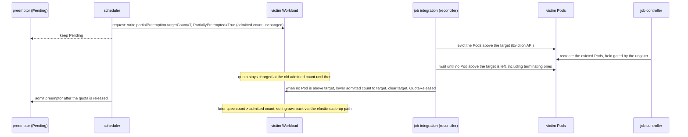

# KEP-975: Partial Preemption of Elastic Workloads

<!-- toc -->
- [Summary](#summary)
- [Motivation](#motivation)
  - [Goals](#goals)
  - [Non-Goals](#non-goals)
- [Proposal](#proposal)
  - [User Stories](#user-stories)
    - [Story 1: Preempting a Spark application loses all of its executors](#story-1-preempting-a-spark-application-loses-all-of-its-executors)
    - [Story 2: Preempting a Ray cluster also removes its baseline workers](#story-2-preempting-a-ray-cluster-also-removes-its-baseline-workers)
    - [Story 3: Preempting an interactive Ray cluster loses the user's notebook session](#story-3-preempting-an-interactive-ray-cluster-loses-the-users-notebook-session)
    - [Story 4: Reclaiming GPU workers restarts a continuous Ray Data pipeline](#story-4-reclaiming-gpu-workers-restarts-a-continuous-ray-data-pipeline)
  - [Notes/Constraints/Caveats](#notesconstraintscaveats)
  - [Risks and Mitigations](#risks-and-mitigations)
- [Design Details](#design-details)
  - [Terminology](#terminology)
  - [Two-phase model: request != release](#two-phase-model-request--release)
  - [Workload API](#workload-api)
  - [Opt-in annotation](#opt-in-annotation)
  - [Partial-preemption minimum](#partial-preemption-minimum)
  - [Scheduler / Preemption](#scheduler--preemption)
    - [Eligibility](#eligibility)
    - [Candidate ordering](#candidate-ordering)
    - [Shrink and evict passes](#shrink-and-evict-passes)
    - [Target selection](#target-selection)
    - [Issuing preemptions](#issuing-preemptions)
    - [No-fit behavior](#no-fit-behavior)
    - [Example](#example)
  - [Shrinking the PodSet](#shrinking-the-podset)
  - [Growing back](#growing-back)
  - [Validation](#validation)
  - [Handling](#handling)
  - [Interactions](#interactions)
  - [Integrations](#integrations)
    - [Ray](#ray)
    - [SparkApplication](#sparkapplication)
  - [Test Plan](#test-plan)
    - [Unit tests](#unit-tests)
    - [Integration tests](#integration-tests)
    - [e2e tests](#e2e-tests)
  - [Graduation Criteria](#graduation-criteria)
    - [Alpha](#alpha)
    - [Beta](#beta)
- [Implementation History](#implementation-history)
- [Drawbacks](#drawbacks)
- [Alternatives](#alternatives)
  - [Kueue mutates the job's replica count directly](#kueue-mutates-the-jobs-replica-count-directly)
  - [Release quota through reclaimablePods](#release-quota-through-reclaimablepods)
  - [Store the target in an annotation](#store-the-target-in-an-annotation)
  - [Delete Pods instead of evicting them](#delete-pods-instead-of-evicting-them)
  - [Drain each victim to its floor](#drain-each-victim-to-its-floor)
- [Future Work Ideas](#future-work-ideas)
<!-- /toc -->

## Summary

Today Kueue preempts a Workload as a whole: the victim is evicted, `stopJob` suspends it, and all
of its Pods are torn down. For elastic workloads that can run at a reduced size (for example a Spark
application whose executor count can shrink), whole eviction is unnecessarily disruptive.

**Partial Preemption** lets Kueue reclaim quota from an elastic, opted-in Workload by shrinking one
PodSet to a target count, instead of evicting the whole Workload.
Kueue evicts the Pods above the target without changing the job's spec, and keeps the Pods that the
job recreates gated until quota is available again.
For each eligible candidate, Alpha first requests a shrink to its configured minimum. If that does
not let the preemptor fit, Kueue proceeds to whole eviction. Fill-back then gives back what the
preemptor doesn't need, so a victim can end above its minimum. The victim keeps running at a
smaller size when shrinking is sufficient.

## Motivation

Elastic batch/data workloads (Spark, Ray, and similar) can often continue making progress
with fewer replicas. When a higher-priority Workload needs quota, Kueue's only tool is to evict a
victim entirely. For a long-running elastic job this means killing the driver and every worker,
losing in-flight progress, and paying a full restart — even though releasing a few replicas would
have been enough.

Kueue does not own a job's Pods, but it can evict some of them, as the cluster autoscaler and the
descheduler do. The job's controller then recreates them, and the elastic-job scheduling gate keeps
the new Pods from running until quota is available. Partial preemption builds on this, while keeping
the quota accounting correct throughout.

### Goals

- Provide an opt-in mechanism where preemption of an elastic Workload reclaims quota by removing
  Pods from its PodSets, down to no lower than their configured partial-preemption minimum, rather
  than evicting the whole Workload.
- Reclaim quota by first shrinking eligible candidates to their configured minimum, then evicting
  candidates whole if more quota is needed.
- Guarantee no quota over-subscription at any point during the scale-down.
- Work without requiring upstream changes to the Ray and Spark controllers.
- Let a shrunk Workload grow back with partial scale-up (KEP-12100) when quota is available again,
  without introducing a new scale-up mechanism.

### Non-Goals

- Kueue does not mutate the parent job's spec (see [Alternatives](#alternatives) for why).
- Kueue does not use the framework's state, such as idle Ray workers, to choose which Pods to
  remove.
- Kueue does not add a graceful shutdown of its own; a removed Pod gets the usual SIGTERM and
  `terminationGracePeriodSeconds`.
- Multi-host Ray worker groups (`numOfHosts > 1`) are not supported, as in partial scale-up
  (KEP-12100): Ray can only reach targets that are multiples of `numOfHosts`.
- Proactive downscaling, where the job's runtime shrinks itself, is not part of this KEP (see
  [Proactive downscaling](FUTURE_WORK.md#proactive-downscaling)).

## Proposal

Add per-PodSet partial-preemption configuration and status to the Workload API. A Job opts in to
partial preemption with `kueue.x-k8s.io/partial-preemption: "true"`; an integration may also set
`kueue.x-k8s.io/podset-partial-preemption-min-count` on the Job's PodTemplate to configure the
minimum for its PodSet. All integrations that configure a partial-preemption minimum use this same
annotation name. Kueue copies the annotation values to the Workload it creates.

For an admitted elastic Workload, Kueue writes an in-progress target to
`status.admission.podSetAssignments[].partialPreemption.targetCount`. The controller evicts the
PodSet's Pods above the target and keeps replacements behind the elastic-job scheduling gate. Once
the evicted Pods have terminated, Kueue lowers the PodSet's admitted count to the target, which
releases their quota for the preemptor. The job grows back through the existing elastic scale-up path
when quota is available again.

In Alpha, the classical preemption decision uses two passes over eligible candidates. In the first
pass, eligible candidates are reduced to their configured `partialPreemption.minCount` in order
until the preemptor fits. If it still does not fit, the second pass whole-evicts candidates. Fill-back
then raises shrunk victims back as far as the preemptor allows. There is no priority-band rule in
Alpha. Fair Sharing support is deferred to Beta.

### User Stories

#### Story 1: Preempting a Spark application loses all of its executors

A Spark application with dynamic allocation runs with 20 executors (`minExecutors=10`) in a
low-priority ClusterQueue that is borrowing quota. The executor PodSet has
`partialPreemption.minCount` set to 10. A high-priority job arrives and needs quota equivalent to 10
executors. Instead of suspending the whole Spark application, Kueue sets the executor PodSet's
`partialPreemption.targetCount` to 10. Spark reruns lost tasks on the remaining executors and requests
replacements, which Kueue keeps gated. Once removed executors have terminated, Kueue releases their
quota and admits the high-priority job. When quota is available again, the waiting executors can
start.

#### Story 2: Preempting a Ray cluster also removes its baseline workers

A RayCluster runs with two worker groups in a low-priority ClusterQueue with nominal quota and a
borrowing limit. One worker group is baseline capacity, sized to run only using the queue's nominal
quota, while the other is a `0..N` scalable group for opportunistic extra capacity, running 6 workers.
The scalable PodSet has `partialPreemption.minCount` set to 4. A high-priority job arrives and needs
the quota of 2 opportunistic workers. Kueue first sets the opportunistic group's
`partialPreemption.targetCount` to 4 and evicts its 2 newest workers through
the Eviction API. KubeRay recreates them, and Kueue keeps the new Pods gated until quota is available
again. Once the 2 evicted workers have terminated, Kueue releases their quota and the high-priority
job is admitted. The RayCluster, including its head and baseline worker group, continues running the
entire time.

#### Story 3: Preempting an interactive Ray cluster loses the user's notebook session

A researcher uses a RayCluster as an interactive workspace: a Jupyter notebook runs on the head and submits Ray tasks to GPU workers.
When a higher-priority job needs GPUs, the researcher wants to give back GPU workers, not lose the notebook session.
Partial preemption must never disrupt the head: it runs the notebook server, which must keep running so the researcher can save their development work.

The head requests 8 CPUs and 32 GiB of memory and runs the notebook server.
The GPU worker group uses the Ray autoscaler, and each GPU worker uses a whole 8-GPU node.
The RayCluster opts in to partial preemption, and the GPU worker PodSet has `partialPreemption.minCount` set to 0.
It runs at a lower priority than production jobs in the same ClusterQueue, `research`; CPU and memory quota are not a constraint in this example:

| `research`              |                                            |
|-------------------------|--------------------------------------------|
| GPU `nominalQuota`      | 64                                         |
| `withinClusterQueue`    | `LowerPriority`                            |
| WorkloadPriorityClasses | `interactive` (100), `production` (1000)   |

1. The RayCluster runs at priority `interactive` with its head and 4 GPU workers (32 GPUs).
   A production fine-tuning job uses the other 32 GPUs.
2. A second production job needs 16 GPUs.
   Kueue first shrinks the GPU worker group to its minimum of 0, which frees 32 GPUs, and fill-back
   then raises it back to 2 workers, so the RayCluster gives up only the 16 GPUs the job needs.
   The head is not shrunk because it has no partial-preemption minimum.
3. The selected GPU worker Pods terminate, and KubeRay recreates them; Kueue keeps replacement Pods
   waiting until quota is available. The notebook kernel and its collected results are kept if the
   head remains running; Ray recomputes task results stored only on removed workers.
4. When quota is available, the waiting GPU workers can start again.

Currently, Kueue suspends the whole RayCluster in step 2.
KubeRay deletes the head with the workers, so the notebook server goes down, unsaved work is lost, and so is everything in the kernel's memory.
Evicting the whole RayCluster gracefully would not save the session either.
A grace period lets the researcher's code write files or a checkpoint, but the kernel's memory, the objects in Ray's object store and the processes the researcher started are still lost, and the environment has to be rebuilt.
It also takes more than the job needs: the RayCluster is requeued with 4 GPU workers and cannot start again until 32 GPUs are free, although it could keep running on 16.
With partial preemption, the researcher loses only the tasks that ran on removed workers, and the session can keep running when the configured minimum allows it.

#### Story 4: Reclaiming GPU workers restarts a continuous Ray Data pipeline

A team runs a continuous Ray Data pipeline as a RayJob and wants it to use whatever GPU quota is spare in its Cohort.
When part of that quota is reclaimed, the Ray cluster and the pipeline should keep running with fewer GPU workers.

The pipeline reads from an unbounded source, so it never completes and never releases its quota on its own.
The Ray cluster has a CPU-only head, requesting 16 CPUs and 64 GiB of memory, and one worker group of GPU Pods.
Each GPU worker uses a whole 8-GPU node, and the GPU worker group sets `minReplicas: 1`.
The RayJob opts in to partial preemption, and the GPU worker PodSet has `partialPreemption.minCount` set to 1.
Its ClusterQueue, `data`, has no GPU nominal quota; every GPU the RayJob uses is borrowed.
It shares a Cohort with `training`, which owns 16 GPU nodes; CPU and memory quota are not a constraint in this example:

|                       | `data`  | `training` |
|-----------------------|--------:|-----------:|
| GPU `nominalQuota`    | 0       | 128        |
| `reclaimWithinCohort` | `Never` | `Any`      |

1. While `training` is idle, the RayJob runs with its head and 16 GPU workers (128 GPUs).
2. A 12-node training job in `training` needs 96 GPUs.
   Kueue shrinks the GPU worker group to its minimum of 1, and fill-back raises it back to 4
   workers, so the RayJob gives up exactly 96 GPUs.
3. A 4-node evaluation job in `training` needs the remaining 32 GPUs.
   Shrinking 4 workers to 1 frees only 24, so Kueue evicts the RayJob whole, as it does today.

Some pipelines keep state on the head that is expensive to rebuild, such as the driver's progress through the source.
For those pipelines, the GPU worker group can set its partial-preemption minimum to 0.
The head remains outside partial-preemption targeting, and Kueue can remove the last GPU worker while keeping the head if the configured minimum is 0.

Currently, Kueue suspends the whole RayJob in step 2.
KubeRay deletes the Ray cluster, and when the RayJob is admitted again, the cluster is recreated and the pipeline restarts from its last persisted progress.

### Notes/Constraints/Caveats

- The victim must opt in, and at least one of its PodSets must have a configured partial-preemption
  minimum below its effective used count (see [Eligibility](#eligibility)); otherwise it is evicted
  whole.
- `partialPreemption.targetCount` is owned by Kueue and is not a user-set field. A later preemption
  may lower a target while it is in flight, but never raises it. Lowering the target does not cancel
  evictions already requested for the previous target: Pods selected under the old target continue
  terminating even if they would not be selected under the new target. Kueue keeps quota charged
  until no Pod above the new target remains, including terminating Pods.
- Workloads with gang semantics, such as Spark barrier stages, MPI or non-elastic distributed
  training, should not opt in, or should set their partial-preemption minimum to the gang size.
- After a shrink, the job's spec still shows its original size, and replacement Pods stay
  `Pending` with the `kueue.x-k8s.io/elastic-job` scheduling gate until quota is available.
- The partial-preemption minimum is configured separately from the framework's own minimum, so it
  can allow Kueue to reclaim more replicas than the framework autoscaler would otherwise remove.
- A preemptor is admitted only after the evicted Pods' termination grace period, and a
  PodDisruptionBudget that blocks evictions keeps it `Pending`.

### Risks and Mitigations

- **Over-subscription window.** Releasing quota when Kueue evicts the Pods would let the preemptor
  and the still-terminating Pods overlap. Mitigated by the [two-phase
  model](#two-phase-model-request--release): quota is released only after no Pod above the target is
  left.
- **Pods that don't go away.** A PodDisruptionBudget can refuse an eviction, and a Pod can stay
  terminating. The preemptor then stays `Pending`. A timeout that evicts the victim whole is
  re-evaluated for Beta (see [Timeout](FUTURE_WORK.md#timeout)).
- **Lost work on removed Pods.** An evicted Pod loses its running tasks and in-memory state. Spark
  executors with decommissioning, and Ray workers on Ray 2.57 or later, drain on SIGTERM within the
  termination grace period. Users protect the rest with the configured minimum.
- **Churn with autoscalers.** The job's controller or autoscaler recreates removed Pods right away.
  The replacements stay gated and use no quota, but they add Pods and API writes.
- **Users who opt in.** Opting in only makes the user's own Workload easier to shrink. The target
  lives in `status.admission`, so a user who can edit a Workload but not its status cannot make
  kueue-controller-manager evict Pods. The extra scheduler work is bounded (see [Target
  selection](#target-selection)).
- **Uneven quota reclamation.** Alpha reduces each selected partial-preemption candidate directly to
  its configured minimum before considering whole eviction. One victim can therefore lose many
  replicas while other eligible victims remain untouched. A future strategy that spreads the
  reduction across candidates is described in [Future Work Ideas](FUTURE_WORK.md#spreading-reductions-across-victims).
- **Regrow can reclaim quota from lower-priority Workloads.** After partial preemption, an elastic
  Workload grows back through its scale-up slice, which can preempt lower-priority Workloads,
  including the ones the shrink spared. The next cycle can then evict a lower-priority Workload
  anyway, and repeated scale-down and regrow can cause quota oscillation. Alpha does not resolve
  this interaction; Beta will define priority-aware coordination between preemption and regrowth.
- **Freed quota is not a freed node.** Kueue picks the Pods to evict without looking at nodes, so it
  can free a little on several nodes. Quota then fits the preemptor, but kube-scheduler may not be
  able to place it. Node-aware Pod selection is future work.
- **Downgrade.** Older versions ungate up to the admitted count, so a shrunk Workload can over-use
  quota. Before downgrading, turn the gate off and wait until no Workload has
  `partialPreemption.targetCount`, or evict those Workloads.
- **New permission.** kueue-controller-manager needs `create` on `pods/eviction`. It already has
  `delete` on Pods.
- **Feature isolation.** All behavior is behind the `PartialPreemption` gate; when off, the
  preemption path is the existing one.

## Design Details

### Terminology

- **Floor** — a PodSet's `partialPreemption.minCount`, the lowest count partial preemption shrinks it to.
- **Target** — a PodSet's `partialPreemption.targetCount`, the count Kueue shrinks it to.
- **In-flight victim** — a preemption candidate with a pending `partialPreemption.targetCount`,
  whose PodSet still has Pods above that target.
- **Request phase** — Kueue sets the target and evicts the Pods above it; quota stays charged.
- **Release phase** — no Pod above the target is left, so Kueue releases their quota by lowering the
  PodSet's admitted count (`status.admission.podSetAssignments[].count`) to the target and clearing
  the target in the same update.
- **Reactive downscaling** — the default. Kueue evicts the Pods and lowers the PodSet's admitted
  count itself; the job's runtime does not shrink itself.
- **Proactive downscaling** — the job's runtime lowers its own spec count to shrink, which the job
  framework must adapt to; it is not the default (see [Proactive
  downscaling](FUTURE_WORK.md#proactive-downscaling)).

### Two-phase model: request != release

The target and the quota release are intentionally decoupled to avoid any over-subscription window:

- **request:** Kueue writes the selected `partialPreemption.targetCount` on the victim's admission,
  stops ungating the PodSet's Pods above it, and evicts the Pods above it (see [Shrinking the
  PodSet](#shrinking-the-podset)). It does **not** change `status.admission` otherwise and does
  **not** release quota.
- **release:** Once no Pod above the target is left, including terminating ones, Kueue lowers the
  PodSet's admitted count (`status.admission.podSetAssignments[].count`, and its `resourceUsage`) to
  the target and clears `partialPreemption.targetCount` in the same update, which releases the quota.
  The admitted count is lowered only after the Pods are gone, never before, so the preemptor is never
  admitted onto quota a victim Pod still holds. The job's spec count is left unchanged, so the
  Workload can grow back (see [Growing back](#growing-back)).



### Workload API

Add an optional, integration-set field to `PodSet`, an optional, Kueue-owned field to
`PodSetAssignment`, and status/configuration structs:

```go
type PodSet struct {
    // ...

    // partialPreemption configures partial preemption of this PodSet, in which
    // Kueue shrinks the PodSet instead of evicting the whole Workload.
    // If unset, Kueue does not shrink this PodSet.
    //
    // This field is alpha-level, and is ignored by Kueue when the
    // PartialPreemption feature gate is disabled.
    //
    // +optional
    PartialPreemption *PodSetPartialPreemption `json:"partialPreemption,omitempty"`
}

// PodSetPartialPreemption configures partial preemption of a PodSet.
type PodSetPartialPreemption struct {
    // minCount is the lowest number of Pods that partial preemption may shrink
    // the PodSet to. It does not stop Kueue from evicting the whole Workload.
    //
    // +required
    // +kubebuilder:validation:Minimum=0
    MinCount *int32 `json:"minCount,omitempty"`
}

type PodSetAssignment struct {
    // ...

    // partialPreemption describes an in-progress partial preemption of this
    // PodSet. Only Kueue sets it. Kueue releases the quota of the Pods in
    // excess of targetCount only after they have terminated: it then lowers
    // count to targetCount and resourceUsage in proportion, and clears this
    // field.
    //
    // This field is alpha-level. Kueue sets it only when the PartialPreemption
    // feature gate is enabled.
    //
    // +optional
    PartialPreemption *PodSetPartialPreemptionStatus `json:"partialPreemption,omitempty"`
}

// PodSetPartialPreemptionStatus describes an in-progress partial preemption of
// a PodSet.
type PodSetPartialPreemptionStatus struct {
    // targetCount is the number of Pods that the PodSet is being shrunk to.
    // It is lower than the assignment's count and not lower than the PodSet's
    // partialPreemption.minCount. Kueue may lower it, but never raises it.
    //
    // +required
    // +kubebuilder:validation:Minimum=0
    TargetCount *int32 `json:"targetCount,omitempty"`
}
```

### Opt-in annotation

A job opts in with `kueue.x-k8s.io/partial-preemption: "true"`, next to
`kueue.x-k8s.io/elastic-job: "true"`, which partial preemption requires. The value must be `"true"`
or `"false"`; only `"true"` opts the Job in. Kueue copies the annotation to the Workload it creates
for the Job, and it cannot be changed while the Workload holds quota. The annotation is alpha-level
and ignored when the `PartialPreemption` feature gate is disabled.

### Partial-preemption minimum

`PodSet.partialPreemption.minCount` sets the lowest number of Pods to which partial preemption may
shrink the PodSet. This minimum is independent of `PodSet.minCount`, which controls partial admission,
and of the framework's autoscaler minimum. It can differ from both.

An integration reads the non-negative integer value of
`kueue.x-k8s.io/podset-partial-preemption-min-count` from the job's PodTemplate and copies it to
`PodSet.partialPreemption.minCount`. All framework integrations use this same annotation name. If the
annotation is absent, the integration does not configure partial preemption for the PodSet. The job
webhook rejects a value that is not a non-negative integer. Kueue copies the value when it creates
a Workload or scale-up slice; a later annotation change applies only to subsequently created
Workloads/slices.

### Scheduler / Preemption

Whole eviction picks candidates in one pass: order them, then evict in order until the preemptor
fits. Partial preemption uses two passes:

1. **Shrink pass** — visit eligible partial-preemption candidates in the existing candidate order,
   set each one's target to its configured `partialPreemption.minCount`, and stop as soon as the
   preemptor fits.
2. **Whole-eviction pass** — if the preemptor still does not fit after the shrink pass, evict
   candidates whole in the existing order until it fits.

This Alpha algorithm description covers classical preemption. If the gate is turned off while a
partial-preemption target is pending, Kueue ignores that target and handles the Workload through the
regular full-eviction path. Fair Sharing support is deferred to Beta. The algorithm makes no
priority-band guarantee: a higher-priority candidate can be partially shrunk before or after a
lower-priority candidate according to the existing ordering and candidate groups.
Flavor assignment runs the same selection through the preemption oracle (`SimulatePreemption`),
which counts a partial target at its reduced usage.

With the `PartialPreemption` gate off, the shrink pass is skipped and today's whole-eviction pass is
used, so there is no behavioral change.

#### Eligibility

A candidate is eligible for partial preemption when the `PartialPreemption` gate is enabled, the
Workload carries the opt-in annotation with value `"true"` and is elastic, and at least one PodSet
has `partialPreemption.minCount` below its effective used count. In Alpha, at most one PodSet per
Workload may be above its configured minimum and therefore be shrinkable; PodSets at or below their
minimum do not count toward this limit. A Workload with multiple shrinkable PodSets is evicted whole
(supporting multiple shrinkable PodSets is a Beta criterion). The shrinkable PodSet must not have a
topology assignment. Otherwise the candidate falls back to whole eviction. The used count comes from
the Workload's usage; an existing lower `partialPreemption.targetCount` is used as the effective
count for simulation. With `waitForPodsReady` enabled, a Workload that has not yet reached PodsReady
is evicted whole rather than shrunk. In Alpha, a Workload with the
`kueue.x-k8s.io/multikueue-origin` label, which MultiKueue dispatched to a worker cluster, is evicted
whole.

#### Candidate ordering

Alpha uses today's candidate ordering. This ordering is independent of partial-preemption cost and
has no priority-band behavior guarantee. A future cost model may compare candidates by priority,
queue relationships, and the amount of quota reclaimed (see [Cost model and candidate ordering](FUTURE_WORK.md#cost-model-and-candidate-ordering)).

#### Shrink and evict passes

Candidates retain the existing candidate groups and order. The scheduler first walks the candidates
that can be partially preempted. Each selected partial-preemption target is set directly to that
PodSet's `partialPreemption.minCount`; it is not incrementally reduced. If these targets do not free
enough quota, the scheduler then walks the candidates again for whole eviction until the preemptor
fits. A candidate whose effective count is already at its minimum is not shrunk again and remains
eligible for whole eviction.

An in-flight victim is considered at its target count in the shrink pass. A later scheduling cycle
may lower that target if needed, but never raises it. Lowering a target does not cancel evictions
already requested for the old target: Pods selected for eviction under that target continue
terminating, even if they would not be selected under the new target. Quota remains charged until no
Pod above the new target remains, including terminating Pods.

#### Target selection

For a selected candidate, the initial target is its configured `partialPreemption.minCount`.
Fill-back may then raise the target of a victim that was shrunk but not evicted, using a binary search 
for the largest count that still lets the preemptor fit, so it takes about log2(count - minCount) fit checks per victim. If shrinking every eligible candidate to its minimum
is insufficient, whole eviction is used for additional quota.

#### Issuing preemptions

For a partial target, Kueue does **not** evict the Workload or call `stopJob`. It patches the
victim's admission status to set `partialPreemption.targetCount`, and sets the `PartiallyPreempted`
condition to `True`. Its reason and message are the same as for the `Preempted` condition, plus the
PodSets and target counts. Kueue emits a `PartiallyPreempted` event on the victim and a
`PreemptedWorkload` event on the preemptor, and increments
`kueue_partially_preempted_workloads_total`. Kueue records the event and the metric only when it
newly sets or lowers the target; a cycle that reuses an unchanged in-flight target does neither.
Quota is not released here (that is the release phase of the two-phase model).

#### No-fit behavior

Partial targets are issued only when the resulting target set makes the preemptor fit. The Kueue
scheduler reuses the existing over-preemption trimming: once it has a target set that frees enough
quota, `fillBackWorkloads` walks the targets in reverse (highest priority first). For each one it
tries reverting it entirely; if the preemptor still fits without it, the victim was not needed and
is dropped. Otherwise, if the victim was shrunk but not evicted, Kueue raises its target to the
largest count that still lets the preemptor fit, without exceeding an existing in-flight victim's
target. A victim evicted whole stays evicted.

If the two passes find no target set that fits, the tentative partial and whole-eviction targets
are discarded and the Kueue scheduler runs today's whole-eviction planner, so partial preemption
never leaves a preemptor `Pending` that whole eviction would admit. The preemptor remains `Pending`
for a later scheduling cycle only if that also fails.

#### Example

`L1` and `H1` are partial-preemption candidates, each with `count=4` and `minCount=2`. `L2` is not
partial-preemptible. Their existing candidate order is `L1`, `L2`, `H1`, and a preemptor needs 5
units of quota. Alpha first prioritizes partial-preemption candidates, so the shrink pass targets both
`L1` and `H1` to 2, regardless of `L2`'s position between them in the existing order. If that is
still insufficient, the whole-eviction pass follows the existing candidate order and evicts `L1`
whole. That reclaims more quota than needed, so fill-back then partially restores `H1` from 2 to 3.
The final result is `L1` evicted, `L2` untouched, and `H1` running with 3 replicas, freeing exactly 5
units in total.

When quota later becomes available, `H1` may grow back. Alpha does not guarantee that this regrowth
will preserve `L2`'s lower-priority allocation: `H1` can reclaim quota currently used by `L2`, which
may then be preempted or shrunk. Preventing this priority-driven quota oscillation is deferred to
Beta.

### Shrinking the PodSet

While a PodSet has a target and Pods above it, kueue-controller-manager's job reconciler shrinks it:

1. It counts the PodSet's Pods that are ungated and not terminal. Gated Pods hold no quota and are
   not counted.
2. It evicts the Pods above the target through the Eviction API, so PodDisruptionBudgets apply and
   the Pods get the `DisruptionTarget` condition. Pods that are already terminating are not evicted
   again. A refused eviction is retried; Kueue does not fall back to a plain delete.
3. It evicts Pods that are not scheduled yet first, then the Pods with the lowest
   `controller.kubernetes.io/pod-deletion-cost`, then the newest.
4. The elastic-job ungater does not ungate Pods above the target, so Pods that the job's controller
   recreates stay gated.
5. When no Pod above the target is left, including terminating ones, Kueue lowers the PodSet's
   admitted count (`count` and `resourceUsage`) to the target, clears
   `partialPreemption.targetCount` in the same update, and sets `PartiallyPreempted` to `False` with
   reason `QuotaReleased`. The preemptor can now use the quota.

Because the release lowers the admitted count rather than reporting reclaimable Pods relative to the
spec count, a later independent spec-count change cannot double-count against the reclaim and
under-count usage.

The steps are level-based, so after a kueue-controller-manager restart Kueue evicts only the Pods
still above the target, never a second batch. The job reconciler keeps shrinking the admitted
Workload even while a scale-up slice for the job is pending.

### Growing back

After the release, the Workload's admitted count is below its job's spec count, and the target is
cleared. Kueue already creates a scale-up slice when the job's spec count exceeds the Workload's
admitted count, so the shrunk Workload grows back through that existing path with no new trigger, and
slicing and `PodsReady` see the real size directly. Partial scale-up (KEP-12100) uses the
post-release admitted count as its baseline. The job then grows back through
`ElasticJobsViaWorkloadSlices`: with the `partial` scale-up strategy as quota frees, otherwise once
its whole size fits.

- While Pods above a target are still running, the Kueue scheduler does not admit a scale-up slice
  for that job.
- The scale-up slice competes for quota like a requeued whole-eviction victim today. Alpha does not
  guarantee that a higher-priority Workload regrowing after a shrink will avoid reclaiming quota
  later used by a lower-priority Workload; repeated shrink and regrow can cause quota oscillation.
  Priority-aware coordination is deferred to Beta.
- A later partial preemption may lower the target of the admitted Workload again.

### Validation

`status.admission` is otherwise immutable after admission. Partial preemption needs two narrow,
gated exceptions: `partialPreemption.targetCount` is mutable, and on the release of a partial
preemption Kueue may lower a PodSet assignment's `count` and `resourceUsage` together (a decrease
only, for elastic Workloads, behind the `PartialPreemption` gate). Kueue's webhooks reject:

- adding or changing partial-preemption fields, or lowering an assignment's `count`, while the
  `PartialPreemption` gate is off; with the gate off, integrations neither set
  `partialPreemption.minCount` nor copy the opt-in annotation;
- any change to `partialPreemption.minCount`; a minimum at or above the PodSet's count means the
  PodSet is never shrunk;
- `partialPreemption.targetCount` below the PodSet's `partialPreemption.minCount` or at or above the
  assignment's `count`, on a PodSet without `partialPreemption.minCount`, or raised;
- raising an assignment's `count`, changing its `flavors`, or any change to `resourceUsage` not in
  proportion to a `count` decrease on a partial-preemption release;
- `kueue.x-k8s.io/partial-preemption` other than `"true"` or `"false"`, and changes to it while the
  Workload holds quota.

The `PartialPreemption` gate depends on `ElasticJobsViaWorkloadSlices`.

### Handling

- **Target set:** the user sees the `PartiallyPreempted` condition and event on the victim, a
  `PreemptedWorkload` event on the preemptor, and `kueue_partially_preempted_workloads_total`, with
  the same labels as `kueue_preempted_workloads_total`.
- **Quota released:** `PartiallyPreempted` is `False` with reason `QuotaReleased`, and the PodSet's
  admitted count (`status.admission`) has been lowered to the target.
- **No minimum configured, or a minimum at or above the PodSet's count:** the PodSet is never shrunk.
- **Gate turned off while a target is set:** Kueue stops setting partial-preemption targets and
  evicting Pods to reach them. The next preemption cycle ignores any remaining target and uses the
  regular full-eviction path for that Workload.
- **Downgrade:** see [Risks and Mitigations](#risks-and-mitigations).

### Interactions

| Feature | What changes |
|---|---|
| `ElasticJobsViaWorkloadSlices` | Required. Partial preemption uses its scheduling gate and scale-up slices. |
| `ElasticJobsViaWorkloadSlicesWithPartialReplicaScaleUp` | Optional. With the `partial` strategy, a shrunk job grows back as quota frees. |
| `ReclaimablePods` | Independent: partial preemption releases quota by lowering the admitted count, not by reporting reclaimable Pods. |
| `PartialAdmission` | Independent: `minCount` bounds admission, `partialPreemption.minCount` bounds shrinking. |
| `WaitForPodsReady` | Partial preemption does not shrink a Workload before it first becomes ready. For count-based readiness, the expected PodSet count is `min(spec.count, admitted.count, partialPreemption.targetCount)`, omitting the target when unset, so shrinking does not trigger a recovery timeout solely because fewer Pods are retained. See [Integrations](#integrations). |
| `PrioritizePreemptorWorkloads` | Recommended, so the waiting preemptor is considered before the victim's scale-up slice. |
| `ConfigurablePreemptions` | In Alpha, victims selected by a `PreemptionConfig` rule are evicted whole. Shrinking them is a Beta criterion. |
| `RecomputeAssignmentUponPreemptionTargetsOverlap` | May be enabled together with `PartialPreemption` in Alpha, but overlap recomputation may use lower quota usage than the victims will actually retain after partial preemption. Full support for their interaction is deferred to Beta (see [Overlap recomputation](FUTURE_WORK.md#overlap-recomputation)). |
| Fair Sharing | Partial preemption support is deferred to Beta. |
| `AdmissionFairSharing` | No change: partial preemption keeps the existing candidate order, including the LocalQueue-usage key. |
| `PriorityBoost` | No change: candidate ordering uses the effective priority. |
| Preemption limits (KEP-16925, proposed) | A shrink counts as one preemption of the victim. |
| Topology-Aware Scheduling | In Alpha, a PodSet with a topology assignment is not eligible, so partial preemption never applies to such a PodSet. |
| MultiKueue | Not supported in Alpha: a worker cluster evicts a Workload with the `kueue.x-k8s.io/multikueue-origin` label whole (see [Eligibility](#eligibility)). Supporting it, including how the manager learns about a release on the worker, is a Beta criterion. |
| `ElasticJobsViaWorkloadSlicesForProvisioningRequests` | No change for the shrink. The scale-up slice requests only the increment, as for any scale-up. |

### Integrations

Alpha covers batch/Job, RayCluster, RayJob, RayService and SparkApplication: the integrations that support
`ElasticJobsViaWorkloadSlices` and whose own controller recreates removed Pods. An integration
copies the opt-in annotation and configures eligible PodSets for partial preemption; Kueue never
creates Pods. All framework integrations use the same minimum annotation described above:
`kueue.x-k8s.io/podset-partial-preemption-min-count`.

batch/Job is covered in Alpha through reactive downscaling. A Pod that Kueue evicts would count
toward `backoffLimit`, so an opt-in Job must use `completionMode: Indexed`, `restartPolicy: Never`,
and a `podFailurePolicy` rule that `Ignore`s the `DisruptionTarget` condition; the Job webhook
rejects opt-in Jobs that do not. With that rule, a reclaimed Pod that fails is retried as a gated
replacement and counted as neither a failure nor a completion. A reclaimed Pod whose SIGTERM handler
exits 0 still completes its index, so opt-in Jobs must not exit 0 on SIGTERM. Covering JobSet and
the other elastic integrations is a Beta criterion.

#### Ray

- For a RayService, Kueue shrinks the active RayCluster.
- Kueue does not write `replicas`, `minReplicas`, `maxReplicas` or `workersToDelete`. KubeRay
  recreates an evicted worker once it is gone, with or without the Ray autoscaler, and the
  replacement inherits the elastic-job gate.
- The Ray autoscaler stops counting an evicted worker once it is terminating, and does not write the
  RayCluster for it. It counts a gated replacement as capacity, and after
  `RAY_AUTOSCALER_RECONCILE_ALLOCATE_STATUS_TIMEOUT_S` (default 1 hour) deletes it and lowers
  `replicas`. Users whose replacements may wait longer raise that timeout.
- From Ray 2.57, `ray start --block` drains the worker on SIGTERM for up to
  `RAY_GRACEFUL_SHUTDOWN_DRAIN_TIMEOUT_S` (default 30s): it takes no new work and exits when idle.
  The default termination grace period is also 30s, so users set the grace period above the drain
  timeout. Objects stored only on the removed worker are lost and are rebuilt from lineage.
- A lost worker fails a RayJob only if the Ray application fails, as today.
- The Workload stays ready: RayCluster and RayService readiness follows the head Pod or the Serve
  endpoints, and RayJob readiness follows the RayCluster state, which KubeRay resets only on
  suspend.

#### SparkApplication

- Requires the `ElasticJobsViaWorkloadSlicesForSparkApplication` gate.
- An evicted executor ends as deleted, not failed, so it does not count toward
  `spark.executor.maxNumFailures` or `spark.task.maxFailures`. Spark reruns its tasks on the
  remaining executors.
- The driver requests a replacement once the evicted Pod is terminal. Replacements stay gated and
  still count toward the executor PodSet's requested size, so the job grows back through a scale-up
  slice. `spark.kubernetes.allocation.maxPendingPods` bounds how many the driver keeps.
- With `spark.decommission.enabled` (Spark 3.1 or later, and an image with `/opt/decom.sh`), an
  evicted executor stops taking tasks, and with `spark.storage.decommission.enabled` it migrates its
  shuffle and cached blocks before it exits, within its termination grace period. Kueue does not set
  these; the docs recommend them.
- Without block migration, repeated shrinks during one shuffle stage can cause fetch failures that
  abort the stage after `spark.stage.maxConsecutiveAttempts` (default 4).
- Spark rejects barrier stages with dynamic allocation, so an elastic SparkApplication is not a gang
  workload.
- PodsReady expects the driver and the executor count from the WaitForPodsReady rule in
  [Interactions](#interactions), so a shrink keeps the Workload ready.

### Test Plan

[X] I/we understand the owners of the involved components may require updates to existing tests to
make this code solid enough prior to committing the changes necessary to implement this enhancement.

#### Unit tests

- Two-pass candidate selection: eligible victims are first targeted at their configured minimum;
  remaining victims are whole-evicted only if the preemptor still does not fit.
- Fill-back: remove unnecessary targets and whole evictions, and raise a shrunk victim to the
  largest count that still fits, without raising an in-flight target.
- Fair Sharing partial-preemption behavior is deferred to Beta.
- Eligibility, including the PodsReady rule with and without `waitForPodsReady`.
- Which Pods are evicted: deletion cost, unscheduled, newest; gated and terminating Pods are
  skipped.
- The ungater cap at the target, and the release condition.
- Webhook validation of the new fields and annotations, with the gate on and off.

#### Integration tests

- A preemptor stays pending until the evicted Pods terminate, and is then admitted.
- Replacements stay gated; the scale-up slice is created after the release and grows the job back.
- A PodDisruptionBudget refuses the eviction; Kueue retries it, and the preemptor stays pending.
- A kueue-controller-manager restart during a shrink does not evict a second batch.
- A scale-up slice that is pending when the shrink starts.
- The spec count drops after the release, and the Workload is evicted whole after it; the admitted
  count follows both.
- A victim is shrunk to its configured minimum and fill-back raises it as far as the preemptor
  allows, and it is evicted whole if the shrink pass is not enough to admit the preemptor.
- Known Alpha limitation: a shrunk higher-priority Workload's scale-up slice preempts a
  lower-priority Workload that the shrink spared.
- The gate is turned off with a target set.
- WaitForPodsReady does not evict a shrunk Workload.

#### e2e tests

- RayJob and RayCluster, with and without the Ray autoscaler: shrink, release and grow back, with
  the same head Pod. The evicted worker's SIGTERM drain runs.
- SparkApplication with dynamic allocation and decommissioning: shrink and grow back without
  restarting the driver.

### Graduation Criteria

#### Alpha

- The `PartialPreemption` feature gate, disabled by default.
- Reactive downscaling for batch/Job, RayCluster, RayJob, RayService and SparkApplication.
- Eligible victims are first shrunk to their configured minimum, and whole eviction is used if that
  is not enough. Fill-back raises shrunk victims to the largest count that still lets the
  preemptor fit.
- The tests in the Test Plan.
- Docs on opting in, setting the partial-preemption minimum, and the recommended Ray and Spark settings.

#### Beta

- The gate is enabled by default, and all reported bugs are fixed.
- Support PodSets with a topology assignment, and MultiKueue.
- Shrink victims selected by `PreemptionConfig` rules.
- Cover JobSet and the other elastic integrations.
- Support multiple shrinkable PodSets per Workload (see [Multiple PodSets per Workload](FUTURE_WORK.md#multiple-podsets-per-workload)).
- Review the opt-in annotation as an API field.
- Support the interaction between `PartialPreemption` and
  `RecomputeAssignmentUponPreemptionTargetsOverlap`, with defined behavior and guarantees (see
  [Overlap recomputation](FUTURE_WORK.md#overlap-recomputation)).
- Define priority-aware coordination between regrowth and preemption to avoid quota oscillation;
  re-evaluate the cost model and candidate ordering, priority-band behavior, the fill-back order,
  spreading reductions across victims, and a timeout for shrinks that do not converge (see
  [FUTURE_WORK.md](FUTURE_WORK.md)).
- Decide on proactive downscaling, with user feedback.

## Implementation History

- 2026-08-18: KEP created; downstream proof-of-concept implemented and validated end-to-end with
  Spark on Kubernetes (feature gate `PartialPreemption`, `reclaimTargetCount` field, preemption
  path, webhook, and jobframework annotation propagation).
- 2026-10-22: proactive proof of concept for batch/Job (#14590) and reactive proof of concept for
  RayJob and SparkApplication (#17484).
- 2026-10-27: reviewers agree on reactive downscaling as the default.
- 2026-11-02: KEP describes reactive downscaling end to end; fields renamed to nested
  `partialPreemption.minCount` and `partialPreemption.targetCount`.
- 2026-11-06: reactive downscaling releases quota by lowering the admitted count (not
  `reclaimablePods`); batch/Job added to Alpha; Fair Sharing shrinking deferred to Beta.
- 2026-11-12: Alpha candidate selection simplified to shrink-to-minimum followed by whole eviction;
  a common minimum annotation is used across integrations.

## Drawbacks

- Adds a new admission-status field and a shrink pass to the preemption consumer, increasing the
  surface area of the preemption code.
- Kueue evicts Pods that it does not own. The job's controller sees them disappear and recreates
  them, which costs Pod churn.

## Alternatives

### Kueue mutates the job's replica count directly

Kueue's jobframework could patch the job's `spec` replica count (e.g. `spec.count`) directly. This
needs no third-party code changes, but it violates the ownership convention — Kueue should not mutate
a job's spec — and is fragile across frameworks.
For Ray, none of the fields works cleanly. With the autoscaler on, KubeRay does not delete Pods when
`replicas` drops, and the autoscaler resets it. Lowering `maxReplicas` means Kueue must restore the
user's value later, which breaks if Kueue loses track. `workersToDelete` belongs to the autoscaler,
which refuses new deletions while some are pending.

### Release quota through reclaimablePods

Kueue could keep `status.admission` immutable and release quota by reporting the reclaimed Pods in
`status.reclaimablePods` (as #17484 does); usage is then `min(admitted, spec count - reclaimable)`.
The release is then expressed relative to the spec count, so when a runtime's autoscaler lowers the
spec count independently (the Ray autoscaler lowering `replicas`), the spec drop and the reclaim
entry subtract twice until the next reconcile, briefly under-counting usage and letting the Kueue
scheduler hand out quota that is still in use. Lowering the admitted count keeps the grant equal to
the real size everywhere, at the cost of the narrow, gated webhook exception described in
[Validation](#validation).

### Store the target in an annotation

Any user who can edit the Workload could then make kueue-controller-manager evict Pods, and the
value cannot be validated like a status field.

### Delete Pods instead of evicting them

A plain delete skips PodDisruptionBudgets and sets no `DisruptionTarget` condition, so a Job's
`podFailurePolicy` cannot tell a removed Pod from a failure.

### Drain each victim to its floor

Kueue could reduce each victim straight to its floor and stop there. That may reclaim more Pods than
the preemptor needs, and one victim can bear most of the reduction while other candidates remain
untouched. Alpha starts at the floor and then lets fill-back raise each shrunk victim to 
the largest count that still fits. Spreading the reduction across victims is future work.

## Future Work Ideas

Ideas deferred from Alpha are in [FUTURE_WORK.md](FUTURE_WORK.md): the cost model and candidate
ordering (including priority-band behavior), priority-aware coordination of regrowth and preemption,
spreading reductions across victims, supporting multiple shrinkable PodSets per Workload, a timeout
for shrinks that do not converge, and proactive downscaling.
