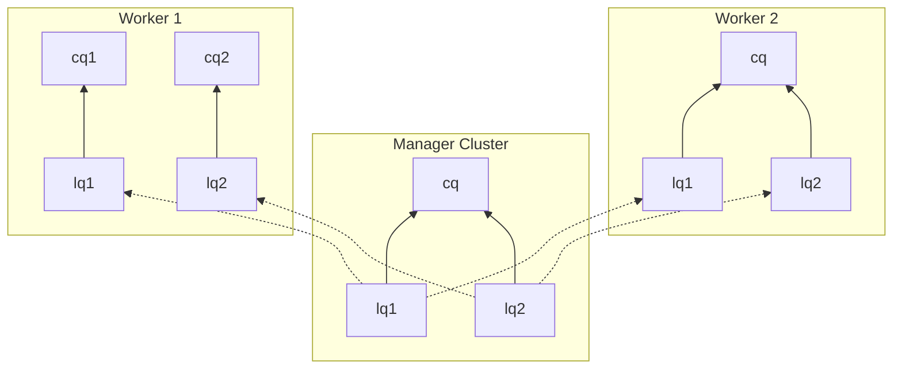

# KEP-9988: MultiKueue Manager Quota Automation

<!-- toc -->
- [Summary](#summary)
- [Motivation](#motivation)
  - [The role of manager quotas](#the-role-of-manager-quotas)
  - [Manager vs. workers separation](#manager-vs-workers-separation)
  - [Goals](#goals)
  - [Non-Goals](#non-goals)
- [Proposal](#proposal)
  - [Example](#example)
  - [User stories](#user-stories)
    - [Story 1](#story-1)
    - [Story 2](#story-2)
    - [Story 3](#story-3)
    - [Story 4](#story-4)
  - [Notes/Constraints/Caveats](#notesconstraintscaveats)
    - [Factors influencing desired manager quota](#factors-influencing-desired-manager-quota)
      - [Potential reasons for increasing manager quota](#potential-reasons-for-increasing-manager-quota)
      - [Potential reasons for decreasing manager quota](#potential-reasons-for-decreasing-manager-quota)
    - [Defining related worker ClusterQueues](#defining-related-worker-clusterqueues)
    - [Treatment of ResourceFlavors](#treatment-of-resourceflavors)
  - [Risks and Mitigations](#risks-and-mitigations)
- [Design details](#design-details)
  - [API surface](#api-surface)
    - [Alpha1 version (deprecated)](#alpha1-version-deprecated)
    - [Alpha2 version (Integration with Dynamic Quota Orchestration)](#alpha2-version-integration-with-dynamic-quota-orchestration)
    - [Migration from Alpha1 to Alpha2](#migration-from-alpha1-to-alpha2)
  - [MultiKueue CapacityProvider Reconciler](#multikueue-capacityprovider-reconciler)
  - [MultiKueue ClusterQueue Reconciler (Alpha1)](#multikueue-clusterqueue-reconciler-alpha1)
  - [MultiKueue Cluster Reconciler](#multikueue-cluster-reconciler)
  - [A note on client usage](#a-note-on-client-usage)
  - [Test Plan](#test-plan)
    - [Unit Tests](#unit-tests)
    - [Integration Tests](#integration-tests)
    - [E2e Tests](#e2e-tests)
  - [Future work ideas](#future-work-ideas)
    - [Move the aggregated quota out of ClusterQueueSpec](#move-the-aggregated-quota-out-of-clusterqueuespec)
    - [Use cached remote clients for low-volume resource kinds](#use-cached-remote-clients-for-low-volume-resource-kinds)
    - [Add a way to adjust the manager-side quota](#add-a-way-to-adjust-the-manager-side-quota)
    - [Change the treatment of ResourceFlavors](#change-the-treatment-of-resourceflavors)
    - [Account for temporarily unavailable workers](#account-for-temporarily-unavailable-workers)
    - [Support MultiKueue cluster role sharing](#support-multikueue-cluster-role-sharing)
  - [Graduation Criteria](#graduation-criteria)
- [Drawbacks](#drawbacks)
- [Alternatives](#alternatives)
  - [Direct mutation of <code>ClusterQueue.status.effectiveQuotas</code> by MultiKueue (bypassing DQO)](#direct-mutation-of-clusterqueuestatuseffectivequotas-by-multikueue-bypassing-dqo)
  - [Referencing <code>ClusterQueue</code> or a dedicated CRD in <code>CapacityProvider.spec.parameters</code>](#referencing-clusterqueue-or-a-dedicated-crd-in-capacityproviderspecparameters)
  - [Support quota automation for multiple manager-side ResourceFlavors](#support-quota-automation-for-multiple-manager-side-resourceflavors)
  - [Support quota automation for no manager-side ResourceFlavors (auto-create one)](#support-quota-automation-for-no-manager-side-resourceflavors-auto-create-one)
  - [Different handling of many-to-many relationships between manager-side and worker-side ClusterQueues](#different-handling-of-many-to-many-relationships-between-manager-side-and-worker-side-clusterqueues)
  - [Make the <code>MultiKueueManagerQuotaAutomation</code> Condition message more informative](#make-the-multikueuemanagerquotaautomation-condition-message-more-informative)
  - [Take Cohorts into account](#take-cohorts-into-account)
  - [Set the default for <code>QuotaManagement</code> based on the feature gate state](#set-the-default-for-quotamanagement-based-on-the-feature-gate-state)
<!-- /toc -->

## Summary

This KEP outlines the design for automatic management of ClusterQueue quotas on the manager cluster in a MultiKueue setup, based on aggregation of quotas of worker ClusterQueues. Starting in Alpha2, MultiKueue quota automation integrates with [Dynamic Quota Orchestration (KEP-12382)](../12382-dynamic-quota-orchestration/README.md) as a built-in `CapacityProvider` (`controllerName: kueue.x-k8s.io/multikueue`), allowing `DynamicQuotaOrchestrator` to scale and distribute the discovered worker capacity into `status.effectiveQuotas` on manager ClusterQueues and Cohorts without mutating `.spec.resourceGroups`.

## Motivation

MultiKueue involves **two layers** of Kueue quota management. A MultiKueue workload must first reserve quota on the **manager** cluster in order to be dispatched to (one or more) workers; then it must reserve quota on a **worker** in order to execute there.

### The role of manager quotas

While _worker quotas_ are the _ultimate definition_ of the actual resource availability, the role of _manager quotas_ is subtler, yet still important.

Specifically, manager quotas **may** serve:

* As a **gate-keeping** mechanism, which allows distributing the _scheduling load_ between the manager and the workers. \
  (This may be irrelevant for small MultiKueue setups - but is essential for scalability of the largest ones).

* As a **representation** of resource availability and usage, viewable by the user without connecting to the worker clusters.

Manager quotas are **effectively optional**: when considered not useful, the Batch Admin can effectively disable them by specifying very large values ("infinite quota"). This may work well for smaller setups (and some users actually do this) - but is not recommended generally.

### Manager vs. workers separation

Currently, quota management is **fully separated** between the manager and workers, up to the point that both sides are **unaware** of each other's quotas.

While this approach offers simplicity and network savings, it also leads to problems:

1. For the manager quotas to serve their purposes discussed [above](#the-role-of-manager-quotas), they often must be **maintained in sync** with the worker quotas. \
   (The exact meaning of "in sync" may vary by use case; see [User Story 1](#story-1)). \
   Currently, MultiKueue does not help in this maintenance, making it entirely **user's responsibility**. \
   This is inconvenient and error-prone.

2. For a user to get the overview of actual resource availability and usage across the worker fleet, it is necessary to connect to all worker clusters and aggregate the information on their own.

3. For the MultiKueue controller on the manager cluster, having no awareness of workers' quotas (and their usage) **prevents more effective dispatching** choices. \
   Even though we generally don't want the manager to take over _the whole_ orchestrating work from the workers (as we intend to share it between both sides), some improvements are likely possible. For example, if a workload fits within the quota of worker A but not of worker B, there is no point in dispatching it to B before A. (At least, unless B could admit it through borrowing).

   While designing specific improvements to dispatching is **out of scope** of this KEP, all these improvements require as the **first step** that the manager *knows* workers' quotas, which this KEP proposes. \
   (Then, the second step would be to let the manager *persist* this information. That part is not proposed in this KEP, as it's not needed for its goals; however, it will be proposed in the KEP for issue [#10105](https://github.com/kubernetes-sigs/kueue/issues/10105)).

### Goals

* Make the manager cluster aware of worker quotas.
* Enable automated maintenance of manager quotas to keep them in sync with worker capacity.

### Non-Goals

* Fine-tune manager quota automation for optimal scheduling throughput.
* Expose a central view of resource availability and usage across all workers (tracked in [#10105](https://github.com/kubernetes-sigs/kueue/issues/10105)).
* Improve MultiKueue dispatching.

## Proposal

We will add an **optional** feature of **auto-aggregating quotas** from the workers to the manager.

In **Alpha2**, this feature is built on top of [Dynamic Quota Orchestration (KEP-12382)](../12382-dynamic-quota-orchestration/README.md) using its two-phase Discovery and Distribution pipeline:

1. **Phase 1 — Capacity Discovery (`CapacityProvider` with `controllerName: kueue.x-k8s.io/multikueue`)**:
   - Determine the set of [related worker ClusterQueues](#defining-related-worker-clusterqueues) for the referenced `MultiKueueConfig`.
   - For each resource `R`, compute the **sum** of effective nominal quotas (`status.effectiveQuotas.resourceGroups` when present on the worker ClusterQueue, or falling back to `spec.resourceGroups`) across **all** _related_ worker ClusterQueues and **all** worker-side ResourceFlavors.
   - Publish the aggregated capacities into `CapacityProvider.status.capacity.flavors` under the single manager-side ResourceFlavor specified in `CapacityProvider.spec.orchestratedFlavors`.
2. **Phase 2 — Quota Distribution (`DynamicQuotaOrchestrator`)**:
   - A `DynamicQuotaOrchestrator` references the MultiKueue `CapacityProvider` (optionally applying `effectiveCapacityMultiplier` for candidate overbooking or conservative buffering) and distributes the resulting capacity into `status.effectiveQuotas` on the target manager `ClusterQueue` (or proportionally across a manager `Cohort` subtree), leaving administrator-owned `.spec.resourceGroups` untouched.

Enabling this feature is opt-in via creating the `CapacityProvider` and `DynamicQuotaOrchestrator` resources (retaining a permanent way to opt out; see [User Story 3](#story-3)).

In Alpha2, the MultiKueue `CapacityProvider` **requires** that `CapacityProvider.spec.orchestratedFlavors` specifies **exactly one ResourceFlavor**, into which all worker-side flavors are aggregated. (See [Treatment of ResourceFlavors](#treatment-of-resourceflavors) for rationale).

### Example

Suppose we have a MultiKueue setup with a manager cluster and two worker clusters (`worker1` and `worker2`), using the following configuration for LocalQueues (LQ) and ClusterQueues (CQ):



On `worker1`, both related ClusterQueues are configured with CPU and memory (in `default-flavor`):

*   `cq1`:
    ```yaml
    resourceGroups:
    - coveredResources: ["cpu", "memory"]
      flavors:
      - name: "default-flavor"
        resources:
        - name: "cpu"
          nominalQuota: 6
        - name: "memory"
          nominalQuota: 24Gi
    ```
*   `cq2`:
    ```yaml
    resourceGroups:
    - coveredResources: ["cpu", "memory"]
      flavors:
      - name: "default-flavor"
        resources:
        - name: "cpu"
          nominalQuota: 7
        - name: "memory"
          nominalQuota: 28Gi
    ```

On `worker2`, the related ClusterQueue `cq` handles both `lq1` and `lq2`, and is configured with CPU, memory, and GPU resources:

*   `cq`:
    ```yaml
    resourceGroups:
    - coveredResources: ["cpu", "memory"]
      flavors:
      - name: "default-flavor"
        resources:
        - name: "cpu"
          nominalQuota: 8
        - name: "memory"
          nominalQuota: 32Gi
    - coveredResources: ["nvidia.com/gpu"]
      flavors:
      - name: "gpu-a4"
        resources:
        - name: "nvidia.com/gpu"
          nominalQuota: 5
      - name: "gpu-h100"
        resources:
        - name: "nvidia.com/gpu"
          nominalQuota: 7
    ```

To automate quota on the manager cluster in Alpha2 using Dynamic Quota Orchestration (DQO), the administrator configures a `CapacityProvider` referencing the `MultiKueueConfig` and a `DynamicQuotaOrchestrator` targeting the manager `ClusterQueue` `cq`:

```yaml
apiVersion: kueue.x-k8s.io/v1alpha1
kind: CapacityProvider
metadata:
  name: multikueue-worker-capacity
spec:
  controllerName: kueue.x-k8s.io/multikueue
  orchestratedFlavors:
  - name: default-flavor
  parameters:
    apiGroup: kueue.x-k8s.io
    kind: MultiKueueConfig
    name: multikueue-config
status:
  capacity:
    flavors:
    - name: default-flavor
      resources:
        cpu: "21"             # 6 + 7 + 8
        memory: 84Gi          # 24Gi + 28Gi + 32Gi
        nvidia.com/gpu: "12"  # 5 + 7
  conditions:
  - type: CapacitySynchronized
    status: "True"
    reason: Synchronized
    message: "Aggregated capacity from 2 active worker clusters"
---
apiVersion: kueue.x-k8s.io/v1alpha1
kind: DynamicQuotaOrchestrator
metadata:
  name: multikueue-dqo
spec:
  capacityDiscovery:
    providers:
    - name: multikueue-worker-capacity
      effectiveCapacityMultiplier: "1"
  capacityDistribution:
    subtreeRootQuotaRef:
      apiGroup: kueue.x-k8s.io
      kind: ClusterQueue
      name: cq
```

The `DynamicQuotaOrchestrator` then writes the effective quotas into `status.effectiveQuotas` on the manager-side ClusterQueue `cq` (without mutating `cq.spec.resourceGroups`):

```yaml
status:
  effectiveQuotas:
    orchestratorRef:
      apiGroup: kueue.x-k8s.io
      kind: DynamicQuotaOrchestrator
      name: multikueue-dqo
    resourceGroups:
    - coveredResources: ["cpu", "memory", "nvidia.com/gpu"]
      flavors:
      - name: "default-flavor"
        resources:
        - name: "cpu"
          nominalQuota: 21    # 6 + 7 + 8
        - name: "memory"
          nominalQuota: 84Gi  # 24Gi + 28Gi + 32Gi
        - name: "nvidia.com/gpu"
          nominalQuota: 12    # 5 + 7
```

This requires that:

* The `CapacityProvider` specifies a single orchestrated flavor (`default-flavor`) in `spec.orchestratedFlavors`, and
* The manager-side ClusterQueue `cq` defines `default-flavor` and the involved resources (`cpu`, `memory`, `nvidia.com/gpu`) in `cq.spec.resourceGroups` (where `spec.resourceGroups` provides the quota structure and relative distribution weights for DQO).

### User stories

#### Story 1
As a Batch Admin, I want to maintain manager quotas automatically synced to the sum of total worker quotas to achieve optimal gate-keeping without manual effort.

#### Story 2

As a Batch Admin, I want to keep MultiKueue manager quotas "infinite". 

In my use case, the potential gains from meaningful ("finite") manager quotas are outweighed by the effort of maintaining them in "appropriate sync", or by the cost of missed opportunities to schedule (in case we haven't sufficiently [increased the manager quota](#potential-reasons-for-increasing-manager-quota)).

#### Story 3

As a Batch Admin, I want to keep MultiKueue manager quotas meaningful ("finite") but **not managed** by the feature proposed in this KEP.

This could be because:

* I need multiple manager ResourceFlavors (due to e.g. using a special dispatcher or a heterogenous topology across the workers; see [Treatment of ResourceFlavors](#treatment-of-resourceflavors) for details).

* I want to control the manager quotas manually (e.g. to make them more stable, or less confusing).

#### Story 4

As a Batch Admin using MultiKueue, I want to see the total worker capacity for a manager-side ClusterQueue, without a need to connect to the worker clusters.

### Notes/Constraints/Caveats

#### Factors influencing desired manager quota

While the "baseline approach" (keep manager quota **equal** to total worker quota) is the most intuitive one, there are several reasons for which the user may wish to adjust this.

##### Potential reasons for increasing manager quota

1. **Divergence of quota reservation** between manager and workers - caused e.g. by how MultiKueue design deals with quota fragmentation among the workers.

   For example, suppose there are 2 workers of capacity 10 CPU, and workloads `wl1`, `wl2`, `wl3`, `wl4` of sizes 7, 7, 6, 3 CPU respectively are submitted to the manager (in that order).

   Then, if manager quota is 10+10, `wl3` will block quota on the manager and get stuck on both workers, preventing `wl4` from reserving quota on the manager.

   OTOH, if manager quota is 23 or more, `wl4` will reserve quota on the manager, and get promptly scheduled on one of the workers, with no unnecessary delays.

2. **Divergence of admission** between manager and workers - caused e.g. by issue [#8585](https://github.com/kubernetes-sigs/kueue/issues/8585) or issue [#9338](https://github.com/kubernetes-sigs/kueue/issues/9338).

   In both these issues, it is possible to have a workload which is _admitted_ on the manager but _not admitted_ on _any_ of the workers (and to have such state for a prolonged time). Whenever that happens, a "perfect sync" between manager and workers quotas could lead to under-utilizing worker resources.

   Even when both those issues become closed, the fixes will be placed behind feature gates, making them still observable in the upcoming release.

3. **Borrowing on a worker**. This may raise the effective capacity of a worker CQ beyond its nominal quota. If the manager quota does not account for that, we risk under-utilization.

4. Other reasons _may_ also exist. For example - assuming hypothetically that a user wants to apply different preemption policies on different worker ClusterQueues (e.g. `Never` on one vs. `LowerPriority` on another) - "over-booking quota" on the manager would be the only way to have both policies honored without extra delays.

##### Potential reasons for decreasing manager quota

1. **Stray workloads on a worker**. When a LocalQueue `lq` points to a ClusterQueue `cq`, both on the manager and a worker, there are numerous ways to have a workload admitted to `cq` on a worker but not on the manager:

   * the workload could be submitted directly to `lq` on the worker, "by-passing" MultiKueue;
   * the workload could be submitted to another LocalQueue `lq2` on the worker, where `lq2` also points to `cq` on the worker but is unrelated to MultiKueue;
   * the workload could be submitted to another LocalQueue `lq2` on the worker, while `lq2` exists on the manager but points to another `cq2` with MultiKueue enabled.

   Some users consider such scenarios valid, and expressed a desire to keep a part of the worker capacity reserved for such "stray workloads". In such cases, the manager quota should be accordingly _decreased_.

2. **Per-team quotas on the manager** (strictly speaking, a special case of "stray workloads").

   A Batch Admin may want to maintain a set of per-team manager ClusterQueues in order to specify separate quotas for them (possibly, but not necessarily, including Cohorts and borrowing), while simplifying the worker-side setup to single ClusterQueues representing actual resource availability.

   In this scenario, each manager ClusterQueue should have quota _significantly below_ the total worker quota; we'd rather consider _the sum_ of all manager quotas to be "on par" with total worker quotas (up to all the divergences considered above).

   Nevertheless, some automatic synchronization may be still useful, if equipped with per-team multipliers. For example: "Let the nominal quota for teams A / B / C be respectively defined as 50% / 30% / 20% of the total available worker quota".

#### Defining related worker ClusterQueues

MultiKueue dispatching connects **LocalQueues** by **their names**: for a workload submitted to a LocalQueue `lq1` on the manager, its remotes will be submitted to LocalQueues named `lq1` on the workers. The **ClusterQueue names** on either side are **irrelevant** for this connection.

Therefore, for a given manager ClusterQueue `Q` (or set of manager ClusterQueues `Q_set` associated with a `MultiKueueConfig` via MultiKueue `AdmissionCheck`s), the set of **related worker ClusterQueues** is the set `R` defined by the following recipe:

1. Let `N` = the set of `(namespace, name)` keys of all manager LocalQueues pointing to `Q` (or to any ClusterQueue in `Q_set`).

2. Let `L` = the set of LocalQueues on all active worker clusters in the `MultiKueueConfig` whose `(namespace, name)` belongs to `N`.

3. Let `R` = the set of all ClusterQueues on those workers to which at least one LocalQueue from `L` points.

For each worker ClusterQueue `rcq` in `R`, its effective resource groups are read from `rcq.status.effectiveQuotas.resourceGroups` when non-nil (for workers that themselves use Dynamic Quota Orchestration), or from `rcq.spec.resourceGroups` otherwise.

(For simplicity, we've ignored resource borrowing between ClusterQueues, on either manager or worker side).

#### Treatment of ResourceFlavors

MultiKueue enforces **no relationships** between ResourceFlavors on the manager and worker sides. The flavors on both sides may have different names; they may even be differently grouped into ResourceGroups.

Even if the flavor names on both sides agree, having multiple flavors on the manager side may likely lead to **manager/worker flavor skew**, where a workload could be admitted on flavor A on the manager but on flavor B on a worker (as the manager's flavor assignment has typically no effect on the remotes). As long as such skews can happen, aggregating quotas per flavor would be meaningless.

As a result, multiple flavors on the manager side _should not be needed for most users_. Yet, they still may be needed in some special cases, for example:

* Using a flavor-aware custom MultiKueue dispatcher.
* Using TAS on the workers, with incompatible names of topology levels on different workers.

Our proposal for now is to leave these cases unsupported by requiring the MultiKueue `CapacityProvider` to specify a single orchestrated flavor in `spec.orchestratedFlavors`. (Some other ideas are discussed below, see [here](#change-the-treatment-of-resourceflavors), [here](#support-quota-automation-for-multiple-manager-side-resourceflavors) and [here](#support-quota-automation-for-no-manager-side-resourceflavors-auto-create-one)).

### Risks and Mitigations

The main risks of this proposal are the following:

1. User confusion - the users may be surprised by ClusterQueue quotas being adjusted automatically, without their initiative.

2. Introducing management of ClusterQueue quotas which some users may consider undesired (see [User Story 3](#story-3)).

3. Slowing down MultiKueue by adding more reconcilers and computations.

4. In Alpha1, by updating ClusterQueueSpec (cf. [Drawback 1](#drawbacks)), we risked GitOps drift and an infinite loop of reconciles in case when the reconcile logic failed to be idempotent.

For these, we propose the following mitigations:

* Risk 1 is mitigated in Alpha2 by recording `status.effectiveQuotas.orchestratorRef` on the managed ClusterQueue/Cohort and exposing `CapacitySynchronized`, `EffectiveCapacityComputed`, and `Distributed` status conditions on `CapacityProvider` and `DynamicQuotaOrchestrator`.

* Risks 1 and 2 are mitigated by introducing feature gates (`MultiKueueManagerQuotaAutomation` and `DynamicQuotaOrchestration`) and the explicit opt-in `CapacityProvider` / `DynamicQuotaOrchestrator` APIs. \
  This also mitigates Risk 3, as computations only run for configured `CapacityProvider` objects.

* Risk 3 is considered low and is further mitigated by `SelectivelyCachingClient`, which caches `LocalQueue` and `ClusterQueue` objects from remote worker clusters.

* Risk 4 existed only in the Alpha1 phase and is **eliminated in Alpha2** by publishing discovered worker capacity into `CapacityProvider.status.capacity` and writing effective quotas to `ClusterQueue.status.effectiveQuotas` via `DynamicQuotaOrchestrator` rather than mutating `ClusterQueue.spec.resourceGroups`.

## Design details

### API surface

#### Alpha1 version (deprecated)

In Alpha1, the configuration for this feature was added to the `MultiKueueConfig` struct (`MultiKueueConfig.spec.quotaManagement`), and the controller mutated `ClusterQueue.spec.resourceGroups[0].flavors[0].resources` directly while reporting a `MultiKueueManagerQuotaAutomation` status condition on `ClusterQueueStatus`:

```go
type MultiKueueConfigSpec struct {
   // ...

   // quotaManagement specifies the management of ClusterQueue quotas 
   // in the manager cluster. 
   // Supported modes:
   // - `Manual`: Quota automation is manual.
   // - `Automated`: Quota automation is enabled (provided that the MultiKueueManagerQuotaAutomation feature gate is enabled).
   // If unspecified, defaults to `Manual`.
   //
   // Deprecated: In Alpha2, use CapacityProvider (controllerName: kueue.x-k8s.io/multikueue)
   // and DynamicQuotaOrchestrator instead.
   QuotaManagement *MultiKueueConfigQuotaManagementMode
}
```

#### Alpha2 version (Integration with Dynamic Quota Orchestration)

In Alpha2, MultiKueue Manager Quota Automation integrates with [Dynamic Quota Orchestration (KEP-12382)](../12382-dynamic-quota-orchestration/README.md) by implementing a built-in `CapacityProvider` controller instead of mutating `ClusterQueue.spec.resourceGroups`.

1. **MultiKueue `CapacityProvider` Contract (`kueue.x-k8s.io/v1alpha1`)**:
   - **`spec.controllerName`**: Must be set to `"kueue.x-k8s.io/multikueue"` (`kueue.MultiKueueControllerName`).
   - **`spec.orchestratedFlavors`**: Must contain **exactly one** `CapacityProviderOrchestratedFlavor` entry (`len(spec.orchestratedFlavors) == 1`). All resources across all flavors of the related worker ClusterQueues are summed and reported under this single orchestrated flavor in `status.capacity.flavors`.
   - **`spec.parameters`**: Must reference a `MultiKueueConfig` object in group `kueue.x-k8s.io`:
     ```yaml
     parameters:
       apiGroup: kueue.x-k8s.io
       kind: MultiKueueConfig
       name: <multikueue-config-name>
     ```
   - **`status.capacity.flavors`**: Contains a single `CapacityProviderNormalizedCapacityFlavor` entry matching `spec.orchestratedFlavors[0].name`, whose `resources` map holds the summed `corev1.ResourceList` across all related worker ClusterQueues on active worker clusters.
   - **`status.conditions[CapacitySynchronized]`**: Reported using the standard `CapacityProvider` condition types and reasons defined in KEP-12382:

     | Status | Reason | When it is set |
     |---|---|---|
     | `True` | `Synchronized` | At least one worker cluster in the referenced `MultiKueueConfig` is connected (`Active=True`) and its related worker ClusterQueue capacities were successfully aggregated and written to `status.capacity`. |
     | `False` | `Misconfigured` | `spec.parameters` is nil, does not reference `apiGroup: kueue.x-k8s.io, kind: MultiKueueConfig`, the referenced `MultiKueueConfig` does not exist, or `len(spec.orchestratedFlavors) != 1`. |
     | `False` | `SourceUnavailable` | None of the worker `MultiKueueCluster`s listed in the referenced `MultiKueueConfig` are currently connected (`Active=True`). |

2. **Scaling & Quota Distribution via `DynamicQuotaOrchestrator`**:
   - Administrators create a `DynamicQuotaOrchestrator` referencing the MultiKueue `CapacityProvider` in `spec.capacityDiscovery.providers`.
   - **Multiplier adjustments**: Administrators can set `effectiveCapacityMultiplier` on the provider entry in `DynamicQuotaOrchestrator` (e.g., `"2.0"` or `"3.0"` for MultiKueue candidate overbooking, or `"0.9"` to leave worker headroom for stray local workloads).
   - **Single ClusterQueue or Cohort distribution**: `DynamicQuotaOrchestrator.spec.capacityDistribution.subtreeRootQuotaRef` can target either a single manager `ClusterQueue` or a manager `Cohort` (distributing the aggregated worker capacity proportionally across per-team manager `ClusterQueue`s according to the relative weights in their `spec.resourceGroups`).
   - **Effective Quotas**: The DQO controller writes the resulting quotas into `status.effectiveQuotas` (`orchestratorRef` + `resourceGroups`) on the target manager `ClusterQueue`(s) and `Cohort`(s).

#### Migration from Alpha1 to Alpha2

Because `MultiKueueManagerQuotaAutomation` in Alpha1 was an opt-in Alpha feature gated by an off-by-default feature gate, Alpha2 replaces the Alpha1 `.spec`-mutating mechanism as follows:

1. **API & Feature Gate Transition**:
   - The Alpha1 `MultiKueue ClusterQueue Reconciler` that mutated `ClusterQueue.spec.resourceGroups` and wrote the `MultiKueueManagerQuotaAutomation` condition on `ClusterQueueStatus` is decommissioned and replaced by the `MultiKueue CapacityProvider Reconciler`.
   - `MultiKueueConfig.spec.quotaManagement` (`QuotaManagementManual` / `QuotaManagementAutomated`) and `ClusterQueue` condition `MultiKueueManagerQuotaAutomation` are deprecated and removed.
   - Running the MultiKueue `CapacityProvider` controller requires both `MultiKueue` (and `MultiKueueManagerQuotaAutomation`) and `DynamicQuotaOrchestration` feature gates to be enabled.

2. **Administrator Migration Steps**:
   To migrate a manager `ClusterQueue` `cq` from Alpha1 (`MultiKueueConfig.spec.quotaManagement: Automated`) to Alpha2:
   - Remove `spec.quotaManagement` from the `MultiKueueConfig`.
   - Ensure `cq.spec.resourceGroups` on the manager `ClusterQueue` declares the target `ResourceFlavor` and `coveredResources` with non-zero baseline/weight `nominalQuota` values (used as proportional weights by DQO and as fallback static quotas if DQO is removed).
   - Create a `CapacityProvider` with `controllerName: kueue.x-k8s.io/multikueue`, `orchestratedFlavors: [{name: <flavor-name>}]`, and `parameters` referencing the `MultiKueueConfig`.
   - Create a `DynamicQuotaOrchestrator` referencing the `CapacityProvider` under `spec.capacityDiscovery.providers` and targeting `cq` (or its parent `Cohort`) under `spec.capacityDistribution.subtreeRootQuotaRef`.

### MultiKueue CapacityProvider Reconciler

In Alpha2, we introduce a reconciler for `CapacityProvider` objects whose `spec.controllerName` equals `"kueue.x-k8s.io/multikueue"`. Reconciling a MultiKueue `CapacityProvider` `cp` proceeds as follows:

1. **Validate configuration (`spec.orchestratedFlavors` & `spec.parameters`)**:
   - Verify `len(cp.Spec.OrchestratedFlavors) == 1`.
   - Verify `cp.Spec.Parameters != nil`, `APIGroup == "kueue.x-k8s.io"`, and `Kind == "MultiKueueConfig"`, and fetch the referenced `MultiKueueConfig` `cfg`.
   - If validation fails or `cfg` is not found, set condition `CapacitySynchronized=False` with reason `Misconfigured` and return.

2. **Check worker cluster availability**:
   - Inspect the remote clients in `clustersReconciler` for each cluster name in `cfg.Spec.Clusters`.
   - If **zero** configured worker clusters have an active/connected remote client (`!rc.connState.isConnected()`), set condition `CapacitySynchronized=False` with reason `SourceUnavailable` (without overwriting `cp.Status.Capacity`). Per KEP-12382, when `CapacitySynchronized=False`, `DynamicQuotaOrchestrator` sets `EffectiveCapacityComputed=False` and preserves the last known good `status.effectiveCapacity` and `status.effectiveQuotas`, preventing a complete control-plane network partition from zeroing out manager quotas.
   - If a subset of worker clusters in `cfg.Spec.Clusters` is connected and others are disconnected, proceed with aggregating quotas from the connected worker clusters and report the active/total cluster count in the `CapacitySynchronized=True` condition message.

3. **Resolve related worker ClusterQueues and aggregate effective quotas**:
   - Find all manager `AdmissionCheck`s referencing `cfg`, all manager `ClusterQueue`s referencing those `AdmissionCheck`s, and all manager `LocalQueue`s pointing to those manager `ClusterQueue`s (set `N` of `(namespace, name)` pairs).
   - On each connected worker cluster in `cfg.Spec.Clusters`, list cached `LocalQueue`s in `N` to identify the set `R` of related worker `ClusterQueue`s.
   - For each related worker `ClusterQueue` `rcq` in `R`, extract its effective resource groups:
     - If `rcq.Status.EffectiveQuotas != nil`, read `rcq.Status.EffectiveQuotas.ResourceGroups` (so worker clusters that themselves use DQO—such as node capacity discovery or temporary quota overrides—propagate their effective quotas to the manager).
     - Otherwise (`rcq.Status.EffectiveQuotas == nil`), read `rcq.Spec.ResourceGroups`.
   - Sum `nominalQuota` for each resource across all flavors of the extracted resource groups, and write the resulting `corev1.ResourceList` into `cp.Status.Capacity.Flavors[0]` (for `cp.Spec.OrchestratedFlavors[0].Name`) along with condition `CapacitySynchronized=True` (`Reason: Synchronized`).

   > **Note on worker-side feature gate disablement**: Because KEP-12382 uses a sparse status model (`rcq.Status.EffectiveQuotas` is `nil` unless a `DynamicQuotaOrchestrator` actively manages `rcq`), static worker ClusterQueues immediately fall back to `rcq.Spec.ResourceGroups` with no initialization race. If an administrator disables the `DynamicQuotaOrchestration` feature gate on a worker cluster that previously used DQO, they should delete the worker's `DynamicQuotaOrchestrator` beforehand so that `rcq.Status.EffectiveQuotas` is cleared.

The reconciler is triggered by:
* **Manager events:** Creation, deletion, or relevant updates to `CapacityProvider` (filtered by `controllerName == "kueue.x-k8s.io/multikueue"`), `MultiKueueConfig`, `MultiKueueCluster` (`Active` condition changes), `AdmissionCheck`, `ClusterQueue`, and `LocalQueue`.
* **Remote events:** Propagated from the [MultiKueue Cluster Reconciler](#multikueue-cluster-reconciler) when remote `LocalQueue`s or `ClusterQueue`s (either `.spec.resourceGroups` or `.status.effectiveQuotas`) change.

### MultiKueue ClusterQueue Reconciler (Alpha1)

*(Historical Alpha1 note: In Alpha1, `cqReconciler` reconciled manager-side `ClusterQueue` objects directly, verified `MultiKueueConfig.spec.quotaManagement == Automated`, summed `rcq.Spec.ResourceGroups`, and mutated `cq.Spec.ResourceGroups[0].Flavors[0].Resources` in place. In Alpha2, quota mutation is replaced by the [MultiKueue CapacityProvider Reconciler](#multikueue-capacityprovider-reconciler), while worker cluster status metric reporting for MultiKueue ClusterQueues remains intact.)*

### MultiKueue Cluster Reconciler

In `multikueuecluster.go`, when quota automation is enabled, `startQueueWatchers` registers watches on remote worker clusters for **LocalQueue** and **ClusterQueue** events using `SelectivelyCachingClient`.
In Alpha2, the remote `ClusterQueue` update predicate checks for changes in both `Spec.ResourceGroups` and `Status.EffectiveQuotas` (via `resourcegroups.EffectiveResourceGroups`). When a remote `LocalQueue` or `ClusterQueue` changes, an event is pushed to trigger reconciliation of the affected MultiKueue `CapacityProvider`(s).

### A note on client usage

In the above reconcilers, local and remote `LocalQueue` and `ClusterQueue` calls are served from cache:

1. Local clients are already cached by controller-runtime.
2. Remote calls for `LocalQueue`, `ClusterQueue`, and `Workload` are cached by `SelectivelyCachingClient` (`pkg/controller/admissionchecks/multikueue/remote_client.go`), while bypassing cache for high-volume job kinds.

### Test Plan

[x] I/we understand the owners of the involved components may require updates to
existing tests to make this code solid enough prior to committing the changes necessary
to implement this enhancement.

#### Unit Tests

* Test the MultiKueue `CapacityProvider` reconcile logic across all exit paths:
  * Valid aggregation across multiple worker clusters and multiple worker flavors into `CapacityProvider.status.capacity.flavors[0]`.
  * Precedence of worker `rcq.Status.EffectiveQuotas.ResourceGroups` over `rcq.Spec.ResourceGroups` when non-nil, and fallback to `rcq.Spec.ResourceGroups` when nil.
  * `CapacitySynchronized=False` (`Reason: Misconfigured`) when `spec.parameters` is missing/invalid, references a non-existent `MultiKueueConfig`, or `len(spec.orchestratedFlavors) != 1`.
  * `CapacitySynchronized=False` (`Reason: SourceUnavailable`) when zero worker clusters in `MultiKueueConfig.spec.clusters` are active/connected, and partial aggregation (`CapacitySynchronized=True`) when a subset of worker clusters is active.
* Test all local and remote watch event handlers enqueueing affected `CapacityProvider` objects.

#### Integration Tests

* Test end-to-end pipeline: remote worker `LocalQueue` and `ClusterQueue` (both `.spec.resourceGroups` and `.status.effectiveQuotas`) updates triggering the MultiKueue `CapacityProvider` reconciler, updating `DynamicQuotaOrchestrator.status.effectiveCapacity` (with and without `effectiveCapacityMultiplier`), and distributing effective quotas into manager `ClusterQueue.status.effectiveQuotas` and `Cohort.status.effectiveQuotas`.
* Verify that when all worker clusters disconnect (`CapacitySynchronized=False`), `DynamicQuotaOrchestrator` preserves the last known `status.effectiveQuotas` on the manager `ClusterQueue`.

#### E2e Tests

* Test automating a manager `ClusterQueue` quota via `CapacityProvider` (`controllerName: kueue.x-k8s.io/multikueue`) and `DynamicQuotaOrchestrator`, verifying that changes to worker `ClusterQueue` quotas propagate to manager `ClusterQueue.status.effectiveQuotas` without mutating `ClusterQueue.spec.resourceGroups`.
* Verify that manager `status.effectiveQuotas` updates promptly trigger workload admission and re-evaluation of inadmissible workloads.

### Future work ideas

#### Move the aggregated quota out of ClusterQueueSpec

*(Resolved in Alpha2 via [Dynamic Quota Orchestration (KEP-12382)](../12382-dynamic-quota-orchestration/README.md))*

In Alpha1, mutating `ClusterQueue.spec.resourceGroups` was a known drawback (see [Drawback 1](#drawbacks)). In Alpha2, this is resolved by integrating with KEP-12382: the MultiKueue `CapacityProvider` controller publishes aggregated worker capacities into `CapacityProvider.status.capacity`, and `DynamicQuotaOrchestrator` writes effective quotas to `ClusterQueue.status.effectiveQuotas` (and `Cohort.status.effectiveQuotas`), which the Kueue scheduler consumes in place of `.spec.resourceGroups` while keeping `.spec.resourceGroups` as administrator-owned configuration and proportional distribution weights.

#### Use cached remote clients for low-volume resource kinds

*(Implemented via `SelectivelyCachingClient`)*

Remote `MultiKueueCluster` clients now use `SelectivelyCachingClient` (`pkg/controller/admissionchecks/multikueue/remote_client.go`), which caches `LocalQueue`, `ClusterQueue`, and `Workload` objects on remote worker clusters while using uncached clients for job kinds.

#### Add a way to adjust the manager-side quota

*(Resolved in Alpha2 via [Dynamic Quota Orchestration (KEP-12382)](../12382-dynamic-quota-orchestration/README.md))*

As explained in [Factors influencing desired manager quota](#factors-influencing-desired-manager-quota), users may want to keep their manager-side quota higher (e.g., candidate overbooking) or lower (e.g., reserving worker capacity for stray local workloads) than 100% of the sum of worker quotas, or split total worker capacity proportionally across per-team manager `ClusterQueue`s in a `Cohort`.

By integrating MultiKueue as a `CapacityProvider` in Alpha2, both capabilities are provided natively by `DynamicQuotaOrchestrator`:
* `spec.capacityDiscovery.providers[].effectiveCapacityMultiplier` scales the discovered MultiKueue capacity before distribution.
* `spec.capacityDistribution.subtreeRootQuotaRef` can target a manager `Cohort` (or `ClusterQueue`), proportionally splitting the scaled capacity across child `ClusterQueue`s according to their `spec.resourceGroups` weights.

#### Change the treatment of ResourceFlavors

While the proposed treatment of flavors (require a single orchestrated flavor in `CapacityProvider.spec.orchestratedFlavors`; aggregate all worker quotas into it) is the simplest one which avoids the [issue of manager/worker flavor skew](#treatment-of-resourceflavors), it may be too simplistic for some use cases involving _mutually exclusive_ flavors on the workers (e.g. CPU-only vs. GPU-only, or TAS flavors based on mutually incompatible topologies). In those cases, the flavor skew can't occur; on the other hand, a single manager-side flavor combining all the worker flavors could be misleading, or even impossible to define.

To handle such cases well in a future iteration, we could extend the MultiKueue `CapacityProvider` when `len(spec.orchestratedFlavors) > 1` to support:
* **1:1 flavor matching**: When `spec.orchestratedFlavors` lists multiple flavors matching worker-side `ResourceFlavor` names, aggregate worker quotas separately per matching `(ResourceFlavor, ResourceName)` pair.
* **Explicit flavor equivalence mapping**: Allow mapping equivalence classes of worker flavors onto manager flavors via provider parameters.

This is postponed to a future iteration as we gather user feedback on Alpha2.

#### Account for temporarily unavailable workers

When a single worker cluster (out of $N > 1$ worker clusters) becomes unreachable (e.g. due to network issues), its admitted workloads are still considered admitted on the manager side until `workerLostTimeout` expires, while its quota is excluded from the MultiKueue `CapacityProvider` sum. (Note: when *all* worker clusters in a `MultiKueueConfig` become unreachable, the MultiKueue `CapacityProvider` sets `CapacitySynchronized=False` with reason `SourceUnavailable`, which causes `DynamicQuotaOrchestrator` to preserve the last known good `status.effectiveQuotas`).

For partial worker disconnections ($1$ of $N$ workers unreachable), this discrepancy may lead to temporary under-utilization of the remaining healthy fleet resources. For example, if there are 3 workers, each with 10 CPU capacity, and we're running a single workload, consuming 7 CPU, on `worker1` which gets disconnected, then the manager ClusterQueue will have its effective `nominalQuota` set to 20, with 7 of that already used, leaving just 13 CPU for new workloads on `worker2` and `worker3` which are both empty.

To cover for that, we could increase the manager-side quota by the sum of requests of all workloads which are admitted on the manager but their assigned worker clusters have remote clients which are currently `.connecting`. (Notably, all this info is available on the manager side, without querying the workers).

We postpone this because it adds some complexity, and the impact feels minor.

#### Support MultiKueue cluster role sharing

Issue [#5704](https://github.com/kubernetes-sigs/kueue/issues/5704) aims at allowing a MultiKueue manager to act as one of its own workers. While the detailed plan for that is not yet ready, it's likely to interfere with this KEP in some way, depending on the future of the [definition of the manager/worker ClusterQueue relation](#defining-related-worker-clusterqueues):

* If that definition is changed (as proposed e.g. [here](https://github.com/kubernetes-sigs/kueue/issues/5704#issuecomment-4401615443)), the quota automation feature will need to be adjusted accordingly.

* If that definition remains unchanged, then a manager-side ClusterQueue `Q` will potentially become a *worker ClusterQueue related to itself*, thus making our "quota aggregation" ill-defined.

### Graduation Criteria

* **Alpha1 (v0.18):**
  * The feature implemented behind the `MultiKueueManagerQuotaAutomation` feature gate, disabled by default.
  * Execution of the newly introduced API calls (local & remote) is guarded by feature gates.
  * Tests are implemented.

* **Alpha2 (v0.21):**
  * Integrate MultiKueue Manager Quota Automation with [Dynamic Quota Orchestration (KEP-12382)](../12382-dynamic-quota-orchestration/README.md) by implementing the built-in MultiKueue `CapacityProvider` controller (`controllerName: kueue.x-k8s.io/multikueue`).
  * Decommission the Alpha1 `ClusterQueue.spec.resourceGroups` mutating reconciler and deprecate/remove `MultiKueueConfig.spec.quotaManagement` and the `MultiKueueManagerQuotaAutomation` `ClusterQueue` condition.
  * Support reading remote worker `ClusterQueue.status.effectiveQuotas.resourceGroups` when present (falling back to `spec.resourceGroups`).
  * Unit, integration, and e2e tests updated for the `CapacityProvider` + `DynamicQuotaOrchestrator` workflow.

* **Beta:**
  * The feature gates (`MultiKueueManagerQuotaAutomation` and `DynamicQuotaOrchestration`) are enabled by default.
  * User documentation is published on the website (including `CapacityProvider` and `DynamicQuotaOrchestrator` configuration examples for MultiKueue).
  * The feature is mentioned in the release notes, in particular mentioning how to opt in/out and migrate from static quotas.
  * The feature has been successfully used in a production environment.
  * [Future work ideas](#future-work-ideas) have been reconsidered, based on any newly gathered feedback.
  * No warning signs on performance were seen (in particular, no news of any external automation of worker ClusterQueue quotas) - or, if any were, they have been addressed.

* **Stable:**
  * The feature (offered functionality, API surface and implementation) has stabilized, without raising concerns.
  * The feature gates are locked to `true` (and then cleaned up in a later release).

## Drawbacks

Besides introducing some risks (see [Risks and Mitigations](#risks-and-mitigations)), the proposed solution has the following trade-offs:

1. *(Eliminated in Alpha2)* In Alpha1, Kueue modified `.spec.resourceGroups` of `ClusterQueue` objects it reconciled, blurring the line between user-managed configuration and controller-managed state and risking GitOps drift. In Alpha2, this drawback is eliminated by publishing discovered capacity to `CapacityProvider.status.capacity` and writing effective quotas to `ClusterQueue.status.effectiveQuotas` via `DynamicQuotaOrchestrator`, at the cost of requiring administrators to create `CapacityProvider` and `DynamicQuotaOrchestrator` resources when opting into quota automation.

2. While manager-side `Cohort` proportional quota distribution is supported in Alpha2 via `DynamicQuotaOrchestrator`, we have still ignored worker-side `Cohort` shared quota and borrowing when calculating discovered worker capacity. This is deliberate to retain reasonable simplicity in the Alpha stage. (See [Take Cohorts into account](#take-cohorts-into-account) in the Alternatives section).

## Alternatives

### Direct mutation of `ClusterQueue.status.effectiveQuotas` by MultiKueue (bypassing DQO)

Instead of implementing a `CapacityProvider` controller that feeds into `DynamicQuotaOrchestrator`, the Alpha1 `cqReconciler` could have been updated to write aggregated worker quotas directly into `ClusterQueue.status.effectiveQuotas` (setting `orchestratorRef` to the `MultiKueueConfig`) while keeping `MultiKueueConfig.spec.quotaManagement: Automated`.

**Reasons for discarding**

* It duplicates or bypasses the capabilities already implemented in `DynamicQuotaOrchestrator` (KEP-12382), such as `effectiveCapacityMultiplier` (for candidate overbooking or headroom buffering) and proportional quota distribution across a manager `Cohort` subtree.
* It prevents composing MultiKueue capacity with other capacity providers (e.g., local node capacity or DRA) within a unified orchestration pipeline, and would trigger `EffectiveQuotasConflict` if a user also attached a `DynamicQuotaOrchestrator` to a parent `Cohort`.
* It couples workload dispatch configuration (`MultiKueueConfig`, which is an `AdmissionCheck` parameters resource) with quota orchestration configuration.

### Referencing `ClusterQueue` or a dedicated CRD in `CapacityProvider.spec.parameters`

Instead of referencing `MultiKueueConfig` in `CapacityProvider.spec.parameters`, we considered:
1. Referencing a manager `ClusterQueue` directly (`kind: ClusterQueue`), or
2. Introducing a dedicated `MultiKueueCapacityProviderConfig` CRD in `kueue.x-k8s.io/v1alpha1`.

**Reasons for discarding/deferring**

* Referencing `MultiKueueConfig` (`apiGroup: kueue.x-k8s.io, kind: MultiKueueConfig`) mirrors how MultiKueue `AdmissionCheck`s reference `MultiKueueConfig` in `spec.parametersRef` and avoids introducing an extra CRD in Alpha2 when no additional configuration fields are required.
* Unlike referencing a single manager `ClusterQueue`, referencing `MultiKueueConfig` naturally supports setups where a `DynamicQuotaOrchestrator` distributes quota across a manager `Cohort` containing multiple team `ClusterQueue`s that share the same `MultiKueueConfig`.
* If future iterations require MultiKueue-specific capacity provider knobs (such as explicit worker `ClusterQueue` selectors or custom flavor-equivalence mappings), `CapacityProvider.spec.parameters` (`APIGroup`, `Kind`, `Name`) can accept a dedicated parameters CRD without breaking the `CapacityProvider` API.

### Support quota automation for multiple manager-side ResourceFlavors

The proposed constraint that quota automation requires a single ResourceFlavor on the manager side may feel inconvenient, or counter-intuitive.

**Reasons for discarding**

* Aggregating quotas per ResourceFlavor is generally risky due to the possibility of manager/worker flavor skews, as explained [here](#treatment-of-resourceflavors).

* Even if we introduced an enforced alignment of flavor assignments between the manager and workers (to address the above risk), this would open a new set of difficult questions:

  * Who decides on the flavor assignment: manager or worker(s)? 
  * What if the flavors setup is changed on one of the workers? Should we re-arrange manager flavors accordingly?
  * What if the flavors setup is conflicting across the workers, so that no compatible manager-side arrangement exists? \
    (For example, worker1 has `flavorA` covering `cpu` and `flavorB` covering `memory` while worker2 has only `flavorA` covering both. A "naive aggregation" on the manager would produce `flavorA` covering both and `flavorB` covering just `memory`, which is invalid inside `.Spec.ResourceGroups` of a ClusterQueue).

* This direction can make sense in some special cases (as discussed in [this follow-up idea](#change-the-treatment-of-resourceflavors)); yet, this is postponed as it requires more deep thought.

### Support quota automation for no manager-side ResourceFlavors (auto-create one)

In the case when a user creates a MultiKueue setup with quota automation enabled right away, as we'll intend to auto-maintain quotas in a single ResourceFlavor, it may seem "nicest" for the user to let them skip that flavor altogether in their ClusterQueueSpec. (A bit surprisingly, the current validation rules allow `.Spec.ResourceGroups` to be empty).

Then, we could auto-create a single ResourceFlavor, with quotas determined by automation - thus saving user's time for typing a few more lines of YAML configs.

**Reasons for discarding/deferring**

This would become problematic in combination with TAS. Supporting TAS workloads requires the manager-side ResourceFlavor to be compatible with the worker-side TAS levels. Therefore, automatic setup of manager-side ResourceFlavor would need to either leave TAS use cases unsupported (which feels poor) or fetch topology setups from the workers (leading to questions how to deal with any inconsistencies between them). This feels overly complex, at least for the start.

### Different handling of many-to-many relationships between manager-side and worker-side ClusterQueues

The "MultiKueue relationship" between manager-side and worker-side ClusterQueues may be in general [many-to-many](#defining-related-worker-clusterqueues), and our proposal of handling it (for a manager-side ClusterQueue `Q`, rely on the _sum_ of quotas of _all_ related worker ClusterQueues) may lead to _distorting the totals_ between the manager and the workers, which may be perceived as misleading.

We've considered 2 ways to work around that:

1. Restrict quota automation support to cases when LocalQueue -> ClusterQueue bindings are compatible between the manager and all workers, so that the considered relationship becomes one-to-one. \
   (In all the other cases, we could refuse to automate, and communicate it via the `MultiKueueManagerQuotaAutomation` Condition).

2. For each worker-side ClusterQueue `Q'` [related](#defining-related-worker-clusterqueues) to multiple manager-side ClusterQueues, split the quota `Q'` into parts "attributed" to each of them. \
   (Likely in a way honoring the Admission Fair Sharing weights on the worker clusters).

**Reasons for discarding/deferring**

* Option 1 leaves reasonable use cases without support, e.g. the per-team manager ClusterQueue setup described [here](#potential-reasons-for-decreasing-manager-quota).

* Option 2 may be more accurate in describing the _admitting potential_ of manager ClusterQueues in case of _omnipresent scarcity_ of resources. \
  However, it fails to describe the _upper bound_ of what can be admitted to a specific manager ClusterQueue, which feels incorrect, and potentially leading to scheduling delays.


### Make the `MultiKueueManagerQuotaAutomation` Condition message more informative

The Condition message could include specific numbers to help the user understand quota calculation, e.g.

```yaml
message: ClusterQueue quota is automatically managed based on MultiKueue workers. Applying total worker capacity (cpu: 10, memory: 25Gi) with a 3x buffer multiplier.
lastTransitionTime: 2026-01-01T00:00:00Z
```

Correspondingly, `lastTransitionTime` would track the last moment when such a richer message changed, effectively indicating when the last automatic adjustment of the ClusterQueue quota happened.

**Reasons for discarding/deferring**

In **Alpha1**, we are hit by the restriction that the ClusterQueue quotas (part of `.Spec`) and Conditions (part of `.Status`) cannot be updated simultaneously. Thus, every auto-adjustment of quotas would introduce a short-lived divergence between the Condition and the actual quotas, also at the level of specific numbers. This would bring a risk of user confusion, of at least two kinds:

* A "sufficiently atomic" snapshot of cluster content might reveal a ClusterQueue's `.Status` inconsistent with its `.Spec` (for example, nominal quota being 50 CPU while the Condition claiming it's "20 CPU with a 3x multiplier").

* The Condition's `lastTransitionTime` would become somewhat misleading in one way or another. \
  (That is, it will necessarily diverge either from the actual quota change time or from the Condition update time, as these two times will differ. Each choice may be perceived as confusing).

Starting from **Alpha2**, the above issues will no longer apply, as quota automation will no longer update ClusterQueueSpec. This will unblock equipping the status Condition with more info.

**A takeaway for the Alpha1 approach**

While our proposed Alpha1 design does not _fully eliminate_ the above inconsistencies (when enabling quota automation for a pre-existing ClusterQueue, we'll still need to update the quota and the Condition _separately_, in some order), it decreases its frequency, and makes it less confusing. \
In particular, if we choose to update the Condition before the quota, the intermediate state can be still interpreted as the Condition saying "quota management has been [just] enabled [but hasn't yet managed to act]", which may be considered legitimate.

### Take Cohorts into account

When a ClusterQueue belongs to a Cohort, it may reserve quota above its nominal capacity, by using _shared Cohort quota_ (Cohort's `.nominalQuota`) or by _borrowing_.

If this happens on the worker side, it clearly influences the actual capacity of a ClusterQueue, and thus could be _somehow_ taken into account in the calculation of "total quota".

**Reasons for discarding/deferring**

There are many difficulties in defining the desired behavior. Example questions:

* What if the whole picture of "LocalQueue -> ClusterQueue -> Cohort -> ancestor Cohort" bindings is fully compatible between the manager and all workers? \
  Should we then aggregate `nominalQuota` from worker-side Cohorts to the corresponding manager-side Cohorts?

  * If so, how do we handle setups which are "incompatible", or "partially compatible"? \
    Do we want to support quota automation for _some resources_ in a case of _partial compatibility_?

  * Even assuming "full compatibility" in the above sense, the result could be considered confusing, due to possible per-workload inconsistencies (e.g. a ClusterQueue could borrow from one sibling on the manager but from another one on a worker, or it could use shared Cohort quota on the worker but not on the manager). \
    Do we accept this?

* What if Cohorts exist only on the workers, or are "badly incompatible" between the workers? \
  Are we fine with increasing `nominalQuota` of manager-side ClusterQueues to reflect the shared Cohort quota on the workers?

  * If so, how should we "attribute" the additional quota among different ClusterQueues? \
    For example:

    * Suppose there's a manager and 2 workers, which all have `lq1`, `lq2`, `lq3`, pointing to ClusterQueues `cq1`, `cq2`, `cq3` respectively. \
      Also suppose both workers have a Cohort `coh1`, to which all those ClusterQueues belong. \
      `coh1` declares a shared `nominalQuota` of 30 CPU. \
      Shall this count as:

      - extra 30 CPU for each of the manager-side ClusterQueues (to reflect the actual upper bound of what can run on them)?
      - extra 10 CPU for each of them (so that "manager's total matches all workers' total")?
      - extra CPU values summing up to 30 CPUs but proportional to the fair sharing weights?

      (While the later options may feel more appealing, keep in mind that the goal of "matching totals" is generally cumbersome to achieve even without supporting Cohorts; see [here](#different-handling-of-many-to-many-relationships-between-manager-side-and-worker-side-clusterqueues)).

    * Now suppose `lq3` and `cq3` don't exist on the manager; should this influence how the quotas for `cq1` and `cq2` are determined?

    * How should we handle [many-to-many relationships](#defining-related-worker-clusterqueues) between manager-side and worker-side ClusterQueues? \
      (Warning: this is [not obvious even when disregarding Cohorts](#different-handling-of-many-to-many-relationships-between-manager-side-and-worker-side-clusterqueues), and adding Cohorts to the picture adds to the complexity of this question).

    * How should we handle incompatible Cohort trees across workers? \
      (This might have a simpler answer: just do the "attribution", whichever way we define it, separately on each worker, and add up the results. Still, it deserves some consideration if the result is acceptable. One alternative would be to refuse to handle such cases).

* Should `borrowingLimit` and `lendingLimit` be aggregated from worker-side ClusterQueues to the [related](#defining-related-worker-clusterqueues) manager-side ClusterQueues?

  * If yes, what should we do if that relationship is many-to-many?

* How should we manage quota automation enablement for Cohorts if it may diverge for the underlying ClusterQueues?

### Set the default for `QuotaManagement` based on the feature gate state

Intuitively, doing so is appealing. MultiKueue documentation already recommends maintaining ClusterQueue quotas in sync with the workers' total, so by defaulting `QuotaManagement` to `Automated` we'd just make the users follow that recommendation by default (still leaving a way to opt out).

**Reasons for discarding/deferring**

Once `Automated` becomes the default, we'll break backward compatibility.

Specifically, when a user creates a ClusterQueue with non-trivial nominal quotas (in `Spec`), and leaves `QuotaManagement` unset, quota automation would lead (depending on the status of the [effective quotas follow-up idea](#move-the-aggregated-quota-out-of-clusterqueuespec)) to either of:

- overwriting nominal quotas with new values,
- silently ignoring nominal quota values,
- making the ClusterQueue `Inactive`,
- rejecting such a config via a validation webhook

where each choice would break the existing v1beta2 contract. Therefore, defaulting to `Automated` can only happen in v1beta3.

While making such a change may be still desired, this is not tightly bound to the lifecycle of the feature gate, and hence out of scope of this KEP.
